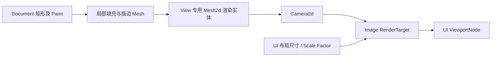

# 在 Canvas View 中显示带填充和描边的矩形

这个增量将已存在于 Document 中的矩形显示在普通 Bevy UI 布局区域内。完成后，一个 Canvas View 通过自己的离屏 Camera 和 Image 显示 Document 图形；它不负责编辑动作，也不会把渲染表示混入 Document 的 ECS 结构。

## UI 视口与坐标映射

Canvas 控件作为有持久 ECS 身份的 Widget，使用 Bevy BSN 的 `SceneComponent` 和 Props 完成构造。此时同步接入顶层 Facade 的 Canvas Feature 与公开 Re-export，使普通应用可以创建 View，而不是仅允许 Gallery 私有访问。Props 只给初值，Document 引用与 View 的后续运行时状态由组件保存。Canvas View 的 UI Node 可以跟随布局改变大小，`ViewportNode` 负责将离屏 Camera 内容展示在该区域并由 UI 区域裁剪；无需单独创建第二套 UI 组合 API。

Document 的 X 向右、Y 向下；Bevy Camera2d 常用世界坐标方向不同，**只在明确的 Document→View→相机映射边界转换一次**，保证鼠标命中、图形呈现和后续导出一致。初始状态下 View 中心对准 Document 原点，Zoom=1.0，Document 的一个单位相当于一个 UI 逻辑像素。Gallery 的窗口 Scale Factor 决定纹理对应的物理分辨率，并不等于 Canvas Zoom；布局或 Scale Factor 变化后应正确调整 RenderTarget，不修改 Document 图形尺寸。

本阶段暂以单 View 为可观察结果，资源结构须允许后续多个 View 引用同一个 Document。Camera、RenderTarget、渲染层及 Render Proxy 属于 View，而不属于 Document 图形 Entity。View 的背景可以作为 UI 显示效果，但不得写成 Document 背景数据。

## 填充、描边与 Mesh 更新

填充使用一个由两个三角形构成的四边形 Mesh；居中描边使用独立的环形 Mesh，由内外边缘和三角形连接形成。两者都使用 Bevy `Mesh2d` 和 `MeshMaterial2d<ColorMaterial>`，分别表达填充色及描边色/透明度；支持只有填充、只有描边或两者都有；`fill: None` 时不产生可见填充，但不改变矩形的内部命中区域。实际图形以 Document 数据为准，两个 Mesh 只是 GPU 表现。

两个 Mesh 在 View 中共享图形位置与旋转投影；改变 `Transform.translation` 或旋转不应重建顶点。改变矩形局部尺寸或描边宽度需要更新对应几何；只改变颜色可更新 Material 或对应颜色表示，不必重新构造几何。描边宽度以 Document 单位计量，随 View Zoom 与整体图形一起缩放，而不是屏幕固定宽度。外部 `Transform.scale` 也整体作用于填充与描边，非均匀缩放时两者按同一仿射变换投影；与 SVG/PNG 导出保持一致。填充和描边的前后顺序、透明混合必须经过视觉检验，不能因为 Mesh 分开而在填充/描边边界产生意外接缝或透明重叠增色。

## 抗锯齿与离屏纹理

优先采用 4× MSAA，重点检查旋转矩形斜边与细描边；这不是机械复制 Waveform 当前的 `Msaa::Off`。实际 Bevy 0.20 / DX12 下离屏 Target 的 MSAA、Resolve 与颜色/Alpha 组合要通过 GPU 验证；如 4× 配置与纹理路径不兼容，应在保持相同视觉语义的前提下调整具体渲染设置，而不是增加自定义 Shader/Renderer 管线作为默认方案。

Canvas 可见且区域非零时更新目标；隐藏或零尺寸时停止无效渲染，重新显示或布局恢复时刷新画面。任何创建中途失败必须撤销其专属 Camera、Target、RenderLayer、Scene 与未被共享的 Mesh/Material。

## 可独立验收的结果

- 用 BSN 创建 Canvas View 并关联一个已有 Document，显示含颜色和可选居中描边的矩形；原点、负坐标、旋转、形状中心和位置符合 Document 约定。
- 布局尺寸及 Window Scale Factor 改变后，视口裁剪、目标分辨率和画面比例正确；不改变矩形数据。空 Document 的 View 正常显示空画布。
- 位置/旋转更新不导致几何重建，尺寸/描边修改能更新图形，颜色修改更新外观；隐藏/恢复没有旧画面残留或资源增长。
- GPU/GUI 针对性的截图与 ECS/RenderTarget 检查验证清晰度、Alpha、填充/描边层次和资源回收；Headless 测试覆盖映射和 Mesh 顶点/索引的确定性规则。
