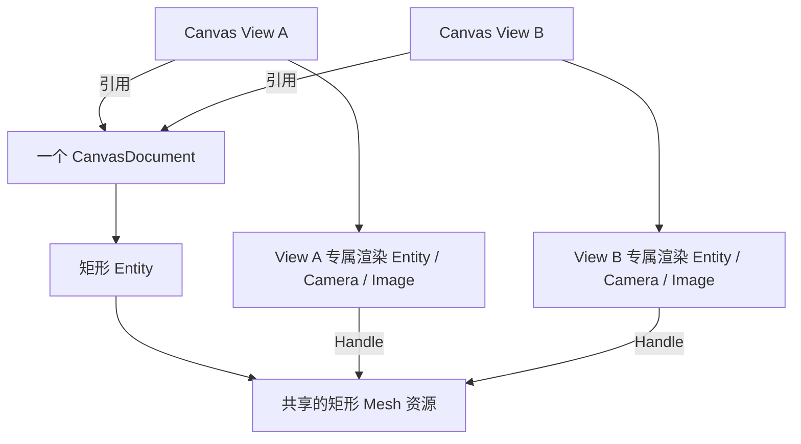

# 支持多 View 共享 Document 与渲染资源管理

此增量使同一个 CanvasDocument 可以同时挂在两个以上 Canvas View 上，并让 Document 数据变化被各 View 正确呈现，同时保持 View 生命周期与 Document 生命周期分离。这样 Document 才真正成为独立内容，而不是被第一个 UI 控件私有化。

## 数据只有一个权威，观察可以有多个

两个 View 引用同一个 Document 时，它们看到的是同一个矩形 Entity、尺寸、颜色、Transform 和描边。任一调用方修改 Document 中的形状，所有可见 View 都应得到新画面；不能分别复制出两份矩形业务状态。Canvas View 的 Zoom、Pan、选择与绘制预览以后各自独立管理，修改一个 View 的相机不会影响另一个 View。

几何 Mesh 可以按 Document 图形统一缓存、由不同 View 的 `Mesh2d` 引用相同 Asset Handle；渲染实体、Camera、RenderTarget、RenderLayers 和 View 控制图形必须各自独立。Mesh 缓存的失效依据 `CanvasRectangle`、`CanvasPaint` 中影响几何的内容，Transform 改变时优先更新各 View 的渲染变换。颜色 Material 是否复用不改变这一所有权边界；不能因为一个 View 清理资源就错误删除仍由其他 View 使用的 Mesh。

## 资源和实体消失时的传播

- **销毁 View A**：释放 A 的相机、纹理、渲染层、渲染实体和预览/交互资源，不释放 Document，也不影响 View B 的画面。
- **删除 Document 中一个矩形**：让所有 View 对应的渲染实体消失，释放不再引用的缓存；后续引入选择功能时，同一机制还需要清理各 View 已失效的选中引用。
- **销毁 Document**：通过 `ChildOf` 移除图形内容；仍存在的 View 保留原有 UI 实体、布局位置和尺寸，清除 Selection 与绘制预览，结束拖动并释放对旧 Document 的渲染引用，显示空白且禁止编辑。View 的相机与透明目标等维持 UI 空白显示所需的基础资源随 View 存续，不解引用已销毁 Document，也不自动创建新 Document。重新绑定有效 Document 后恢复显示与编辑。
- **重建/隐藏某个 View**：它的目标纹理和相机独立处理，可从 Document 恢复当前图形；另一 View 无需重建。

共享资源回收必须基于实际所有权及引用情况，而不是依靠某个 View 的释放顺序。公共离屏基础层的 RenderLayers 已是全局分配，不能在 Canvas 中重新产生第二套层号域。不要把 Render Proxy 挂到 Document 作为子 Entity，否则 Document 删除、共享 View 的清理语义会互相干扰。

## 验证与后续增量的关系

同时显示两个引用同一 Document 的 View，检查 RenderLayers/Target 隔离、形状修改后双视图更新、销毁其中一个 View 后另一 View 稳定，以及矩形/Document 删除后的渲染资源清理与无悬空引用。Document 删除时还要检查两侧 View 的布局不消失、画面清空、交互不可用，以及重新绑定新 Document 后能够恢复。Headless 侧检查资源计数与实体引用，GUI 侧检查跨 View 画面同步；不用人为要求两 View 的相机设置相同。

本阶段交付的是**共享显示与资源生命周期**。后续选择功能的跨 View 选择修复在其选择机制具备后补全，不能在尚无选择状态时建立无意义的独立状态副本。
