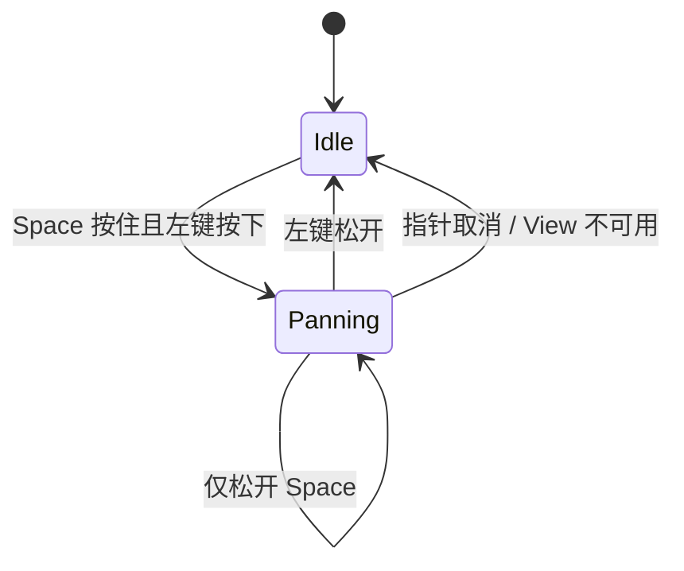

# 实现 Space 加左键画布平移

这个增量只增加 **Canvas View 的平移**。它不改变 Document 图形位置，也不改变任意其他 View 的相机状态。初始 View 中心位于 Document `(0,0)`；在无限画布上允许平移到负坐标区域，不引入画布边缘裁剪或自动回弹。

## 手势独占与输入优先级

只接受 `Space + 鼠标左键拖动`，**不绑定中键**，以免依赖不同鼠标的中键手感。在选择模式与矩形绘制模式中，这一手势都应优先作为平移，不允许同一按压再触发移动矩形或新建图形。开始平移时捕获按压来源、对应 Pointer ID、目标 View 和开始位置；自捕获起手势模式锁定到左键松开，即使中途松开 Space，也不会突然转为编辑手势。

平移以 View 局部指针移动量为输入，按 Camera 当前缩放关系变成 Document 中的观察中心变化。鼠标向右拖时内容在视口里向右移动，实际观察中心向相反方向变更；不修改矩形 `Transform.translation`。从第一个 UI Frame 开始使用布局后的真实 Viewport 坐标，不能把窗口物理像素、UI 逻辑像素和 Document 单位直接混用。

## 与既有输入系统的组合

使用已有 `InputFocus`、Pointer 事件及 `PointerCaptureMap` 相关模式接入 UI；不通过捕获离屏 Mesh Entity 代替 UI 区域拾取。开始操作时不应吞掉其他控件区域的输入。正常 Release 与 PointerCancel、失焦、隐藏、Disabled、Root 销毁等不可继续的情形均须结束手势并归还捕获。平移时如果 Pointer 移出 Canvas 可视区，在捕获有效的情况下仍延续当前手势，避免突然丢掉释放事件。

## 验收要点

- 在默认视口中按住 Space+左键拖动，画面随位移改变且 Document 矩形 Transform 不变；连续拖动没有明显跳变。
- 先开始平移再释放 Space，画面仍只平移直到左键释放；释放后普通左键不再触发平移。中键不会引起 Canvas 平移。
- 同一个 Document 的另一个 View 画面不因该 View 平移而改变；在负坐标和不同 UI 尺寸下平移正常。
- 通过真实 Pointer/Keyboard 输入及 View 状态进行 GUI 验证；Headless 测试覆盖手势状态与坐标转换。取消/销毁时捕获被释放，不阻碍后续其他 UI 控件输入。

此阶段无需给 Canvas 添加工具栏、惯性滚动、边界限制或额外鼠标设备手势。
