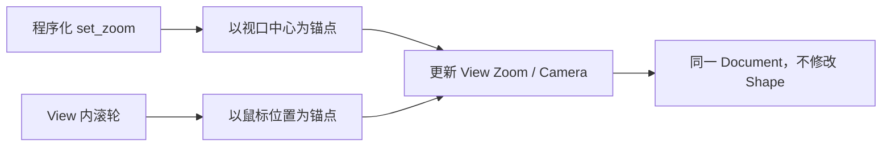

# 实现以光标为锚点的画布缩放

此增量使每个 Canvas View 独立控制自己的观察倍率，支持程序化设置和鼠标滚轮缩放。它延续无限 Document 的概念：缩放只改变相机观察方式，**不改变矩形的尺寸、描边宽度或业务 Transform**。

## 两种缩放入口与各自锚点

`CanvasView` 默认 Zoom=1.0（100%），内部使用 `f32`，合法范围为 `[0.1, 10.0]`。无穷大、NaN、零、负值或范围外值都应由公开 API 明确拒绝，不默默钳制为边界，也不能产生失败后的半提交状态。合法的同值设置保持原画面，避免不必要的状态变化通知。

- **程序化设置 Zoom**：以当前 View 的视口中心为锚点；中心对应的 Document 坐标在缩放前后不变。
- **鼠标滚轮缩放**：以鼠标所在 View 坐标为锚点；滚轮引起倍率变化后，光标下原先的 Document 点仍保持在光标下。到达 Zoom 边界时不产生跳变或额外 Pan。

这里的锚点差异是明确的 API 语义，不是底层算法偶然的实现结果。为保持光标锚点，可在改变倍率的同时修正相机观察中心。Window Scale Factor 是由宿主窗口设置的 UI/纹理比例，不应参与 Zoom 状态值的定义。

## 逻辑坐标、物理像素与渲染

Zoom=1.0 时一个 Document 单位显示为一个 UI 逻辑像素；某个矩形的 Document 宽度乘以 View Zoom 决定屏幕逻辑宽度，再受窗口 Scale Factor 影响成为 RenderTarget 的物理像素。改变 Zoom 应更新 Camera 的投影/观察状态，不重新生成矩形本地 Mesh；居中描边也随着图形在屏幕上等比变化。后续编辑控制点则使用 View 的 UI 逻辑像素尺寸，不能随着 Zoom 扩张或缩小。

View 的尺寸变化、Window Scale Factor 在运行时变化以及两个 View 不同 Zoom 的情况都必须保持坐标双向换算一致。缩放只在指针位于适用的 Canvas View 内发生，不能截获其他 Widget 的滚轮行为；View 不可用、禁用或失焦时按现有输入守卫处理。

## 完成条件

Headless 测试至少验证中心锚点、光标锚点、连续滚轮缩放和反向缩放后的点稳定性、极值边界与非法参数错误；同时验证修改倍率不改变 Document 的 Transform、size 或 stroke width。GUI/BRP 检查不同 Window Scale Factor、变化后的 RenderTarget 分辨率以及多 View 相互独立。前一增量的 Space+左键平移行为仍有效，Wheel 缩放不会重置 Pan。
