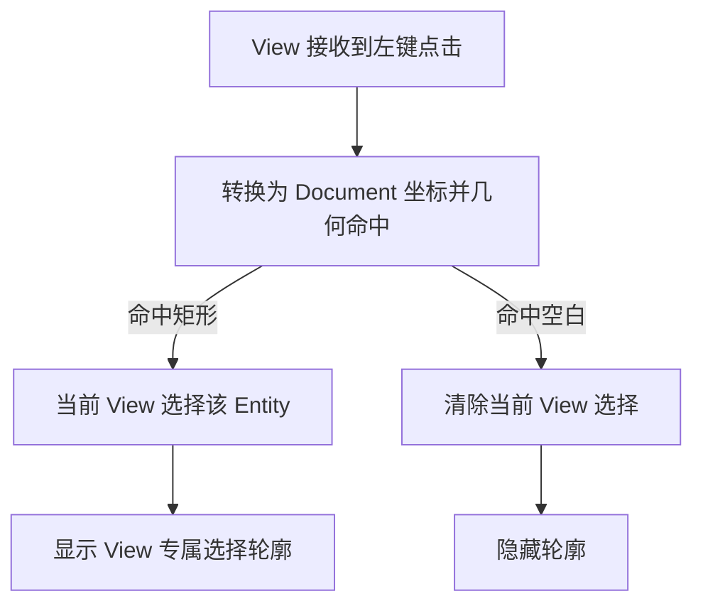

# 实现矩形几何命中与单选

这个增量让 Canvas View 能从 Document 的图形中选出一个矩形，形成明确的 View 专属 Selection，并用不可导出的编辑辅助轮廓标记选中结果。它独立于“拖动移动”：第一次点击尚未选中的矩形只是选择，不应悄悄开始移动。

## 几何命中，而不是 GPU Mesh 拾取

图形实际绘制在离屏 RenderTarget 中；UI Pointer 首先命中的是 Canvas 的 Viewport/交互区域，不能指望 Bevy 对离屏 `Mesh2d` 的默认 Picking 直接给出 Document 中的矩形 Entity。需要从该 View 的局部 UI 位置，经 Camera/Pan/Zoom 转换到 Document 坐标，再使用矩形的逆 `Transform` 将点转换到局部形状坐标完成命中。描边的外扩几何也纳入点击区域。

**空心矩形的内部同样可选中**：命中依据矩形几何占据的区域，不以填充 Alpha、Material 是否可见或只有描边为条件。这一契约与具体“无填充”字段表示方式无关。点击空白取消选择；点击另一个矩形切换选择；一次只持有一个被选中的 Entity。View 的 Selection 不属于 Document，多个 View 的选中项可以不同。

## 选择状态与屏幕标记

Selection 是 Widgetry 自有 Runtime State，应通过明确的公开读写 API 更新，实际改变时先提交后通知；合法同值、重复清空不额外通知。使用 View 所持有的 Entity ID，不能维护另一个形状模型副本。当前目标已从 Document 删除或 View 已失效时，后续操作不能继续保留悬空选择；完全的跨 View 删除修复将在删除增量落实。

选中效果是 View 自身的轮廓覆盖物，不修改 `CanvasPaint`，不成为 Document 子图形，不出现在 PNG/SVG。选中矩形有旋转时轮廓应沿实际旋转边界，而不是简单使用轴对齐 AABB。八个缩放点和旋转点的实际可编辑行为留给后续增量，避免在选择阶段提前增加其他手势。

## 输入焦点与验证

点击当前 Canvas 的可交互区域应按现有 Bevy `InputFocus` 语义获取焦点，为后续 Delete 快捷键建立基础；点击其他 UI Widget 时不可保留冒领的键盘权限。与 Space+左键平移重叠时，平移优先，不切换选择。选择/取消/切换应可由 Headless 输入语义测试保护；GUI 验证旋转矩形、描边外缘、空心内部、空白、不同 Zoom 和 Window Scale Factor 下的选择表现。

同一 Document 的两个 View 分别点击图形，Selection 互不覆盖。重叠图形的层叠命中优先级尚未在“一个矩形跑通”的目标中确定，不应在本阶段扩展通用选择排序系统。
