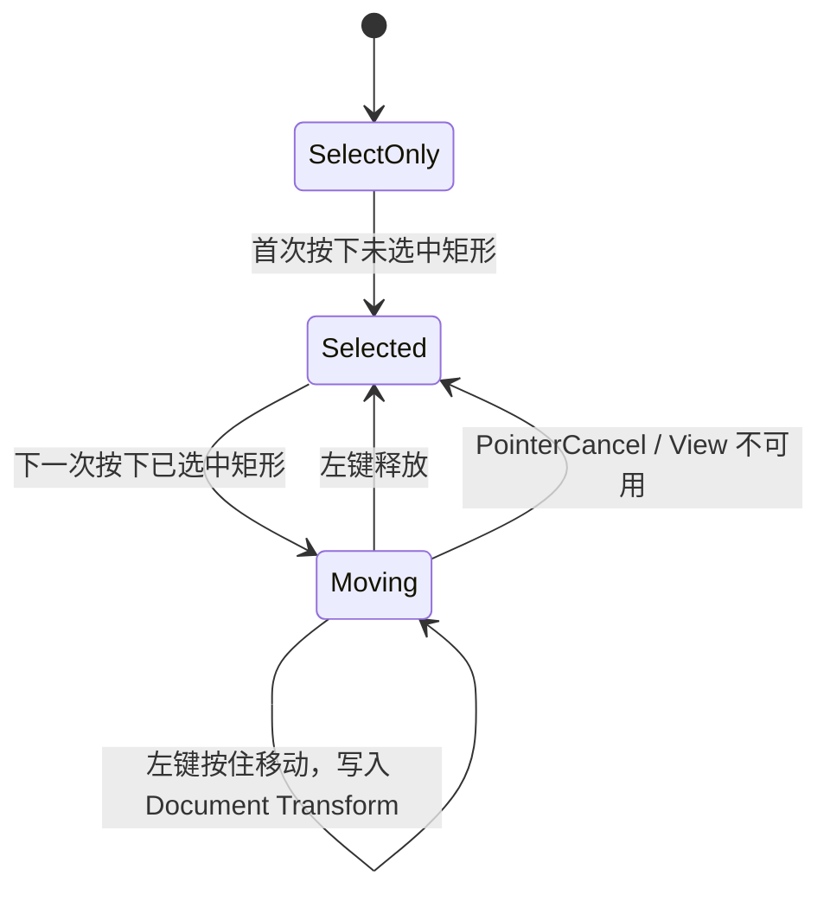

# 实现已选中矩形的拖动移动

这个增量允许对当前 View 已选中的矩形执行左键拖动，并直接修改 Document 中该矩形的 `Transform.translation`。它依赖已存在的单选与命中机制，但不涉及调整尺寸或旋转。

## 为什么必须“先选择，再拖动”

用户交互采用明确的两次按压语义：第一次按在未选中矩形上，只改变 Selection；即使这一次按压后移动了鼠标，也不能据此移动图形。只有后续新的左键按压命中**当前已经选中**的矩形，才开始移动手势。这样选择和移动不会在一次按压中意外混合。

移动开始时记录 Pointer 及目标 View、鼠标在 Document 坐标中的位置、矩形初始中心与抓取偏移。拖动期间把当前指针位置换算为 Document 坐标，应用原抓取偏移，避免鼠标按下瞬间矩形中心跳到指针位置。旋转矩形仍移动其中心，保持原尺寸、旋转和颜色；以当前 View Zoom 换算位移，不能把 UI 逻辑像素的移动量直接写进 Document。

## 文档状态和其他 View 的同步

移动更新的是同一个 Document Entity 的 Bevy `Transform`，不维护 View 私有的第二份位置，不因移动而重建矩形几何 Mesh。两个 View 引用同一 Document 时，在 A 中拖动矩形，B 必须看到位置更新；但 B 的 Zoom/Pan/Selection 本身不应改变。选中轮廓跟随移动中的矩形，不能落后于画面。

Space+左键手势优先平移 View；一旦已经捕获某次“移动矩形”的按压，也不能因后来按下 Space 突然改为 Pan。Pointer Release、取消、窗口失焦、隐藏、Disabled、目标图形删除以及 View 销毁时都应结束当前移动并释放 Pointer 捕获。移动手势取消时对已经提交的 Document 位置是否回滚未作额外承诺；不要由手势取消自动实现未讨论的撤销系统。

## 验证

确定性测试覆盖首次按压只选中、第二次按压能移动、抓取偏移保持、不同 Zoom 下屏幕位移对应正确 Document 位移、旋转图形移动时 size/rotation 不变。多 View 测试验证 Document 更新可见且 View 自有状态互不覆盖；GUI 验证拖动中途松开 Space、取消、焦点变化及拖动后重新选择不会残留捕获。
