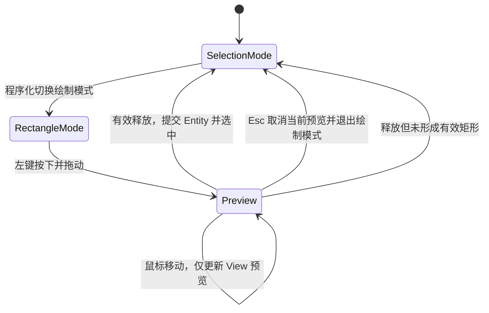

# 实现预览式矩形绘制

这个增量为 Canvas View 增加一次性矩形绘制工具。它通过用户操作创建真正的 Document 矩形 Entity，而不是要求调用者事先在 ECS 中手动插入图形。**只有松开鼠标并通过尺寸校验，图形才进入 Document**。

## 模式切换与临时预览

Canvas View 默认选择模式，提供程序化 API 进入矩形绘制模式。模式属于 View 而非 Document；多个 View 可以分别处于不同模式。选择模式原有的选中、移动机制保持不变。Space+左键平移仍优先于绘制；按下开始时确定本次按压的用途，不能在拖动途中切换模式而误写 Document。

在绘制模式下按下左键时记录起点，拖动时显示一个由 View 自己拥有的临时矩形预览。预览可以使用 View 内的 Mesh，但不对应 Document 图形 Entity，不参与其他 View 的画面，也不参与 SVG/PNG 导出。`Esc` 丢弃预览并退出矩形绘制模式，返回选择模式，不需要创建后再删除 Document Entity。

左键释放时，使用按下与释放的 Document 坐标形成矩形中心和尺寸；向左上、左下、右上、右下四个方向拖动均按两个端点的 min/max 计算边界。只有坐标有限且宽、高均至少 **1 个 Document 单位**才提交 Document。单击未形成有效矩形时不生成 Entity，直接取消这次绘制并返回选择模式。创建成功后自动选中新 Entity，并立即返回选择模式，**不进入连续画矩形工具循环**。

## 数据与资源处理

创建矩形延续统一 Document 模型：`CanvasRectangle.size` 为正、Transform 以中心为位置，CanvasPaint 指定填充及可选描边；不会引入另一个“Canvas 内部 Shapes Vec”作为数据权威。预览 Scene、Mesh 或 Material 在提交、取消、View 销毁时按其 View 归属释放；绘制中修改的只是预览而非 Document，也不向多 View 广播半成品。

矩形绘制的四向拖动、最小尺寸与 Esc 行为按上述规则统一处理；实现不需要另设一套以屏幕像素计量的“开始拖动阈值”，也不为验证一个矩形添加框选、连续绘制或更多工具模式。

## 完成条件

GUI/Headless 测试覆盖进入绘制模式、按下/移动时仅当前 View 可见预览、有效松开后 Document 才出现 Entity、成功自动选中并返回选择模式。验证无效单击不写入 Document、Esc 取消预览、Space+左键仅平移、取消或 View 销毁后不残留预览与捕获。使用两个 View 观察同一 Document，确保另一个 View 只在正式提交后看到矩形。
