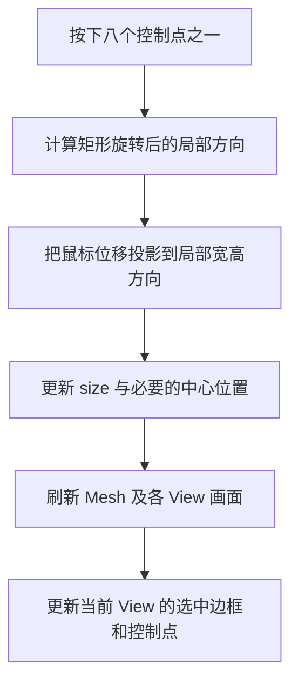

# 实现八控制点矩形缩放

这个增量让已选中的矩形具有四角和四边中点共八个可操作控制点，可以沿矩形自身局部方向调整宽度与高度。它只涉及尺寸调整，不把旋转或连续工具体系引入同一增量。

## 控制点是 View 辅助表现

选中矩形后，八个控制点出现在实际矩形边界相应位置：四个角、四条边的中点。矩形旋转时，位置随形状旋转，而控制点的视觉尺寸保持固定 **UI 逻辑像素**，不随 Canvas Zoom 放大或缩小。它们属于当前 Canvas View 的编辑辅助内容，不进入 Document、不参与普通图形 Mesh 的共享缓存、不出现在 SVG/PNG 导出中。

控制点必须优先于它下方的矩形内部命中，避免拖动角点时被解释成移动整个矩形。View 本身仍承担 Pointer 命中到 Document 几何的转换；不把离屏 Mesh 的 Picking 结果作为控制点定位权威。

## 缩放的几何约束

每种控制点调整对应的边界：角点同时作用于宽和高；边中点只调整一个尺寸。更新 `CanvasRectangle.size`，以及必要时的 `Transform.translation`，使拖动的边沿与鼠标交互一致；旋转值保持不变，不用非均匀 `Transform.scale` 代替用户可编辑的矩形尺寸。

**不允许负宽度、负高度或越过零后翻转。** 局部宽、高均至少为 **1 个 Document 单位**，拖动到下限时钳住尺寸而不是自动反转控制点角色。角控制点拖动时保持局部对角位置不变；边控制点拖动时保持局部对边不变。矩形已经旋转时，沿其自身局部宽高方向修改，保持旋转角度与固定边/角对应的 Document 空间位置。描边以 Document 单位居中；修改尺寸引起 Mesh 几何和外接边界变化，其他 View 同步看到修改后的矩形。

八向缩放只调整局部 `size` 和必要的中心位置，不把局部尺寸编辑改写为 `Transform.scale` 操作；当图形已有非单位 Scale 时，控制点的位置与固定边/角也必须以实际变换后的 Document 几何为准。控制点与矩形之间的视觉排列、命中容差须在不同 Zoom、Window Scale Factor 下保持可用。

## 完成条件

针对八个控制点分别验证可预期的局部尺寸变更、中心位置及旋转保持；拖动越过最小尺寸时不产生零/负尺寸、不翻转、不发生位置突跳。验证 `Transform` 和 `CanvasRectangle` 仍是唯一 Document 权威，两个 View 同步更新，当前 View 的控制点保持固定 UI 大小。GUI 验证倾斜矩形及 0.1×/10× 缩放下的命中和拖动；取消/失焦时捕获释放。测试覆盖描边随尺寸更新及导出前计算所依赖的边界正确性。
