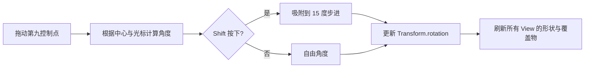

# 实现矩形旋转与十五度角度吸附

这个增量为已选矩形增加一个专用旋转控制点。旋转只修改 Document 矩形的 Bevy `Transform.rotation`，保持矩形的中心、局部尺寸和 Paint 不变；不通过“重新计算四个顶点并改写 size”模拟旋转。

## 独立旋转点与圆心

在矩形顶部边中点之外显示第九个控制点，并通过可见的偏移让用户区分它与顶部的尺寸调整点。控制点跟随矩形方向旋转，视觉尺寸保持固定 UI 逻辑像素；它同样只是 View 编辑覆盖物，不属于 Document 图形、不参与 PNG/SVG 输出。

按住旋转点并拖动时，以矩形中心为旋转中心，将鼠标在 Document 坐标中的方向变化转换为旋转角度。普通拖动允许连续自由旋转；**按住 Shift 时将角度吸附到 15° 的整数倍**。释放 Shift 后恢复自由旋转交互，不允许按键模式改变导致矩形中心突跳。矩形的宽高始终来自 `CanvasRectangle.size`，描边的居中语义不变。

## 与其他操作的关系

旋转控制点的命中优先于矩形内部移动和空白点击；Space+左键若已被判定为平移，则不触发旋转。旋转后的矩形继续按逆 Transform 进行几何命中，八个尺寸控制点按新角度位置显示，AABB 必须反映其实际旋转和描边。

改变旋转是 Transform 更新，不要求重建矩形的填充/描边局部 Mesh；两个 View 引用同一 Document 时均看到新旋转，但只有发起操作的 View 拥有本次拖动手势和控制点状态。

## 完成条件

验证绕中心旋转时中心、宽高和描边宽度不变；自由旋转连续、Shift 对齐 0°/15°/30° 等步进以及跨越 ±180° 时没有异常跳变。验证按住/松开 Shift、PointerCancel/失焦/销毁后的状态清理；倾斜图形的八向控制点和命中仍准确。GUI 视觉测试覆盖不同 Zoom 和窗口 Scale Factor，Headless 测试覆盖角度计算与吸附规则。

本增量不实现任意枢轴旋转、旋转历史、更多吸附间隔或组合变换工具。
