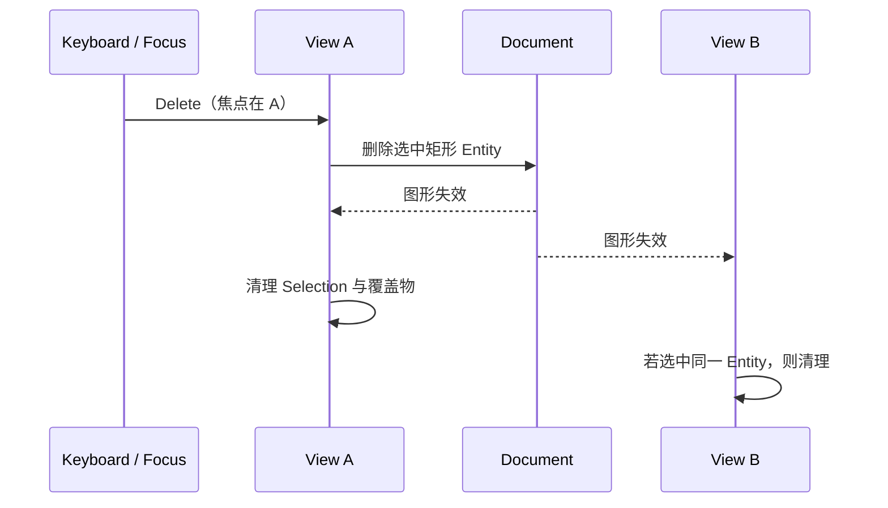

# 实现删除与跨 View 选中修复

这个增量使当前拥有键盘焦点的 Canvas View 可以通过 `Delete` 删除所选矩形，并保证所有引用同一 Document 的 View、Mesh 缓存和渲染实体不会保留失效状态。这是形状生命周期的最终编辑闭环，但不包含撤销/重做。

## 删除权威属于 Document

按 Delete 时，先确认键盘焦点确实在当前 Canvas View，且该 View 有有效选中的矩形 Entity。只有满足条件时才删除 Document 的该矩形实体及其数据组件，不是仅让当前 View 的 Render Proxy 隐藏。未选中任何图形时，Delete 没有效果，也不制造错误或空操作通知。

特别需要避免抢走 TextField 的快捷键：当焦点落在 TextField 或其他接受 Delete 的控件时，Canvas 不处理该按键。Canvas 的 Selection 仍遵循 Widgetry 自有 Runtime State 公开更新与实际变更后通知的规则；Delete 改变的是模型实体和所有受影响 View 的有效选择状态，不能在实体已经删除后继续发出“仍选中旧实体”的通知。

## 跨 View 清理与资源归属

当一个矩形在多个 View 中显示、甚至同时被两个 View 选中时，删除后所有受影响 View 均清空指向它的 Selection，退出针对该矩形的移动/缩放/旋转手势，并移除渲染代理。共享 Mesh 不再被使用时才释放；删除它不能误删其他图形使用的资源，也不能影响任一 View 的 Camera/Pan/Zoom。若某个 View 已被销毁或 Document 已被移除，清理不能再次访问过期 Entity。

删除最后一个矩形后，Document 成为合法的空 Document，View 仍可显示空画布并继续接受绘制操作。但按照已定导出规则，空 Document 无法导出 PNG 或 SVG；无论是否指定导出区域都必须返回 `EmptyDocument`。

## 完成条件

通过 Headless/ECS 测试验证有选中删除、未选中无操作、焦点在 TextField 时不触发、删除后两个 View 的选择状态修复、Render Proxy 和无用 Mesh 释放、Document 与 View 自身继续存在。GUI/BRP 测试应先为 Canvas 获取焦点，再按 Delete 验证真实交互；切换到 TextField 后验证其输入不受影响；删除时若指针捕获在途，应终止并释放。不得通过直接预先删除实体来代替对键盘交互的验证。

删除操作不自动产生撤销栈、历史状态或恢复 Entity 的能力。
