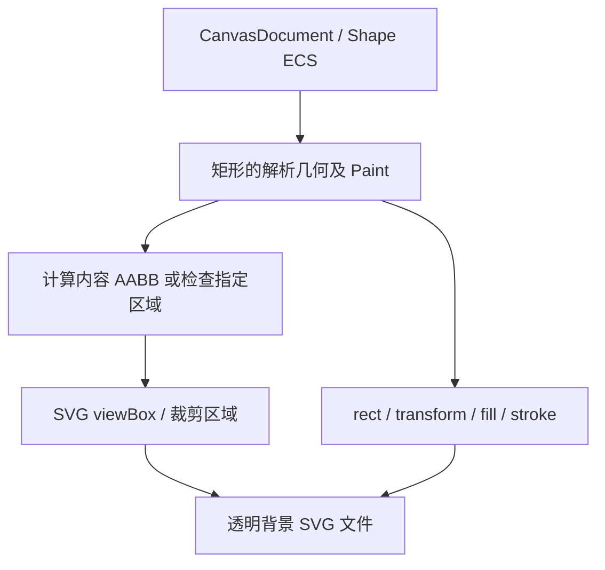

# 实现 SVG 矢量导出

这个增量让应用从 CanvasDocument 直接写出 SVG 矢量文件，保持图形的坐标、中心、旋转、尺寸、填充和居中描边语义。SVG 导出不依赖 Canvas View、Mesh、Camera、Zoom 或窗口 Scale Factor；也不会导出编辑辅助轮廓与控制点。

## 自动与显式导出区域

Document 是无限画布，因此不可能以 Document 的“完整尺寸”直接输出 SVG。默认导出区域是**所有已提交图形实际外轮廓的最小轴对齐包围盒（AABB）**；必须包括旋转以及宽度为 `w` 的居中描边向矩形边界外扩的部分。图形位于负坐标时，使用实际 `min_x/min_y` 建立输出区域，不能默认从 `(0,0)` 截取。调用者也可以显式提供一个有限、合法的 Document 坐标矩形作为导出区域；导出结果以该区域为视图/裁剪依据，而非依赖某个 Canvas View 当前看见哪里。

举例：矩形未旋转，Document 大小为 120×80，描边宽度为 10，则默认内容边界宽高为 130×90。旋转后改为根据实际变换后的外轮廓计算 AABB，周围可能保留透明角落；不使用凸包或自动旋转的裁剪框。多个图形时合并各自的几何覆盖范围，不因为当前 Gallery 只显示一个矩形就仅处理第一项。

## 保持原始二维图形语义

SVG 直接表示矩形和变换，不把 Bevy 顶点三角化结果写成固定像素图。矩形的中心与 `Transform`（包含整体及非均匀缩放）、Y 向下的 Document 坐标、`fill: None` 的无填充语义、填充 Alpha、可选居中描边和旋转必须与屏幕显示保持等价。SVG 本身不绘制背景，空白位置保持透明；View 在屏幕上使用的背景色与 Selection/八向控制点/旋转控制点/未提交预览均不输出。

空 Document 是明确错误：**无论默认 AABB 还是调用者显式指定区域，都返回 `EmptyDocument`，不生成 SVG。** 非法或非有限指定区域不能生成伪合法 SVG。只要 Document 存在图形，即使图形位于当前 View 之外，仍可按默认区域导出。显式区域不必与当前 View 的内容一致；若区域与图形没有交集，空白裁剪结果的语义与“Document 没有图形”不同，不能误用 EmptyDocument。

## 文件写入契约与验证

SVG 导出接口直接接收目标文件路径，完成矢量内容生成和文件写入并同步返回 `Result`。已有文件默认直接覆盖，不在控件内部检查是否存在或弹出确认框；应用层自行决定是否先提示用户。几何校验与 `EmptyDocument` 检查必须先于打开或截断目标文件执行，确保空 Document 不会改写已有文件。文件 I/O 失败应返回错误。

测试 SVG 结构和几何边界，至少覆盖负坐标、旋转、填充/描边颜色与透明度、居中描边、显式区域、空 Document 错误以及编辑覆盖物不出现；检查已有目标文件被有效导出覆盖，以及空 Document 时原文件保持不变。用解析后的 SVG 几何/必要时矢量渲染比较与 Document 的一致性，不把当前窗口截图作为对照真值。后续 PNG 导出必须重用一致的 AABB 与坐标约定。

文件写入是本次 SVG 导出的唯一对外结果形式，不额外暴露字符串/字节数组导出 API。`fill: None` 不输出实心填充，只有描边的空心形状保持空心。
