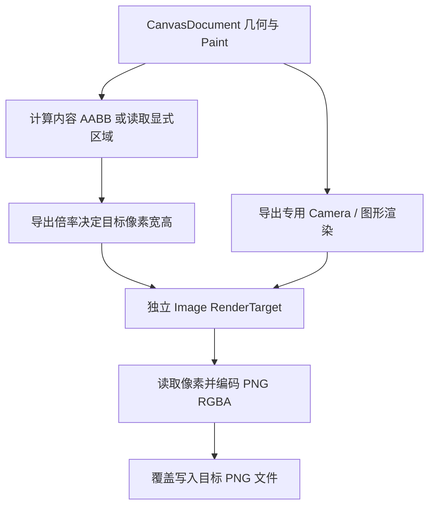

# 实现 PNG 高分辨率离屏导出

这个增量让应用在指定导出倍率下从 CanvasDocument 重新渲染并写入高分辨率透明 PNG 文件。PNG 不使用现有 Canvas View 的截图，也不放大已生成的低分辨率位图；为导出操作创建独立的目标分辨率和 RenderTarget，必要时从 GPU 读回像素并编码成 PNG。

## 导出区域和分辨率

无限 Document 的默认导出区域同 SVG：自动取全部已提交图形的最小 AABB，并包含矩形旋转与居中描边外扩。调用者可以显式提供合法的 Document 坐标导出区域。图形的绝对坐标只决定所选区域的原点，不应自动把 `(0,0)` 到图形之间的大片空白算进文件宽度。

PNG 倍率 `scale` 默认 1×，允许调用者指定 2×、4× 或其他有效的正倍率。输出目标像素尺寸基于区域宽高乘以倍率并向上取整；例如 130×90 Document 区域在 1×/2×/4× 下分别成为 130×90、260×180、520×360 像素。非整数尺寸应采用使图形不被裁切的取整/映射处理。实际像素尺寸与 GPU 最大纹理限制、内存开销必须校验，非法倍率、空目标尺寸、非有限值不得进入 RenderTarget 分配路径。

**倍率增大必须重新栅格化 Document 几何。** 这样 2×/4× 在相同显示尺寸下通常能更细腻地表达斜边和描边；若只是拉伸 1× PNG，则不能得到额外真实细节。Bitmap 输出的物理分辨率不与 Canvas View 的 Zoom 或 Gallery 的 Window Scale Factor 相乘。

## 内容与颜色一致性

背景默认 RGBA 透明；Canvas View 的背景色、Selection/控制点和绘制中的临时预览均不进入输出。矩形填充（包括 `fill: None`）、可选居中描边、颜色 Alpha、旋转、Transform 的整体/非均匀缩放及裁剪区域应与 Document 和 SVG 的语义一致。一个 Document 可以没有任何 View；只要有有效图形，PNG 仍应能在专用导出上下文绘制。

Document 为空时，无论是否指定区域都返回 `EmptyDocument`，不分配无意义的导出纹理、不创建或截断目标文件，即使已有同名文件也要保留原内容。若 Document 非空但显式区域落在图形外，透明裁剪结果应与真实空 Document 错误区分。导出操作完成或失败后释放其专属 Image、Camera、Mesh 引用和渲染层，不打断已有 View 或 Waveform 的 RenderTarget。不能重用一个正在显示中的 View 相机并临时修改它的 Zoom、Pan 或目标尺寸来完成导出。

## 文件导出生命周期与 Bevy 渲染验证

PNG 导出 API 直接接收目标文件路径，已有文件默认直接覆盖，文件存在判断和用户确认属于应用层职责。导出请求先进行 Document 非空、导出区域、倍率及目标尺寸校验，再进入离屏渲染；完成 GPU 读回及 PNG 编码后写入文件，并通过异步完成结果报告成功或失败。不能在仅提交 GPU 渲染请求时就报告文件写入成功。文件 I/O 失败应进入同一错误结果路径。

Bevy 0.20 / DX12 中离屏 Camera、4× MSAA 的 Resolve、纹理读回、色彩空间与 Alpha 处理须进行真实 GPU 路径验证；不能假定 `Assets<Image>` 上能立即读到已绘制的像素。离屏渲染与文件写入完成结果必须具有明确关联，避免“导出调用已返回”却尚无有效像素的数据竞争。不额外暴露 PNG 编码字节返回 API。

完成测试应检查 1×/2×/4× 的真实尺寸、非整数裁剪边界、颜色/透明度、负坐标、旋转与描边、空 Document 错误、无编辑覆盖物、Zoom/Scale Factor 独立性，以及同一 Document 多 View 正在显示时导出不会改变它们。真实 GPU 截图/像素检查与 Headless AABB/参数测试分别覆盖两类风险，不将单纯文件存在当成渲染成功。验证已有目标被正常覆盖、空 Document 时已有文件不变，以及异步结果与最终写盘成功/失败一致。
