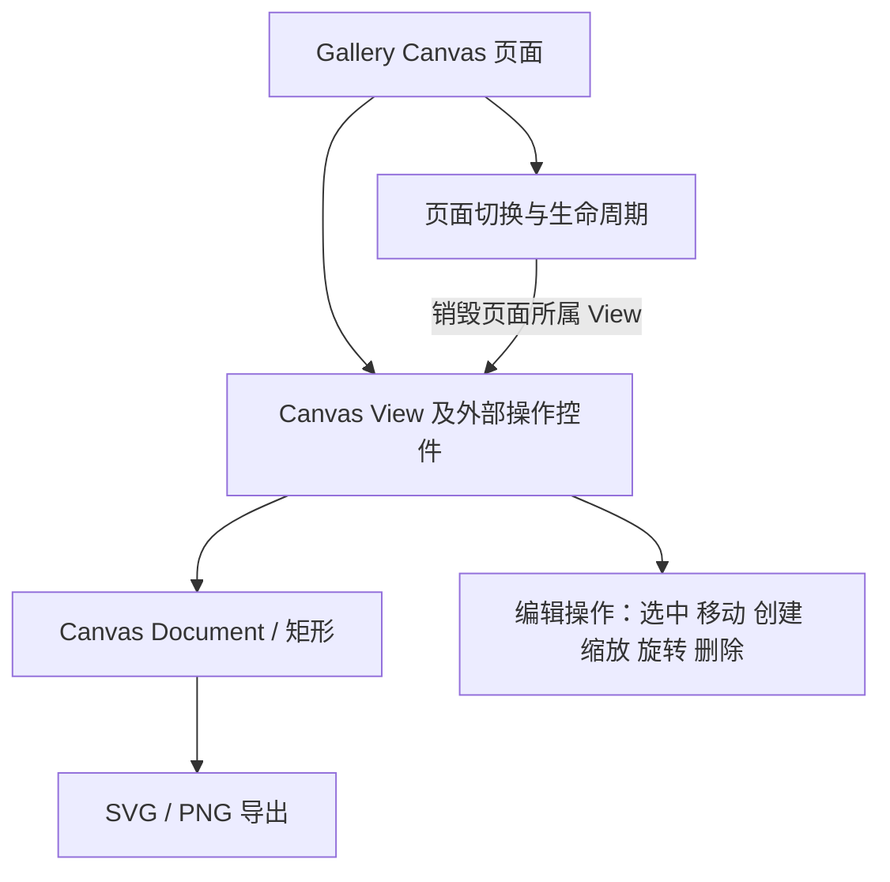

# 在 Gallery 中展示 Canvas 矩形完整闭环

这个增量为 Gallery 增加可实际操作的 Canvas 展示页面，将已实现的 Document、View、编辑交互和两种导出功能集成在真实 Bevy UI 中。它是一项独立的用户可观察展示能力，不是把所有前序测试积攒到最后才统一执行。

## 页面如何表达第一个矩形

Gallery 页面使用项目统一的 Bevy BSN UI 组合方式，注册新的页面标识、导航入口、展示 Scene 和必要的插件；随 Gallery 现有 PageHost 的挂载/卸载生命周期创建或移除 View。Canvas 自身仅作为可布局、可裁剪的 UI 视口，切换选择/矩形绘制模式、触发导出等操作所需的外部 Gallery 控件位于 Canvas **外侧**，不把 Widgetry Button 嵌入 Canvas 绘图内容。

演示以一个矩形走通完整流程：初始化或通过绘制创建矩形，点击选中，再次按下移动，八个点调整尺寸，第九个点旋转、Shift 15° 吸附，Delete 删除。展示 `Space + 左键` 平移、滚轮围绕光标缩放和独立 Zoom 更新。支持触发 SVG 与 PNG 默认 AABB 导出及指定区域/倍率选项，使导出结果容易实际检查。Gallery 负责提供目标文件路径，按应用需求自行决定是否检查文件存在并请求覆盖确认；Canvas 导出接口拿到路径后直接覆盖写入，PNG 的成功或失败应等待异步完成结果。初始实例不限制 Document 只能保存一个图形。

页面可展示两个指向同一 Document 的 View，验证各自 Zoom/Pan/Selection 不同但图形更新一致。若实际布局采用一个主 View 和一个辅助 View，也必须保证两个 View 的目标纹理、渲染层和资源互不混淆。页面关闭只清理页面拥有的视图/演示资源，不因一个 View 的移除误删其他仍被引用的 Document；重复进入页面不应造成资源不断增长。

## 与现有 Gallery 的集成边界

需要更新 Gallery 的页面枚举、导航按钮、页面插件注册、展示场景与必要文案；Canvas crate 已在数据模型增量加入 Workspace，View 在渲染增量通过 Facade Feature / Re-export 对外可用；本阶段负责 Gallery 的接线与展示行为，并同步受影响的 Canvas Widget 文档及 Gallery 文档。Gallery 自己的演示数据、图标与资产保持应用所有权，不为了展示而让库 crate 依赖 Gallery。所有代码仍以现有 Windows 64 位、Bevy 0.20、DX12 工程配置为准。

Gallery 当前使用窗口 Scale Factor Override，并可在运行时选择不同倍率；Canvas 自身 Zoom 与这个设置完全独立。应分别在 1.0、1.25、1.5、2.0 等配置下观察 UI 尺寸与 RenderTarget 像素，特别验证九个控制点尺寸、Pointer 坐标、矩形边缘清晰度和高分辨率导出。不要用窗口缩放冒充 Canvas Zoom，也不要让导出倍率由当前 Gallery 窗口比例隐式决定。

## 实际 GUI 验证与验收结果

- **创建和编辑**：真实 Pointer/Keyboard 输入完成选择、二次按压移动、绘制预览/提交、Esc 取消、八向缩放、旋转/Shift 吸附和 Delete；截图检查编辑辅助图形，ECS Query 检查 Document Transform/size 的实际变化。
- **视口导航**：Space+左键按下后即使中途松开 Space 仍持续平移，左键释放才结束；滚轮缩放保持光标锚点，多 View 的 Zoom/Pan 互不干扰。
- **导出**：PNG/SVG 输出透明、无控制点、包含描边，默认取 AABB，指定区域和倍率有效；文件存在时由 Canvas 按接口契约直接覆盖；删除最后一个矩形后空 Document 导出明确报错且不得清空原有文件。
- **生命周期**：页面切换、隐藏、重新进入、同一 Document 多 View、重复创建/删除后，无旧纹理残留、悬空 Entity 或泄漏的相机/RenderLayer/Asset；Waveform 页面仍按原契约工作。

按现有 GUI 规则使用 `bevy_brp_mcp` 进行针对性的 BRP 输入、截图、ECS/日志检查，验证结束释放 BRP Pointer。BRP 使用的 Custom Pointer 不等于原生 OS 鼠标，不能将它的输入结果直接宣称为原生鼠标或系统级失焦场景的验证。Gallery 页面不强制增加专用 Unit/Integration Test，但功能本身的可观察契约应已在对应 Canvas crate 增量中建立确定性回归测试；新增集成影响的部分在本次页面验证里闭合。

本展示只覆盖首个矩形闭环，不增加撤销/重做、绘制多个类型、Canvas 内嵌 Button 或全局 UI 编辑器框架。
