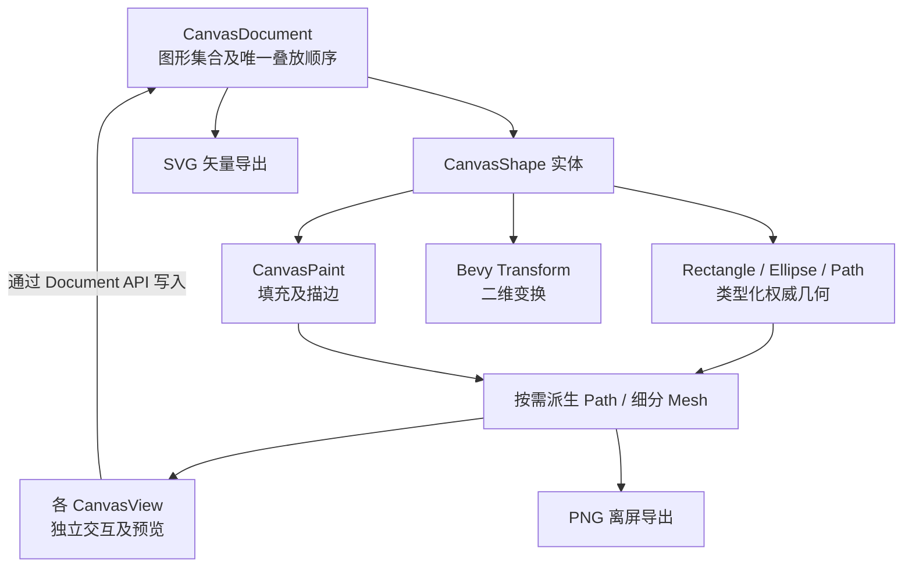

# Canvas 多图形与 Path 编辑：整体设计与实施顺序

Canvas 从以矩形为中心的二维控件，扩展为能显示和编辑 Rectangle、Ellipse 与 Path 的轻量级矢量绘图控件。核心保持不变：**CanvasDocument 是图形数据和唯一叠放顺序的权威；CanvasView 持有每个视图独立的交互、选择与预览；几何可以派生 Path 供计算，Mesh 只是一份可失效的绘制结果。** 不因需要复杂轮廓而引入多图层、分组、参数图形转 Path、多人并发编辑或大型绘画软件能力。

从数据模型入手，是因为后续显示、命中、工具和导出都必须辨认同一种图形身份。叠放顺序首先在现有矩形上形成闭环，再扩展至椭圆和路径，避免出现某种图形有独立且冲突的绘制次序。参数图形保留类型与尺寸数据；Path 保留命令、曲线和多子路径，允许节点编辑。各类型既能经统一几何管线显示，也能在最终 SVG/PNG 中表达同样的语义。

```mermaid
flowchart LR
    MODEL[图形身份与写入] --> ORDER[统一叠放顺序]
    ORDER --> PARAM[参数图形能力]
    PARAM --> PATH[Path 命令及细分]
    PATH --> STYLE[填充和描边语义]
    STYLE --> HELPERS[基础轮廓追加 API]
    HELPERS --> PICK[真实几何命中]
    PICK --> XFORM[单图形整体移动、旋转与缩放]
    XFORM --> TOOLS[椭圆及 Pen 交互工具]
    TOOLS --> NODES[Path 节点编辑]
    NODES --> MULTI[多选与批量操作]
    MULTI --> EXPORT[SVG / PNG]
    EXPORT --> GALLERY[Gallery 完整交互入口]
```

图中箭头表达实施链的总体组织方向，不代表每一对相邻目标都有直接代码调用。比如基础轮廓 API 与后续 GUI 节点编辑可以分别验收；SVG 和 PNG 也是不同的输出能力。每项功能的对应测试、失效清理及必要文档更新随其实现闭合，不另建纯验收阶段。最后的 Gallery 目标是提供真实的多图形交互演示入口，并借由标准 BRP CustomPointer 验收整体使用流程，而不是改造 BRP 输入机制。

## 唯一执行顺序

1. [统一 CanvasShape 身份与矩形数据契约](01-统一CanvasShape身份与矩形数据契约.md)
2. [建立 Document 唯一叠放顺序](02-建立Document唯一叠放顺序.md)
3. [支持参数椭圆的创建与显示](03-支持参数椭圆的创建与显示.md)
4. [支持 Path 命令与多子路径渲染](04-支持Path命令与多子路径渲染.md)
5. [补齐 SVG 对齐的填充与描边规则](05-补齐SVG对齐的填充与描边规则.md)
6. [提供 Path 基础轮廓追加接口](06-提供Path基础轮廓追加接口.md)
7. [统一图形命中与选择覆盖层](07-统一图形命中与选择覆盖层.md)
8. [支持跨类型单图形移动、旋转与缩放](08-支持跨类型单图形移动旋转与缩放.md)
9. [实现椭圆交互式绘制工具](09-实现椭圆交互式绘制工具.md)
10. [实现参数图形类型化控点编辑](10-实现参数图形类型化控点编辑.md)
11. [实现 Pen 多子路径草稿与提交](11-实现Pen多子路径草稿与提交.md)
12. [支持 Path 锚点与控制点拖动](12-支持Path锚点与控制点拖动.md)
13. [支持 Path 节点和子路径结构编辑](13-支持Path节点和子路径结构编辑.md)
14. [让 CanvasView 支持独立多选集合](14-让CanvasView支持独立多选集合.md)
15. [实现多选图形批量移动与删除](15-实现多选图形批量移动与删除.md)
16. [导出保留路径语义的 SVG](16-导出保留路径语义的SVG.md)
17. [将通用图形接入 PNG 离屏导出](17-将通用图形接入PNG离屏导出.md)
18. [在 Gallery 提供多图形编辑演示](18-在Gallery提供多图形编辑演示.md)
