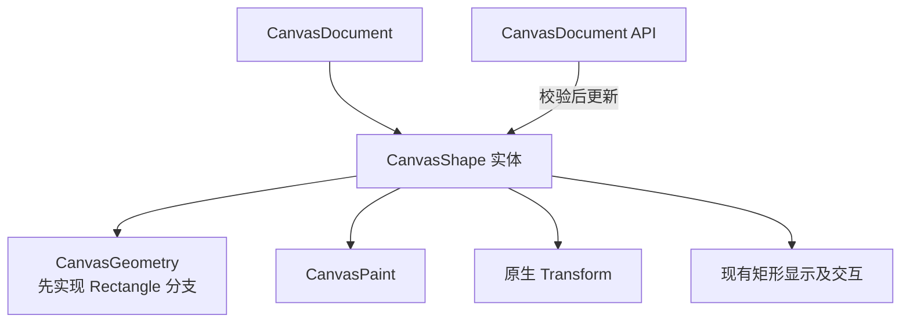

# 统一 CanvasShape 身份与矩形数据契约

## 目标与整体机制

将原本只围绕 `CanvasRectangle` 的 Document 写入契约调整为统一的 `CanvasShape` 图形身份，先以矩形形成完整闭环。后续椭圆和 Path 只增加几何种类，不再重建图形所属关系、变换或样式写入通道。



本增量可单独交付的结果是：原有矩形的创建、编辑、移除、选择、拖动和导出仍正常，但 API 和组件关系已经为三类形状准备好公共身份。**不需要在本增量把尚不存在的椭圆和 Path 提前显示出来。** 允许破坏原先矩形专用 API 的兼容性。

## 图形身份与数据归属

每个图形仍是一个 ECS Entity，属于且只属于一个 `CanvasDocument`；可沿用 `ChildOf(document)` 表示所属关系。几何类型在同一个身份下是确定的，概念结构如下，具体 Rust 存储方式在实现时选定：

```rust
// 概念接口，并非要求使用该确切组件布局。
enum CanvasGeometry {
    Rectangle(CanvasRectangle),
    Ellipse(CanvasEllipse),
    Path(CanvasPath),
}
```

三个几何类型在后续增量各自落实；这个结构表达“一个形状对应一种几何”的不变量，不允许同一实体因被渲染为 Path 就改变种类。Rectangle 在此次公共身份迁移时至少完整保留现有宽高与矩形行为；圆角半径及其显示、控点与边界计算由后续的参数图形编辑增量一起实现。几何处理需要时允许按需派生路径，不能把派生结果作为可独立写入的权威数据。

图形的变换继续使用 Bevy 原生 `Transform`，以本地几何为输入，位置、旋转和缩放只有这一份权威；不增加第二套可编辑变换状态。`CanvasPaint` 仍归图形所有，表达填充和描边，与其 Rectangle/Ellipse/Path 几何种类解耦。`Mesh`、显示代理和选中覆盖层都不是 Document 的业务数据。

## 统一公开写入契约

Document API 负责创建、修改、删除图形，以及后续阶段调整前后顺序、Path 指令等操作。既有 `create_rectangle`、`update_rectangle`、`remove_rectangle` 可扩展或替换为类型化 API，但外部调用应能明确知道操作的是哪个 Document 和图形。

- 创建前校验目标 Document、参数化几何、Paint、Transform；成功才生成归属明确的 Shape。
- 更新前校验 Shape 实体存在，所属 Document 与 API 提供的一致，几何类型吻合，并在更新完成后统一通知相关消费者所需的变化。
- 删除时确保选择、正在进行的手势、渲染代理和缓存能发现图形失效；移除顺序条目将在下一增量由 Document 顺序管理补齐。
- 参数要求有限、有效的二维几何：宽高及可编辑圆角符合各自定义，变换的 XY 可逆、数值有限、绕 Z 旋转；Paint 的颜色与描边宽度有效。延续既有二维校验意图，不因升级模型默认允许任意不可逆矩阵。

外部直接 `World` 写 Shape、Paint、Transform 不属于保证一致性的 Canvas 公开业务接口。BRP 可用于 ECS 调试，但直接改字段不等同于按 API 更新，也不作为正常 UI 验收的替代操作。

## 与下一增量的关系

本增量解决“一个图形是什么、谁能修改它”。下一增量会在已存在的 Shape 集合上建立唯一相对绘制顺序，并将 View、命中和导出从旧 Z 值转移到该顺序。这里不预先实现完整顺序重排功能，也不将类型转换、图层和 Group 纳入模型。

## 验证及边界

使用现有矩形生命周期测试检查合法创建、无效数据拒绝、其他 Document 图形拒绝、删除后无悬空图形；确认原矩形拖动、旋转、缩放、普通选择与显示行为保留，`Transform` 为唯一变换权威。检查创建失败不生成半成品 Entity，更新失败不留下部分写入，原矩形导出仍能读取正确数据。

测试应保留现有对有限数值、二维可逆缩放、绕 Z 旋转、有效颜色与正描边宽度的约束。不得因为模型统一而创建 Path 与矩形之间的可编辑转换、引入 Layer、或把节点、子路径另建为 Shape 实体。
