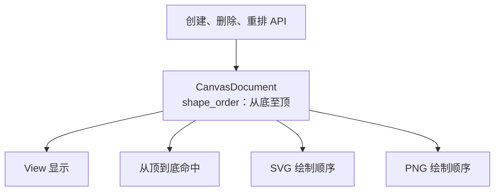

# 建立 Document 唯一叠放顺序

## 目标与整体机制

让同一个 `CanvasDocument` 内的所有现有图形具有唯一的前后相对顺序，并保证画面显示、命中检测、SVG 和 PNG 使用同一顺序。先以矩形实现完整链路，之后新增的 Ellipse 和 Path 直接加入同一顺序。

这是**严格全序**而不是 Photoshop 式图层。不存在两个独立 Shape 占用同一个顺序位置；也不要求在每个 Shape 上分配不同的用户可见 `z_index`。`Transform.translation.z` 不再作为图形先后关系的独立权威。

## 顺序数据及操作

可由 Document 保存 `shape_order: Vec<Entity>`，按从底到顶排列。实现时保持：序列中每个成员恰好出现一次，图形必须属于当前 Document；删除或失效时同步修复序列；新建图形默认追加到末尾。

提供上移、下移、置顶、置底的 Document API。上移/下移与相邻 Shape 交换顺序，置顶/置底将成员移动到对应端，不创建 Layer 或 Group。无效所属关系和非法实体必须拒绝，不能让重排使 Document 集合与序列不同步。

## 一份顺序作用于四种消费场景

- **View 画面**：在现有 `Mesh2d` / `ColorMaterial` 代理中，填充、描边组成同一图形连续的绘制单元。后方 Shape 的描边不能插到前方 Shape 的填充上面。选择轮廓是 View 编辑覆盖层，不进入业务顺序。
- **命中检测**：从序列尾部向前迭代，首个实际命中的 Shape 获得选择。现有矩形命中可先沿用原几何规则；未来 Path 的真实填充/描边检测将在独立增量实现。
- **SVG**：按 Document 绘制次序发出图形，舍弃此前以 `Transform.z` 和 `z + 0.01` 排序形状填充与描边的机制，不能产生跨 Shape 的填充/描边交错。
- **PNG**：离屏快照也沿用相同排序，而不是把原模型 Z 值当作唯一依据。内部是否映射为渲染深度是实现细节，但必须得到稳定的遮挡结果。

例子说明为什么要统一顺序：A 在后、B 在前，A 的描边仍在 B 的后面；把 B 置底后，View 与两种导出都同步变为 A 遮挡 B。不同 View 对同一个 Document 不能各自维护不同 Z 次序。

## 与相邻增量的关系

前一增量提供统一 Shape 身份和有效所属关系，本增量为其建立有序集合。后续新增椭圆、Path 不必重新发明自己的顺序；几何命中改为真实形状后仍沿用同一个自顶向下遍历规则。

## 验证及约束

覆盖创建置顶、顺序上移/下移、置顶/置底、删除后的完整性，测试边界位置重排、不属于当前 Document 的拒绝、顺序中不重复实体。针对重叠矩形，验证 View、SVG、PNG 三者的遮挡关系一致；更改原 `Transform.z` 不应偷偷恢复旧的图形先后语义。对单个图形的填充/描边，特别验证后方描边不会穿到前方填充上面。

仅管理图形顺序，不提供图层的显示/隐藏/锁定、对象分组或多选整体变换。这些功能与排序不是一回事。
