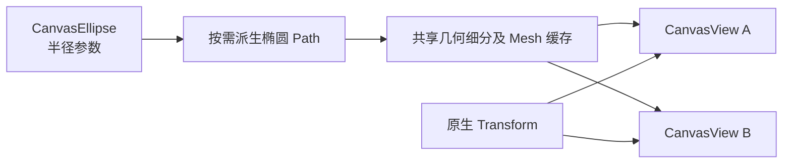

# 支持参数椭圆的创建与显示

## 目标与设计

在统一 Shape 模型中增加 `Ellipse`，使程序可以通过 Document API 创建、更新、删除参数椭圆，多个 View 能显示同一个椭圆并正确响应形状数据变化。本增量先提供**模型与可见图形**，交互绘制工具和参数控点分别由后续增量实现。

Ellipse 保留参数，不因为渲染时转换为 Path 就改变为 `CanvasPath`。圆形是半径相等的椭圆。需要一个点时允许创建很小的椭圆，不新增 Point 类型。图形仍使用独立 Shape Entity、`CanvasPaint` 和原生 `Transform`，并加入 Document 的统一叠放序列。

## 参数、派生路径和缓存

Ellipse 的局部几何以两轴半径定义，并与位置、旋转、缩放分开。Document 校验半径、几何经过变换后的数值和 Paint 的有效性。通过构造与椭圆等价的 Path 复用通用几何处理，渲染用的曲线细分网格可以按需生成与缓存；缓存不成为可编辑数据。

延续现有跨 View 共用 Document、共享几何资源的方案：参数或影响细分的描边设置变化时使网格失效；仅 Transform 变化无需重建局部网格。无效形状不得进入任何一个 View 的正常显示链路。

虽然未来的通用 Path 有多子路径和弧线命令，Ellipse 本身不因此提供节点编辑入口，也不允许转换为可独立编辑的 Path。圆、椭圆的参数编辑属于后续专门的 Select 控点功能。

## 与相邻增量的关系

前两个增量确立 Shape 身份和绘制顺序，因此新椭圆一创建就能与矩形确定前后关系。后续 Path 命令与细分机制会进一步复用这条几何链路；这里的交付是“参数椭圆能被创建并显示”，不是把 Pen、节点编辑或多选一次带进来。

后续 SVG/PNG 通用导出仍需接入 Ellipse；在导出还未完整迁移的期间，应明确区分当前已经支持的图形种类，避免将未支持的形状悄悄从输出中省略。

## 验证与边界

测试椭圆的合法与非法半径、几何范围、Document 成员校验、默认圆形与不等半径椭圆、旋转和镜像缩放。验证在两个 View 中同步显示，更改半径触发网格变化、只改变 Transform 不重复细分，以及与现有矩形的重叠次序。确认组件类型未变化、无需生成第二个 Shape Entity、删除后缓存和代理正常释放。
