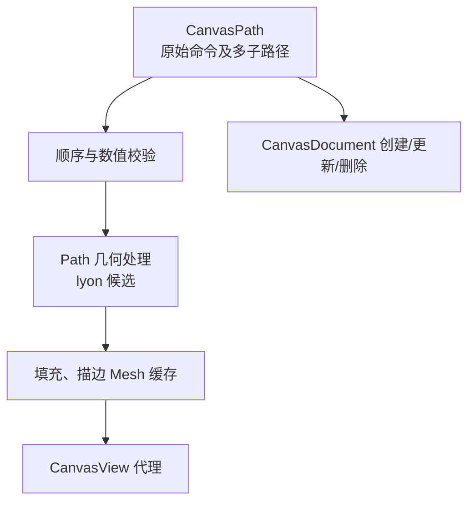

# 支持 Path 命令与多子路径渲染

## 目标与机制

让 `CanvasPath` 成为第三种可独立创建、更新、显示和删除的 Shape 几何。路径保存**原始命令**，而不是把折线细分结果当权威，支持一条 Shape 中多个开放或闭合的子路径。可通过 Document API 直接创建 Path，不依赖尚未完成的 Pen 工具。

## 路径命令及子路径语义

Path 直接保存以下命令和参数，曲线与弧线不得永久降级为折线：

| 命令 | 语义 |
| --- | --- |
| `MoveTo` | 开始一个新的子路径 |
| `LineTo` | 从当前点添加直线段 |
| `QuadTo` | 带控制点的二次贝塞尔曲线 |
| `CubicTo` | 带两个控制点的三次贝塞尔曲线 |
| `ArcTo` | SVG 椭圆弧，包括半径、轴旋转、弧标志及终点 |
| `Close` | 闭合当前子路径，不表示整条 Path 已完成 |

一个 Path 可同时拥有多条不连接的子路径，单条子路径可开放或闭合。所有子路径共享这条 Shape 的 Entity、`Transform` 和 `CanvasPaint`；它们不是独立 Shape，不能分别获得 Document 叠放位置。后续节点工具仍然修改同一个 CanvasPath。

路径命令必须保留正确的子路径起点、当前点和命令上下文；API 校验非法顺序、非有限点坐标、弧线参数、曲线控制点以及会使二维边界无效的变换。派生的边界应覆盖实际路径以及相应描边外缘。类型化几何仍使用一个独立 `CanvasShape` 实体。

## 细分与渲染

使用 `lyon` 作为候选的 Path 构建/网格细分库，输出供 Bevy `Mesh2d` 和 `ColorMaterial` 使用的填充与描边 Mesh。椭圆弧必须按 SVG 语义保留其长短弧和方向等参数，不能把 `ArcTo` 解释成普通二次曲线的某个参数替代。

绘制基础行为先按 NonZero 填充和 SVG 常规描边默认语义实现，使开放/闭合子路径都可显示；EvenOdd、端点/拐角的可配置表现由下一增量补齐。Path 的多子路径绘制仍是**一个 Shape 的绘制单元**，排序时与别的 Shape 不交错。参数几何派生 Path 与用户自定义 CanvasPath 共用网格生产方式，但前者不生成可以再次修改的 CanvasPath 模型组件。

Mesh 缓存根据原始几何和细分相关的描边参数变化失效。Path 命令变化后，各共享 View 应显示同一更新；仅移动或旋转 Shape 则只更新代理变换，不重新写权威路径或重建几何。

## 与相邻增量的关系

前序模型与椭圆已经建立类型化身份、统一顺序和 Mesh 资源思路；本增量增加任意路径表达和可见显示。下一增量增加完整 SVG 填充规则及端点/连接样式，之后才有基础轮廓追加 API、真实命中、Pen 和节点编辑。

## 验证及边界

覆盖 MoveTo/LineTo/QuadTo/CubicTo/ArcTo/Close，包含开放路径、闭合路径、多独立子路径、弧标志不同组合、非法命令顺序及控制点，确保没有因 `Close` 错误终结整条 Path。路径经 `Transform` 平移/旋转/缩放与多个 View 显示一致；几何改变刷新缓存，纯 Transform 更新无需重建细分网格。确认 Path 不会产生多个 Shape、不能自动转换成 Rectangle/Ellipse、SVG/PNG 未接入部分不会被静默当作已成功导出。
