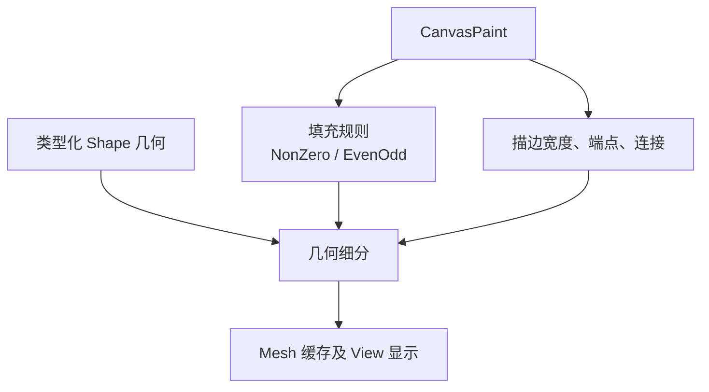

# 补齐 SVG 对齐的填充与描边规则

## 目标与机制

让 `CanvasPaint` 和通用几何细分完整表达方案确定的 SVG 风格填充与描边规则，尤其让一条 Path 的多个子路径能够正确形成孔洞、端点和连接。该增量改变的是**已有图形如何被填充和描边**，不新增图形类型或编辑工具。

## 填充规则

支持 `NonZero` 与 `EvenOdd` 两种 SVG 语义，**Canvas 默认 NonZero**。多子路径内部空洞、自交路径的可见填充依赖所选规则和必要的轮廓方向。填充规则是图形 Paint 的属性，不通过增加图层、生成独立 Path 或改变 Shape 身份表达。

`lyon` 的 `FillOptions` 存在自身默认规则，与 Canvas 默认不一定相同，因此实现中要显式指定 NonZero，而不是错误依赖库的默认值。EvenOdd 切换后应使对应网格失效并重新生成；原始命令不需重写。

## 描边规则

描边颜色和有限正宽度仍由 CanvasPaint 定义。端点至少支持 SVG 对齐的 **Butt、Round、Square**；连接至少支持 **Miter、Round、Bevel**。可配置样式参与细分缓存键与失效判断，开放子路径端点必须按对应 cap 绘制，拐点要反映 join 的差异。

一个 Shape 的填充和描边仍是统一顺序中的连续绘制单元，不让其他 Shape 的填充或描边插入其中；描边宽度和连接外延会影响边界计算与未来命中区域。

## 与前后方案的关系

此前 Path 已可用默认规则显示，本增量把样式补足到确定的 SVG 语义，为后续真实几何命中以及 SVG/PNG 同语义导出奠定基础。Rectangle 和 Ellipse 使用相同的 CanvasPaint 表达，不在不同类型上维护互不一致的填充规则解释。

## 验证与边界

构造外/内轮廓方向不同的多子路径，以及自交路径，比较 NonZero 与 EvenOdd 的孔洞和填充；验证 NonZero 默认选择是 Canvas 自身设定而非依赖库默认。分别测试 Butt/Round/Square 端点和 Miter/Round/Bevel 连接，检查开放/闭合路径差异、描边宽度变化、缓存失效及两个 View 一致显示。除既定 SVG 端点和连接语义外，不擅自引入画笔纹理、渐变、布尔形状操作或像素笔刷。
