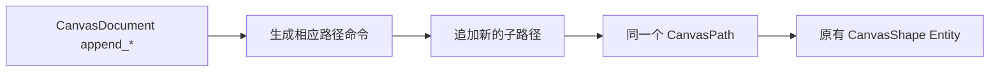

# 提供 Path 基础轮廓追加接口

## 目标与设计

为已有 `CanvasPath` 提供一组按几何类型展开的便利 API，使应用无需手写基础轮廓的 `MoveTo`、`LineTo`、`ArcTo` 与 `Close` 命令。这里交付的是**追加路径命令的模型能力**，不是把另一个独立图形嵌套进 Path。



## 支持范围及展开语义

基础轮廓包括矩形、圆形/椭圆、线段、折线和多边形等可用既有路径命令表达的图形。各 API 在目标 Path 上**开始一个新的子路径**，而不是将点错误连接到上一条子路径尾部。

例如接口 `append_rectangle(world, document, path_entity, rect)` 的效果等价于：

```rust
MoveTo(p0);
LineTo(p1);
LineTo(p2);
LineTo(p3);
Close;
```

线段和折线按其开放轮廓语义展开，多边形和矩形按闭合轮廓展开。圆/椭圆使用保持曲线语义的 `ArcTo` 等命令，不把圆弧永久转换成细分折线。已有 Path 的其他子路径内容不被替换；新增子路径同样使用 Shape 统一的 `CanvasPaint`、`Transform` 和 Document 顺序。

这些 API 不保存“新子路径来自 Rectangle/Ellipse”的元信息，不生成 `CanvasRectangle`/`CanvasEllipse` 组件或子 Entity，也不赋予它们尺寸控点。追加之后所有节点都像普通 Path 节点一样可随意编辑，甚至可以拉成非矩形、不规则曲线。

## API 契约与前后关系

API 应验证目标 Document 和 Path 的所属关系、路径种类、输入数值及生成命令的合法性，在成功前检查整体更新。失败不应产生部分追加结果。前序已经提供命令模型、通用细分及 Paint 规则，因此该增量可以独立以 API 输入与模型变化、可见图形结果验收；后续 PathNodeEdit 将直接编辑新生成的普通节点。

本机制不是参数图形转换：`create_rectangle` 创建独立参数化 Rectangle；`append_rectangle` 只向现有 Path 添加路径几何。特别不提供把一个已有 Rectangle Entity 转成可编辑 Path 的操作。

## 验证重点

逐种轮廓检查生成命令、子路径开放/闭合状态及曲线保真，验证已有多条子路径不受影响、新子路径不会被误连到旧终点、单次调用只更新原 CanvasPath 的一个 Shape Entity。通过统一几何管线确认两个 View 可见同样结果，并在无效 Path 目标、非有限参数或所属 Document 不符时拒绝而不留下半段命令。
