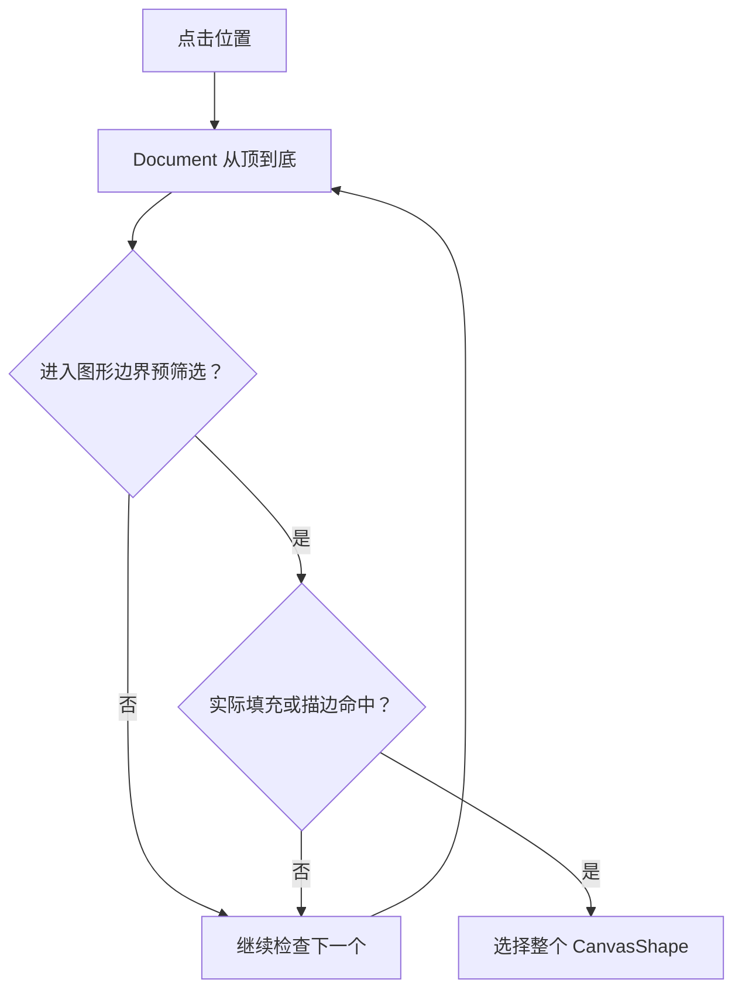

# 统一图形命中与选择覆盖层

## 目标与机制

将矩形专用选择扩展成 Rectangle、Ellipse 和 Path 均可使用的真实几何命中与选择 UI。仍先维持单个图形选择；后续另一个增量再将它扩展成多选集合。

## 真实几何与穿透规则

前后顺序只能由 Document 的唯一有序集合决定，遇到第一个实际命中的图形就停止。对 Path，命中可以来自符合 NonZero/EvenOdd 填充规则的真实填充区域，也可以来自描边附近的命中区域；描边应以**屏幕空间容差**处理，不能因为 View 缩放改变而变得难点。

整体包围框只做初步范围筛选、提供编辑框参考，**不是可点击的填充面**。点击 Path 多个子路径之间的空白，或点击填充规则形成的内部空洞，必须放过该 Path，继续检查更下方图形。点击 Path 任意一个子路径只选中整条 Path，不选出单独子路径 Entity。

一个例子：上方是圆环 Path，下方是橙色 Ellipse。点击圆环边缘选中 Path；点击环中央空洞穿过 Path，选中底下的 Ellipse；若两者都没有真实命中则为空选。这个规则与视觉上看到的有效填充、描边保持一致。

透明填充是否仍算有效的填充命中，原方案仍标记**待确认**。在确认前不得把“颜色 alpha 为零”自动等同于“没有几何填充”；对无填充的 Path 孔洞、包围框空白不命中则已经确定。

## View 选择覆盖层

所有类型都能显示独立于 Document 内容的整体选择框与旋转/缩放编辑参考。参数图形后续显示其类型化控制点；Path 后续有锚点和贝塞尔控点。覆盖层留在各 View 的离屏场景中，不生成新的 Document Shape，也不进入 SVG 或 PNG 导出。

选择框随着图形尺寸、实际描边外缘、`Transform` 和 View Zoom 更新。几何结果和编辑 UI 分开处理，不能通过点击空白包围框冒充对复杂 Path 的真实命中。现有鼠标/CustomPointer 的 Picking 与手势入口保留，Canvas 内部才决定哪一个 Shape 被选中。

## 依赖与验证

前序顺序、三种几何、Paint 填充规则使真实命中有明确语义。后续的单选旋转/缩放、Pen 和节点编辑在本能力之上提供各自手柄行为，不由本增量决定多选操作。

覆盖 Rectangle/Ellipse/Path 真实命中、描边边缘与不同缩放、开放路径、孔洞穿透、包围框内空白、多子路径任意一点选中整 Shape、两个重叠图形的自顶向下选择。多 View 的选中轮廓应各自存在、不进入导出、删除 Shape 后消失；不得添加新的 Layer、Group 或子路径实体。
