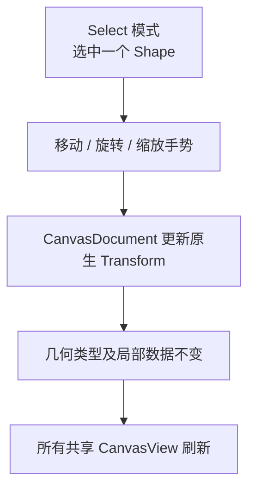

# 支持跨类型单图形移动、旋转与缩放

## 目标与操作模型

在统一 Shape 选择之后，让 Rectangle、Ellipse 与 Path 均继承现有 Canvas 的**单个图形整体移动、旋转、缩放**能力。这个功能修改的是图形的整体 `Transform`，与后续 Rectangle/Ellipse 参数控点修改尺寸、PathNodeEdit 修改内部节点是三个不同层次。

## 类型无关的整体变换

选中一个 Rectangle、Ellipse 或 Path 时，允许按原 Canvas 交互方式拖动移动，或通过单 Shape 的旋转、缩放控制点更新 `Transform`。这个操作不需要将椭圆或 Path 转换为矩形，也不会把 Path 中的子路径拆成各自独立的图形；对多个子路径的 Path 而言，整个 Shape 一起变换。

在局部几何计算与世界坐标之间保留原生 `Transform`，二维平移、绕 Z 旋转、可逆 XY 缩放遵循已经确定的校验。整体 Transform 更新不需要重新细分局部 Path；如果需要更新选择框或控制点位置，则在 View 覆盖层重算。原有矩形操作仍保持：第一次点击新图形只选择；对已经选中的目标发起后续拖动才移动，Space+Primary 优先平移画布，拖动的用途在手势期间保持。

单个 Shape 的控制框是编辑 UI，不是点击复杂 Path 空白包围框的通行证：从未选中的状态进行普通选择时仍要真实填充或描边命中；已选中时控制柄的命中另按编辑覆盖层处理。图形的共同前后顺序不因变换修改而改变，原 `Transform.z` 不作为层序依据。

## Pointer 生命周期

继续使用 `PointerId`、输入目标和 `PointerCaptureMap`，只由本次手势处理与其身份相符的 Pointer 事件；通过 Document API 实时提交 Transform，其他 View 可实时看到结果，但它们自己的视角、选择和预览不改变。正常 Release 完成，PointerCancel、失焦、View 禁用/不可用、Document 解绑或图形被删后结束手势并释放自身捕获，保留已提交变换。

是否让用户按 Esc 额外恢复本次拖动前的 Transform 是原方案待确认事项，不应擅自将 BRP 的取消等同于历史撤销。

## 相邻关系与范围

此前各类型已经具有独立身份、实际几何命中和显示代理；这一增量为它们赋予相同的**整体 Transform** 操作。后续的参数化控点修改 Rectangle 的宽高/圆角、Ellipse 半径，PathNodeEdit 修改路径节点；本方案不支持多选整体旋转/缩放，也不新增 Group。

## 验证

对 Rectangle、Ellipse、包含开放与闭合多个子路径的 Path 分别进行平移、旋转、非均匀缩放及镜像缩放，确认每种类型和其局部参数、原始路径命令保留；不同 View 实时一致，但各自 Pan/Zoom 不受影响。验证单选先选后拖、鼠标移出 View 后继续、Space 平移优先、滚轮期间抓取关系、手势终止/失效时捕获释放；确认单纯 Transform 更新不引发不必要的 Mesh 重细分或改变 Shape 顺序。
