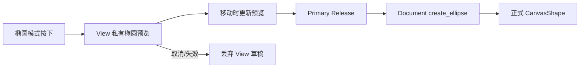

# 实现椭圆交互式绘制工具

## 目标与交互思路

在 `CanvasMode` 新增 `Ellipse`，让用户可以在 CanvasView 中直接按下、拖动、松开生成一个独立的参数化椭圆。沿用已有矩形“先预览、后提交”的交互规律，复用 Bevy Pointer 捕获与坐标转换，不让预览半成品污染共享 Document。

## 状态与几何

每个 View 自有模式和草稿，初始按下点及当前拖动点经过当前 UI 相机、Viewport、Node 变换及 View Zoom 转换到 Document 空间，推导椭圆中心和两轴半径。该几何属于 `CanvasEllipse` 参数，绝不能把预览或提交结果转成独立 CanvasPath。

在按下至松开期间，预览仅存在于当前 View 的离屏覆盖层，不进入 Document、不出现在其他 View 或 SVG/PNG 中。有效释放后一次性通过 Document API 创建新 Ellipse，并进入 Document 统一顺序的顶部；无效或不足以构成合法椭圆的拖动不写 Document。

Space+Primary 保留现有平移优先语义；拖动开始后模式不因中途改变修饰键而突然切换。切换工具、PointerCancel、失焦、View 不可用、Document 解绑等应清理预览并释放自己持有的 Pointer Capture；不得释放其他 Pointer 的捕获。矩形绘制的行为不应随椭圆模式添加而退化。

## 与前后增量的关系

此前已具备椭圆模型与绘制网格、统一图形选择；本增量只交付椭圆的交互创建。接下来的类型化控点编辑负责修改已创建的椭圆半径，而不是扩大绘制模式的职责。

## 验证

覆盖四个拖动方向、有限中心和半径、单击/过小输入不创建、预览只在当前 View 出现、提交后其他共享 View 看到新形状，以及图形默认置顶。结合 Pointer 捕获测试拖到 View 外、正常 Release、PointerCancel、切换模式、失焦与解绑清理。使用标准 CustomPointer 实际拖动验证输入路径，不能直接写椭圆 Entity 冒充 GUI 操作。
