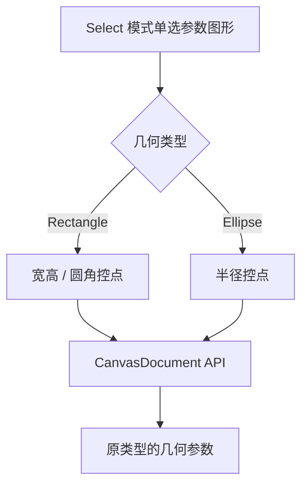

# 实现参数图形类型化控点编辑

## 目标与交互模型

让 Rectangle 与 Ellipse 在 `Select` 模式下直接修改各自的几何参数，而不是进入 Path 节点编辑。用户选中单个参数图形后，按类型展示和拖动控点，图形类型始终不变。

## 参数与变换边界

Rectangle 保留宽、高、圆角半径等参数。现有八向缩放及旋转的基本体验应继续可用；当提供圆角参数时，网格生成、边界计算和控点表达都必须反映实际圆角，不能只有数据字段而显示仍是普通直角矩形。Ellipse 根据半径控制尺寸，圆形仍只是两轴相等的椭圆。

图形整体移动、旋转、缩放使用现有 Bevy `Transform` 作为权威，而参数控点修改几何参数。对于尺寸控点，延续原有相对对边/对角固定、局部空间换算以及二维非均匀或镜像缩放的有效变换处理；不把拖动控点变成自动转换到 Path 的操作。已经支持的单图形旋转/缩放继续在 Select 模式使用，不能误作为多选整体缩放/旋转。

拖动控点时通过 Document API 实时更新，所有共享 Document 的 View 同步显示参数变化；控点和轮廓各自属于 View 覆盖层，不写入 Document 或导出结果。图形参数或影响细分的 Paint 变化需更新共享 Mesh；纯 Transform 变化不重新生成局部路径网格。

## 手势与保护

使用当前 `PointerId`、目标与 `PointerCaptureMap` 限定一次拖动，处理 UI 坐标到 Document、本地几何坐标的转换。正常松开完成；普通 `PointerCancel`、焦点丢失、View 隐藏/禁用、Document 换绑或图形失效则结束手势、释放该 Pointer 的捕获，**保留已经实时写入的参数修改**。不为 BRP 的自动化引入并发编辑锁。

`Esc` 是否要额外撤销进行中的拖动属于尚未决定的独立行为，不能默认把普通 PointerCancel 视作回滚。所有变更都必须遵守 Document 几何和二维变换有效性限制。

## 与相邻增量的关系

椭圆的独立创建和可见显示、三类型通用选择、Ellipse 绘制模式已经先行交付；本阶段专门完成参数图形编辑，与后续 Pen 和 PathNodeEdit 的自由节点编辑形成清楚的边界。

## 验证

测试矩形宽高和圆角、椭圆两轴半径修改，多个角/边控点、对边固定、旋转后控点定位、镜像/非均匀 XY Scale、极小尺寸校验与无效数据拒绝。变更后检查原几何类型始终保留，两个 View 实时一致，形状网格/选择框同步，取消和失焦清理捕获，既有矩形操作没有退化。
