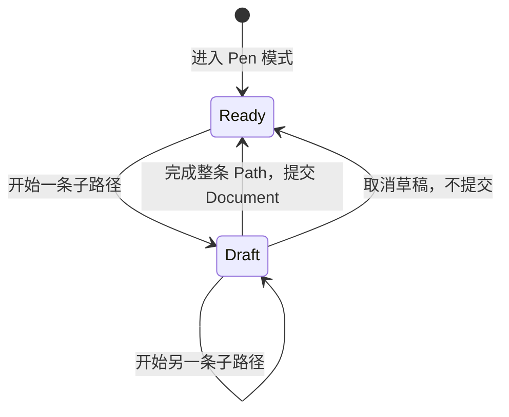

# 实现 Pen 多子路径草稿与提交

## 目标与核心交互

在 `CanvasMode` 中增加 `Pen`，通过用户输入逐步构造带直线、曲线及多子路径的 CanvasPath。Pen 是 CanvasView 的绘图模式，不是另一个 Widget；绘制期间只是 View 私有草稿，直到明确“完成整条 Path”才调用 `CanvasDocument::create_path` 创建图形。

与 Rectangle/Ellipse 的一次拖放不同，Pen 的关键是区分三个操作：**闭合当前子路径、开始新的子路径、完成整个 Path**。`Close` 只完成当前子路径的闭合，不隐式提交整个 Shape。一个 Path 可以同时包含多条相互分离、开放或闭合的子路径。

## 草稿位置与最终数据

草稿保存在发起交互的 CanvasView 一侧，包括当前命令、活动子路径、待确定的点或控制点，以及独立的预览几何。草稿不会提前生成 Document Shape，也不会影响其他 View、统一 Shape 顺序或导出。预览属于 View 的离屏编辑覆盖层，其 Mesh 资源按当前预览变化创建或更新，并在取消、完成、View 销毁时回收。

有效结束整个 Path 时，调用统一 Document API 一次性创建 CanvasPath 与其 Shape Entity，保留原始 `MoveTo`、`LineTo`、`QuadTo`、`CubicTo`、`ArcTo`、`Close` 命令，不把曲线和弧线永久细分为折线。新 Shape 加入 Document 唯一顺序的最上方，其他共享 View 随之显示。

**提交之后继续保持 Pen 模式**，用户可以立即绘制另一条新的 Path；只有显式切换模式才离开 Pen。这与原矩形工具一次绘制后自动返回 Select 的行为不同，不应混用。

## 输入生命周期和边界

统一使用已有 Pointer 身份、捕获、位置转换与焦点规则。普通取消、失焦或 View/Document 不可用时清理当前草稿及捕获，不生成半成品 Shape；只取消 Pen 草稿，不回滚任何已经提交到 Document 的其他图形。Space+Primary 平移应保留与原 Canvas 相同的优先约束，不让一次手势在平移、Path 草稿之间中途改变用途。

完成或丢弃草稿不等于删除其他 View 的选择结果；各 View 的模式、草稿、中心和缩放仍然独立。程序通过 `CanvasDocument::create_path` 创建 Path，不依赖 Pen 模式是否存在。

## 与相邻增量的关系

此前 Path 模型、绘制、样式、选择已经可用；Pen 只补齐“用户能创建 Path”的入口。下一增量接着支持对**已提交**的 Path 锚点和控制点拖动，不把草稿编辑与持久图形编辑混成一套生命周期。

## 验证

通过正常交互构造单子路径与多子路径、开放线段和闭合轮廓，分别执行关闭子路径、开始新子路径、完成 Path；确认 `Close` 不自动创建 Document Shape。检查绘制中只在当前 View 显示、提交后其他 View 可见且新增置顶，完成后仍处于 Pen 模式，再绘制会生成新的 Shape。测试 PointerCancel、模式切换、失焦、删除/解绑 Document 等清理，无效草稿不生成半成品。
