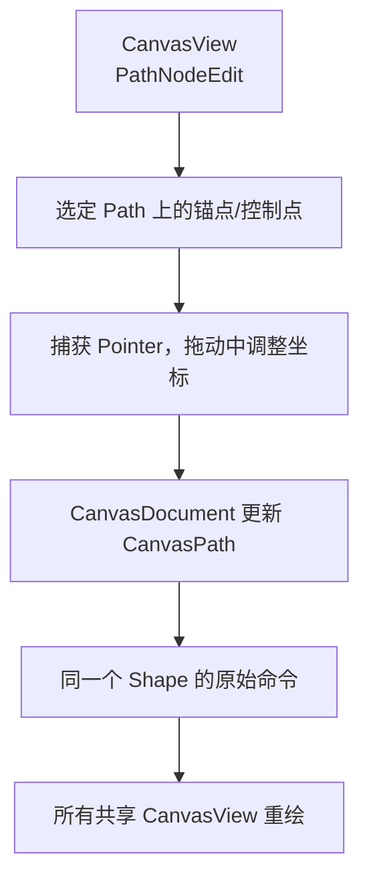

# 支持 Path 锚点与控制点拖动

## 目标与编辑思路

新增 `CanvasMode::PathNodeEdit`，允许用户编辑**已提交 CanvasPath** 的锚点及二次/三次贝塞尔控制点的位置。它只作用于 Path，不能改变 Rectangle、Ellipse 的参数化类型，也不把每个锚点创建成单独 Entity。

## 节点显示与状态归属

已选 Path 的锚点、贝塞尔控制点和连接线由当前 View 的编辑覆盖层呈现，不写进 Document 的图形集合，也不进入 SVG / PNG 导出。活动编辑目标应能定位到 Path 的相应命令/子路径与控制点位置，但这些标识是编辑过程所需状态，而不是新的 Shape Entity。

编辑数据在 Shape 的本地路径坐标内更新；Pointer 坐标从 View UI 坐标通过视图缩放/平移和 Shape 的二维 Transform 转换后，按对应锚点或控制点产生修改。`Transform` 始终是整体移动、旋转、缩放的唯一权威，不因局部节点变化复制另一套整体变换。

## 实时提交与终止规则

拖动过程通过 `CanvasDocument` API 实时写入更新的原始 CanvasPath，Mesh 缓存随命令变化失效并重新细分，所有共享 Document 的 View 立即看到曲线变化。普通 Primary Release 表示完成；PointerCancel、失焦、View 失效或更换 Document 则停止手势并释放原 Capture，保留已实时提交数据。

用户按 Esc 是否恢复本次拖动前的几何，仍是独立待确认项。不能将 BRP CustomPointer 的取消当作 Esc 撤销，也不增加跨 View 图形锁或多操作者事务。保证单次手势只消费匹配的 PointerId 与目标输入，其他 Pointer 捕获不由该 View 释放。

## 与相邻增量的关系

此阶段交付“拖动现有锚点与 Bézier 控制点”；后续增量再加入锚点增删、线段与曲线互转、子路径开闭等**拓扑修改**。先拆开两类编辑，使自由曲线拖动可以独立验收，而无需把整个节点编辑器塞进同一提交。

## 验证

选择含多子路径的 Path，分别拖动 MoveTo/LineTo 锚点、QuadTo 单控制点和 CubicTo 双控制点，确认未被编辑的命令保留；旋转、镜像、缩放后局部坐标正确，所有 View 同步显示且 Mesh 随命令更新。检查其他图形类型无法进入 Path 节点编辑，节点无额外 Entity，控制点不导出；用 CustomPointer 真实拖动与普通 Cancel 覆盖捕获收尾。
