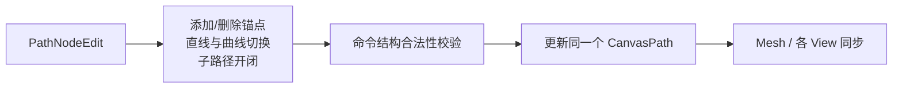

# 支持 Path 节点和子路径结构编辑

## 目标与机制

在已有 PathNodeEdit 的节点拖动上，增加对**路径拓扑与命令类型**的修改能力：添加、删除锚点，在线段与贝塞尔曲线之间切换，以及打开、闭合和分别修改多条子路径。

## 命令修改的语义

这些操作直接修改原始 `MoveTo` / `LineTo` / `QuadTo` / `CubicTo` / `ArcTo` / `Close` 命令序列，而不是替换成细分折线、复制一份独立路径，或新增图形实体。新增锚点要落在指定子路径的正确命令位置；删除节点要保持剩余路径的命令关系有效。将线段改成曲线或反向转换，应以相应命令的几何含义更新原始数据。

`Close` 只闭合指定子路径，不完成整条 Path；打开子路径不能误删其他独立子路径，开始新子路径仍使用自己的 `MoveTo`。同一个 Path 的所有子路径始终共享一个 Shape、一个 `CanvasPaint`、一个整体 `Transform` 和一个 Document 顺序位置。

用户在 PathNodeEdit 中可以针对不同子路径分别操作，但普通 Select 模式只选择、拖动整条 Path；两种编辑粒度必须清楚分离。

## 校验与更新

通过统一 Document API 检查修改后的整条命令序列、目标 Path 和 Document 所属关系，以及有限坐标、曲线/弧参数。只有合法结果才替换权威路径，失败时不应留下半条子路径或不完整命令。每次有效修改使对应绘制缓存失效、各 View 实时同步，且不改变其他 View 的中心、缩放和选择状态。

节点和控制点继续由 View 编辑覆盖层绘制、清理；SVG/PNG 最终必须输出改变后的权威命令而非在途控制点。普通 PointerCancel 只清理正在进行的手势，保留已经有效提交的编辑。`Esc` 恢复拖动前数据是待确认的独立用户体验，不在这里暗中定义回滚规则。

## 与前后增量的关系

先有 Path 命令模型、PathNodeEdit 节点拖动，才有可靠的命令拓扑修改。后续多选是 Shape 级交互，与节点级编辑不是同一种选择集合，不将节点并入 CanvasView 的多 Shape 选择状态。

## 验证

覆盖直线段内部添加锚点、删除首/中/末节点、直线改二次和三次贝塞尔再转换、开放与闭合切换、多子路径分别操作；确保只修改指定子路径，不意外关闭或删除其他部分。对失效索引、非法命令顺序及非法数值返回拒绝且原数据完整。通过两个 View 和 PathNodeEdit 覆盖层确认更新、命中、Mesh 变化一致。
