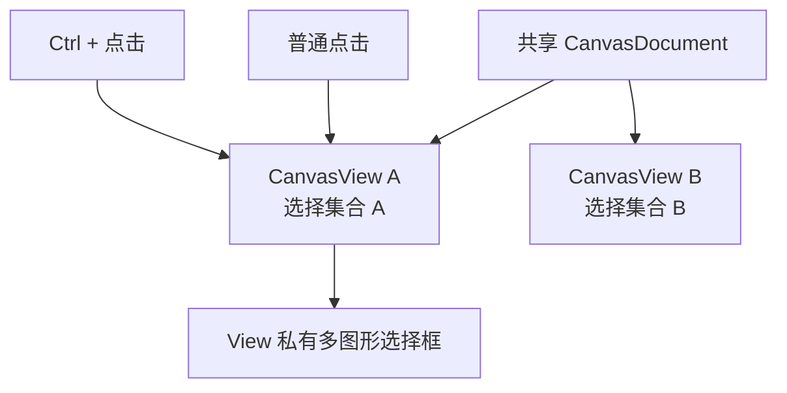

# 让 CanvasView 支持独立多选集合

## 目标与机制

将 `CanvasView` 的单一 `Option<Entity>` 选择状态扩展为**同一 Document 的 Shape 集合**，允许单击单选和 Ctrl+单击切换成员。此增量交付可见的多图形选择与正确的独立 View 状态，不把多选立即等同于图形分组或批量变换。

## 选择语义与命中

普通点击从 Document 自顶向下找第一个**真实几何命中**的 Shape，然后将当前集合替换为单个命中项；点击空白则清空。`Ctrl + 点击` 对命中的 Shape 执行添加或取消选中，其他成员保持。Path 依旧以整体 Shape 为选择单位，即使命中它的某条子路径；包围框空白与内部空洞不额外产生点击目标。

每个集合的成员只允许来自当前 View 关联的 Document，已删除或脱离 Document 的实体应被修复。两个 View 可以分别选择不同的 Shape 组合，而不会在 Document 上保存“全局当前选中集合”。选中轮廓和每个 Shape 的参考框分别属于对应 View 的编辑 UI，不出现在导出中。

原有 `CanvasSelectionChanged` 等对外事件/查询需要随选择状态的语义同步调整，不允许继续误报“只有一个选择”。对外公开选择集合的实际类型及消息布局在实现中确定，但行为必须完整且不隐式创建 Group。

## 单图形编辑的边界

单个选中时保持已实现的移动、旋转、缩放、矩形/椭圆参数控点和 PathNodeEdit 交互。多选阶段**不执行整体缩放或旋转**；不同图形被同时选中也不改变它们各自的 `Transform`、Paint 或 Document 排序。下一增量才提供多选同步移动和删除。

## 与前后增量的关系

此前几何命中与各 View 的覆盖层已经基于 Shape 身份运行，此处只扩展 View 选择集合。下一阶段在该集合上实现批量拖动和删除，避免在修改选择 UI 的同时混入批量 Document 写入逻辑。

## 验证

测试普通单击替换、点击空白清空、Ctrl+点击添加/移除、重叠图形依真实命中从顶到底选择、Path 空洞穿透及任意子路径选中整 Shape。检查两个 View 的多选独立、某个成员删除时选择集合修复、切换 Document 取消旧选择以及多图形轮廓不进入 SVG/PNG。
