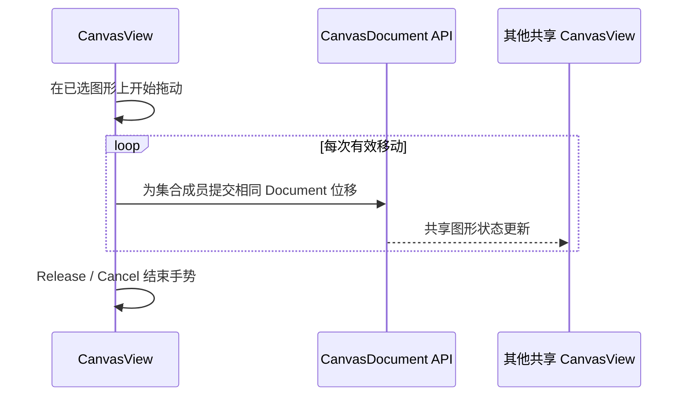

# 实现多选图形批量移动与删除

## 目标与交互机制

在已有多图形选择集合上，让用户拖动任意一个选中 Shape 时**整体平移当前选择集合**，并允许 Delete 删除所有已选 Shape。图形身份、几何类型和叠放顺序仍分别保留，不产生 Group 或共用变换组件。

## 批量平移语义

移动必须以 **Document 空间中的同一位移向量**更新所有已选 Shape 的 `Transform.translation`，而不是给每个图形重新计算不同的拖拽抓取点。这样不同类型、尺寸和原有旋转/缩放的 Shape 都能保持相对位置关系。原来的单图形拖动继续保留；单选时不因改成集合模型而改变抓取体验。

拖动过程中通过 Document API 实时提交合法更新，其他共享 View 立即显示各 Shape 的变化，但其各自选中集合、Pan/Zoom/预览保持独立。多个图形之间仍有 Document 唯一全序，批量移动不改变排列，不实现整体旋转或缩放。

对于批量更新，应在提交前检查所有成员的所属关系与变换有效性，避免部分 Shape 已移动、另一部分因失效未动的错误状态。删除所有选中 Shape 同样需要使 Document 顺序、其他 View 选择集合、活动手势、代理和共享 Mesh 引用得到一致清理。

## 指针与键盘收尾

手势按既有 `PointerId`、目标和 Capture 路由处理；Primary Release 完成，PointerCancel、失焦、隐藏/禁用、View/Document 失效则释放捕获并停止，保留已经提交的位移。已选成员在拖动途中被删除或改属其他 Document 时不能继续向旧 Entity 写入。

Delete 只在输入焦点属于有效 CanvasView 时作用于它当前的选择集合，不能抢占 TextField 或其他控件的键盘输入。BRP CustomPointer 和真实鼠标共用这条输入协议，不需要图形级锁或双操作者协作机制。

`Esc` 是否额外支持主动恢复本次批量拖动的初始位置仍是待确认产品行为；不等同于普通 PointerCancel，更不引入 Undo/Redo 历史系统。

## 与相邻增量的关系

前序多选提供集合和覆盖层，本增量才提供集体移动/批量删除，之后 SVG/PNG 导出仅消费最新 Document 数据和其原有顺序，不关心这些 Shape 曾经是否被同时选中。

## 验证

选择不同种类的多个 Shape，拖动其中一个，检查位移相同、相对距离不变、类型/旋转/缩放/层序不变；正常 Release、取消、焦点转移、不同 View 实时同步、移动途中成员失效都应正确处理。Delete 删除全部选中成员、清理其他 View 的失效选择并释放资源；焦点不在 Canvas 时不得误删。检查多选时没有整体旋转/缩放行为，既有单图形移动未回归。
