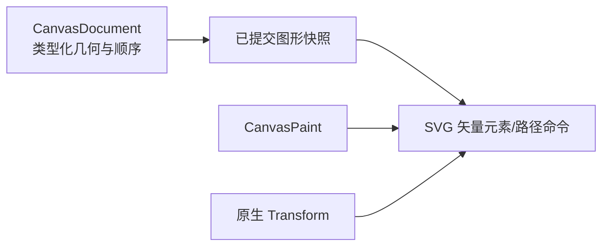

# 导出保留路径语义的 SVG

## 目标与整体机制

将 SVG 导出从矩形专用快照扩展为所有已提交的 Rectangle、Ellipse 和 Path，保留原始矢量几何、样式及 Document 绘制顺序。这是可独立使用和验证的**矢量文件输出功能**，不与 PNG 的 GPU 离屏读回混成一个实施增量。

## 快照与图形输出

导出只读取 Document 已提交 Shape 和它们的有效变换、样式与顺序；不取当前 CanvasView 的 Pan/Zoom、选择集合、轮廓、节点控制点或 Pen 在途草稿。快照在一次请求中保持独立，后续 Document 修改不改变该次文件内容。导出区域指定或由有效图形边界推导，沿用区域有限、尺寸为正、空 Document 等既有错误契约。

Rectangle / Ellipse 保留其参数图形的几何效果，Path 直接输出原始 SVG 风格命令，包含 `MoveTo`、`LineTo`、`QuadTo`、`CubicTo`、椭圆 `ArcTo` 和 `Close`；多个子路径及开放/闭合信息不能因转换丢失。不能把曲线/椭圆弧写成网格三角形或永久折线，再宣称是原始路径导出。

导出 `CanvasPaint` 的填充、描边宽度和颜色透明度、`NonZero`/`EvenOdd` 填充规则及 Butt/Round/Square、Miter/Round/Bevel 样式。对 SVG 的弧标志、轴旋转、路径方向和孔洞语义保持和 View 显示一致。有效二维 `Transform` 应正确应用到图形，不把 Transform.z 当作新的排序依据。

## 绘制次序和遮挡

对 Document 的 `shape_order` 从底到顶输出；同一 Shape 的填充与描边作为连续的绘制单元，避免后方图形的描边穿过前方图形。按旧 `Transform.translation.z` 或 `z + 0.01` 全局交错排序的逻辑必须退出。

验证场景：外轮廓/内洞的 Path 覆盖在椭圆上方，圆环的填充与线宽、孔洞方向、Ellipse 的可见部分应与 View 一致。不同 View 即使缩放与选择不同，对同一 Document 的 SVG 结果也相同。

## 校验与其他增量的边界

沿用有效几何、正尺寸区域、颜色可输出范围、文件 IO 失败等明确错误；对不属于 Document、缺失必要组件或非法路径的数据要报告错误而不能静默跳过。默认 PNG 离屏结果的一致性在下一增量完成，当前只负责 SVG 及其可核对的几何语义。

## 验证

导出三类图形、各类曲线与弧线、多开放/闭合子路径、NonZero/EvenOdd 空洞、各端点和连接形式、透明填充/描边及二维变换。解析 SVG 或使用可靠 SVG 渲染对比判断轮廓与遮挡，验证顺序重排、导出区域、无效几何和文件写入错误。确认编辑控点、选择框、在途草稿、View 缩放/平移不会进入 SVG，且已导出的文件不随后续 Document 更新变化。
