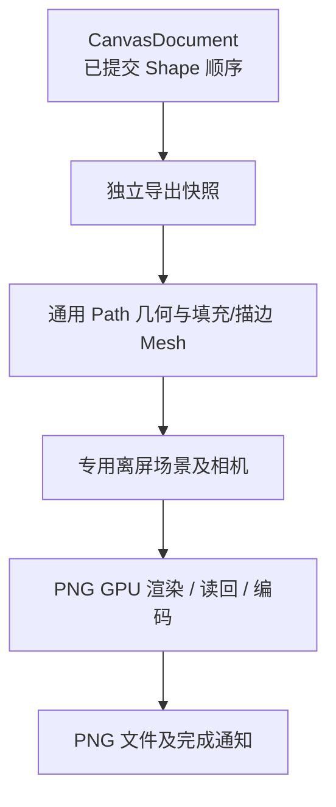

# 将通用图形接入 PNG 离屏导出

## 目标与机制

将现有 Canvas PNG 离屏导出从矩形专用几何扩展为 Rectangle、Ellipse、Path 通用图形，保证结果与 CanvasView、已实现的 SVG 导出在形状、填充和叠放次序上保持一致，同时保留当前 PNG 独立请求和像素读回的工作方式。

## 通用几何快照

离屏导出在请求开始时获得独立的 Document 图形快照，不修改共享 CanvasView 的场景、相机、目标、中心和缩放。快照包含已提交的几何、Paint、原生 Transform 和 Document 顺序；Path 的多个子路径、曲线、弧线和填充规则用与 View 相同的细分几何绘制，不能退回矩形网格或因无 View 存在而缺少图形。

PNG 沿用现有独立 Image / RenderLayers / 专用 Camera，以及 4×MSAA、透明 RGBA 和 StraightAlpha 转换的机制。导出区域与缩放由请求参数确定，不把设备窗口缩放、View Pan/Zoom、背景、节点/选择控点或正在绘制的草稿写入输出。

## 唯一绘制顺序

导出的代理按 `CanvasDocument` 的 `shape_order` 从底到顶组织。内部可给专用代理分配实际渲染深度，但这是对顺序的映射，不能由 Shape 旧的 `Transform.z` 再次排序。单个 Shape 的填充与描边连续绘制，后方图形描边不得跨过前方图形填充。

例如在圆环 Path 下方放一个橙色椭圆；PNG 中环的真实透明洞应露出橙色区域，EvenOdd/NonZero 的差异也应与 SVG 和 View 相同。不能出现一边图像显示洞，另一边导出被意外填实的情况。

## 错误、资源与前后关系

延续 PNG 请求对有效区域、有限正缩放、图像分辨率限制、Renderer 不可用、GPU/编码/IO 失败的错误反馈和完成通知。多个导出请求维持彼此独立的 Image、场景及快照生命周期，成功、失败和取消后清理专用资源；不能借导出触发对 Document 几何或正常 View 的写入。

前一增量交付 SVG 保真路径输出，这个增量完成通用 PNG 视觉呈现，并针对全部 Shape 完成跨 View、SVG、PNG 的一致性检查。相关验证与本次 PNG 实施一并完成，不另建一个纯验收方案。

## 验证

覆盖三种图形、开放和封闭 Path、SVG ArcTo、Bezier、线帽/线连接、NonZero/EvenOdd 孔洞、透明颜色与描边外缘；检查重排后 View/SVG/PNG 的前后遮挡一致。测试自定义导出区域、缩放、分辨率极限、空/非法 Document、Renderer 不可用、GPU 失败与文件错误；多 View 独立、没有任何 View 时导出仍有效，导出过程不影响原 View。确认已提交形状正确、节点控点与预览不出现在像素中。
