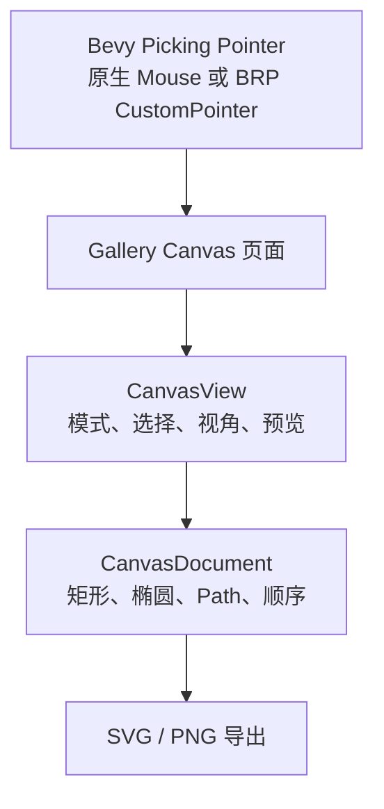

# 在 Gallery 提供多图形编辑演示

## 目标与交付

更新 Gallery 的 Canvas 页面，使轻量级多图形绘图能力拥有一个可直接操作、观察和自动化调试的实际入口。此目标交付的是**真实的可用演示界面**，不只是运行一次已有测试或生成验收报告。

## 演示入口与数据观察

Gallery 页面应能切换 Select、Rectangle、Ellipse、Pen、PathNodeEdit，展示多种参数图形和至少一条含直线、二次/三次曲线、ArcTo、多子路径的 Path。通过同一页面可观察图形叠放调整、真实几何命中及孔洞穿透、圆角/半径控点、Path 节点操作和基础轮廓追加后的效果。

使多选集合、Ctrl+点击切换、批量拖动/删除可以在实际 View 中被操作和观察；同时能够表现“各 View 选择及预览独立，共享 Document 图形实时同步”。已有 View Pan/Zoom 和矩形绘制能力应继续可用；不需要添加新的 Layer、Group、整体多选旋转/缩放入口。

SVG 和 PNG 导出的可见结果应能与 Gallery 画面核对，且不包含选择覆盖层、在途草稿或某个 View 的 Pan/Zoom。这里是对已交付导出功能的集成展示，不另造一套导出算法。

## Pointer 与自动化边界

Gallery 的真实输入通过 Bevy Picking 进入 Canvas。BRP CustomPointer 是用于 GUI 调试和自动化的独立输入来源，不等同于 OS 鼠标，也不应通过直接修改 ECS Component 代替鼠标点击/拖动的验收。使用 BRP 期间不并行使用物理鼠标；完成操作后释放 Pointer 控制并检查状态完成收敛。Canvas 仍沿用 `PointerId`、目标及 `PointerCaptureMap`，无需识别 BRP UUID 或提供 BRP 专门编辑 API。

运行时应通过截图、ECS 状态、日志和有效输入事件共同核实行为；BRP 请求已接受不等于 Canvas 操作已成功。不将不可由 CustomPointer 忠实验证的原生窗口移动等 OS 级行为宣称通过。

## 与前序方案的关系

此前各增量已经分别交付模型、几何、交互和导出，Gallery 在其上提供一条完整实际操作路径。这里不重复开发其内部功能，也不另开纯回归阶段；集成中发现问题时由受影响功能对应的实现闭合修复，并重新核对直接受影响部分。

## 可观察验收

在 Gallery 中实际完成：创建 Rectangle 与 Ellipse、绘制并提交多子路径 Path、编辑曲线控制点、追加基础轮廓、上下重排图形、点击环形 Path 的空洞穿透到下方 Shape、Ctrl+点击多选及批量移动/删除；观察两个 View 同步图形但选择/缩放/草稿不同。以真实 Pointer 点击/拖动、键盘焦点、截图及 Document 数据验证结果，检查正常 Release、PointerCancel、失焦、关闭/解绑 View 清理捕获，且 SVG/PNG 与视图几何及遮挡一致。

Gallery 不变成完整矢量设计应用：不加入多图层、永久分组、完整 Undo/Redo、笔刷压感、纹理画笔、像素橡皮擦、渐变、布尔形状运算或多人并发编辑。
