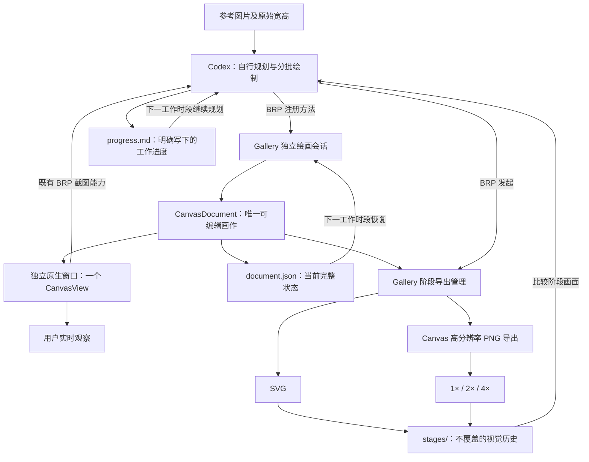

# Canvas 动画人物复刻实验：整体设计

这次实验想检验 Canvas 已有二维矢量模型，能在多大程度上复刻复杂动画人物画面。绘画者拿到参考图后自行决定构图与绘制顺序，通过 BRP 对正在运行的 Gallery 提交图形操作；用户在**独立的原生绘画窗口**实时观察，而不必占用现有 Canvas 控件演示页面。绘画过程支持随时导出同一画布范围的 SVG、1×、2×、4× PNG，并在不同 Codex 工作时段之间恢复。

工程能力与绘画实验分开：新增实验窗口、Gallery BRP 接口、工作存档、阶段导出管理以及 Canvas 高分辨率 PNG 改造，都需要针对代码变更测试和 Code Review；具体复刻图像的每次画笔、调整、删除和重画不要求逐笔测试或 Review。工程准备好之后才开始正式绘画；绘画中若发现真正的程序缺陷，作为工程修复单独处理。

## 独立实验与原有 Gallery 演示的关系

实验窗口是新的、可调整大小和最大化的 Windows 原生窗口，窗口里只有一个 CanvasView，画面自动适配可用显示区域；不设置简洁工具栏、导出按钮或其他绘图控制 UI。Codex 通过 BRP 创建/打开窗口与会话、绘制、编辑、查询和导出。窗口不依附于 Gallery 的页面切换，关闭窗口不使已保存的作品丢失，再打开或重新启动后可以恢复。

**现有 Gallery Canvas 演示保持原样**：两个共享 Document 的 View、示例形状、工具栏、现有导出按钮和演示页面生命周期都不应因实验而被替换、搬迁或删除。实验使用自己的 Document、窗口和会话状态，也不把原演示的 SVG/PNG 按钮接入实验阶段管理。Canvas 库已有的多 View 共享能力仍保留，但这次绘画实验只用一个 View。

BRP 不能任意执行尚未注册的 Rust 函数；Gallery 通过自定义 Remote Method（可配置 Agent Tool 元数据）把远程请求转成对现有 `CanvasDocument` 公开业务 API 的调用。无须修改 BRP 框架，也不为实验在 Canvas 中新建一套绘图 API。

## 固定的画面与成果规则

- 参考图原始宽高在会话初始化时给出，固定作品区域为 Document 坐标 `Rect(0,0,width,height)`。坐标单位与参考图原始像素对应。Document 本身依然没有硬边界，越界几何可以存在，导出时才裁剪。View Zoom/Center、窗口大小和 DPI 都不影响导出范围。
- 绘画只能使用现有 Rectangle、Ellipse、Path、Paint、Transform、层序及相关公开业务 API。任意复杂轮廓可以靠直线、二次/三次贝塞尔曲线、圆弧和多子路径组合。禁止直接显示参考图纹理、绕道使用 Bevy 其他绘制系统，或为一张画增加 Canvas 图形原语。唯一允许修改 Canvas 内部的例外是高分辨率 PNG 导出。
- 每次 BRP 提交可以包含多项绘图操作。**选用部分成功语义**：前面已经成功的操作保留，不因后来某项失败整体回滚；返回逐操作的实际结果，持久化真实生效状态。是否在错误后继续执行后续项，可由接口设计明确，但绝不能误报整批成功。
- 输出根目录固定为 `gallery/exports/<会话ID>/`。实验阶段成果放入 `stages/`，每个阶段一份 SVG、三份 1×/2×/4× PNG，全部来自同一画作快照；新导出绝不覆盖历史文件。新会话目录也不能与旧会话冲突。
- `document.json` 是当前画作的可编辑状态及会话信息，允许可靠覆盖更新；`progress.md` 是 Codex 主动写出的构图、已完成部分、困难与下一步。二者足够用于跨工作时段继续，不要加入 `operations.jsonl`、独立 `session.json` 或每阶段完整 Document 备份。存档仅覆盖实验 BRP 绘图，不扩展为 Gallery 手工编辑的通用持久化。
- Canvas 原有 PNG 导出按像素预算限制 512 MiB；4× 等高分辨率目标需要改造峰值资源占用。优先分块渲染/读回与流式输出，不只是调高限额，保留画面色彩、透明度、抗锯齿以及异步 Job 取消与清理语义。

## 功能关系与实施顺序

独立窗口/会话确定绘图目标；BRP 绘图操作作用于该目标；工作存档保存并恢复这些操作的实际结果。Canvas 高分辨率 PNG 改造与存档没有直接数据依赖，但它是四倍率阶段导出的前提。阶段导出和跨时段续画就绪后再进行实际动画人物复刻。以下为唯一实施顺序，编号相邻不代表每两个增量都存在技术硬依赖。

1. [Gallery 独立绘画窗口与固定画布会话](01-gallery独立绘画窗口与固定画布会话.md)
2. [Gallery BRP 绘图接口与实时反馈](02-gallery-brp绘图接口与实时反馈.md)
3. [实验画作存档与跨时段恢复](03-实验画作存档与跨时段恢复.md)
4. [Canvas 高分辨率 PNG 导出](04-canvas高分辨率png导出.md)
5. [Gallery 不覆盖的阶段导出](05-gallery不覆盖的阶段导出.md)
6. [通过 BRP 复刻动画人物画作](06-通过brp复刻动画人物画作.md)

每个工程增量就地完成针对其改动的测试、错误路径检查、必要文档同步与 Code Review，不独立增加一个纯验收阶段。最后的艺术绘画以实时画面、阶段图像、存档可继续性来判断，不把是否像参考图转成强制的程序测试。
