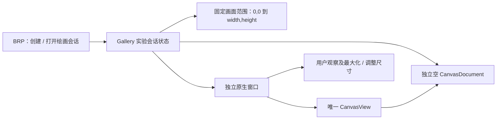

# Gallery 独立绘画窗口与固定画布会话

Gallery 已有的 Canvas 页面是控件演示：进入页面会构造示例 Shape，两份 CanvasView 共享一份 Document，离开演示页面就清理该页对象。动画人物复刻需要另一种工作场景：由 BRP 创建一份空白作品，在**专用 Windows 原生窗口**中显示，窗口大小可以随时改变或最大化，且不随着 Gallery 页面切换而消失。

本增量交付的是可通过 BRP 创建/定位的实验会话和唯一的绘画窗口，不在这里实现具体图形批量绘制、磁盘恢复或阶段导出。会话将作为后续 BRP 操作和存档的目标。

## 会话身份与作品范围

初始化输入至少包含参考图的原始像素宽高。每个有效会话获得唯一 ID，关联一份无默认示例 Shape 的 `CanvasDocument`，及固定的 Document 区域 `Rect(0,0,width,height)`。例如 1920×1080 的参考图，对应坐标从左上角 `(0,0)` 到右下角 `(1920,1080)`。这样绘制中即使只有一个眼睛，后续阶段仍能导出整个固定画幅，而不是按照已有图形 AABB 收紧。

画幅不是 Document 的硬边界。背景、发丝、服装边缘或任意 Path 可以超出画幅；导出时裁剪。Document 初始是透明的业务模型，作品需要实际背景色时，应由后续绘图操作使用 Canvas 公开 API 创建背景图形。不能把窗口或 View 的 BackgroundColor 当成会被导出的作品背景。

会话目录固定在项目 `gallery/exports/<会话ID>/`，与 EXE 位于 Debug、Release 或其他路径无关。会话 ID 可基于易读时间戳生成，但遇到重名必须新建唯一目录，不能接管或覆盖既有作品。目录定位策略应有稳定项目根，而不能依赖启动命令的当前工作目录。BRP 会话查询至少能获得会话 ID、画幅宽高/区域、运行时 Document 标识、导出目录和绘画窗口身份；Entity 仅是进程内引用。

## 独立窗口及画面适配

实验会话的可视部分是一扇独立的原生 Windows 窗口，内部只放一个 `CanvasView`，不添加工具栏、保存按钮或第二个 View。窗口支持原生调整尺寸与最大化，CanvasView 占用绘画可用空间，依据作品区域居中和调整 View Zoom 以尽量完整显示画幅。窗口的物理尺寸、DPI、UI Scale、Pan/Zoom 都只影响观察，不改变业务坐标与导出尺寸。需要遵守现有 CanvasView Zoom 允许范围，不能为适配窗口擅自改动底层绘画模型。

窗口创建、打开与会话定位由 Gallery 注册的 BRP 方法完成，不要求人手在原 Gallery 页面找到入口。会话和 `CanvasDocument` 的归属独立于现有 `GalleryPage::Canvas`；用户切换原 Gallery 页面时绘画窗口保持，普通关闭绘画窗口不等于退出 Gallery 主程序。关闭窗口后已成功持久化的作品仍可在下一次打开窗口或下一次工作时段恢复；具体磁盘重建由存档增量负责。

## 与旧演示的边界

既有 Canvas 页面保留双 View、示例形状、手工编辑工具、原来的 `canvas.svg` / `canvas.png` 演示导出和生命周期。它不复用实验 Document，也不管理实验窗口；新建独立窗口不需要替换、隐藏或修改原页面 UI。底层 Canvas 继续允许一个 Document 被多个 View 共享，只是这次实验不使用该演示结构。

Gallery 可以继续复用已安装的 CanvasPlugin、现有窗口设施及 BRP Runtime。BRP 只能调用应用显式注册的方法，窗口操作在 Gallery 自身实现，不需要修改 BRP 框架或为 Canvas 库增加一套窗口 API。

## 验证与限制

通过 BRP 创建不同合法尺寸的会话，并能查询正确画幅、目录、窗口与 Document；新窗口只有一份 CanvasView 且没有示例内容。改变窗口大小、最大化以及改变 DPI/显示比例时，画面适配可用区域，固定画幅坐标保持不变。切换原 Gallery 页面不影响实验窗口；关闭实验窗口不关闭主 Gallery，也不修改旧 Canvas 页面行为。

非法宽高、不可表示的区域、路径定位失败、同名会话目录不得破坏已有会话或覆盖旧成果。若原有 Zoom 范围使极端宽高比无法完全显示，应该可明确识别这种显示限制，而不是修改固定导出范围来假装适配成功。相关实现需要工程测试和 Code Review；不在此测试画作艺术质量。
