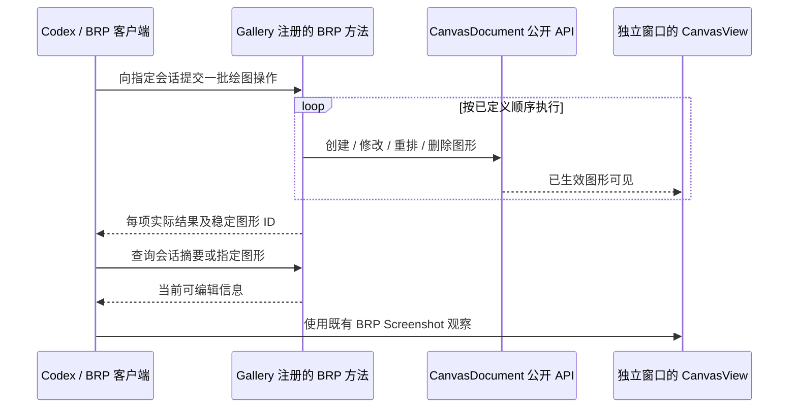

# Gallery BRP 绘图接口与实时反馈

这个增量把独立绘画会话变成 Codex 可直接驱动的运行时 Canvas。每批绘制通过 BRP 发送给 Gallery，Gallery 解析请求并调用 `CanvasDocument` 现有公开业务 API，独立窗口的 CanvasView 根据同一份 Document 实时显示最新内容。绘画者不用反复修改 Rust 代码、重新编译或重启 Gallery；窗口也不需要任何绘图工具栏。

BRP 本身不会自动暴露任意 Rust 函数。这里的工作是为 Gallery 注册所需的自定义 Remote Method，可以附带 Agent Tool 元数据供 Codex 发现；方法内部使用既有 Canvas API，不改动 BRP 框架，也不另造一个渲染系统。

## 操作范围与唯一绘图通道

BRP 应能创建 `Rectangle`、`Ellipse`、`Path`，设置 `CanvasPaint` 和 `Transform`，并对已有图形进行更新、删除、调整叠放顺序。Paint 包含可选纯色填充、NonZero/EvenOdd 填充规则、可选描边及颜色、宽度、Butt/Round/Square 端点、Miter/Round/Bevel 连接。Transform 包含平移、绕 Z 轴旋转和整体 Scale。Path 必须完整传递原始 `MoveTo`、`LineTo`、`QuadTo`、`CubicTo`、`ArcTo`、`Close`，能表示开放/闭合、多子路径与孔洞；不把曲线强行退化成折线。

对于复杂人物，多个 Shape 可以描述独立发丝、瞳孔、阴影或衣褶，也能在一个 Path 内使用多个轮廓。移动、旋转、缩放、Paint/Path 修改与重排都调用已有业务接口，使 Geometry、Transform、Paint 和实际图层顺序保持 Canvas 的权威语义。禁止通过 BRP 私自写 Shape、Paint 或 Transform 组件以绕开业务校验，也不能把参考图片贴成纹理，或改用 Bevy 的其他绘制通道实现画面。

## 稳定 ID、批次与部分成功

在 BRP 参数中使用会话内稳定的业务图形 ID，返回创建结果时给出该 ID，随后可通过 ID 精确定位和修改。运行时 Entity 映射不能作为跨进程永久身份；后续从 `document.json` 恢复时应能重新建立相同业务 ID 到新 Entity 的关系。BRP 需要明确作用的会话 ID，避免向旧 Canvas 演示的 Document 误写。

一次 BRP 请求可以包含按顺序排列的多项绘制动作，减少复杂路径场景中单控制点往返的开销。**确定采用部分成功语义**：若第 87 个操作失败，之前已经成功执行的操作保留，不做整批回滚。响应需要清楚标明哪些操作成功、失败项及原因、创建图形的 ID，以及请求结束后的实际状态；不能只给一个模糊的“失败”并让 Codex 猜测前 86 项有没有生效。遇到失败后停止批次还是继续尝试后续独立操作，可由接口实现时定义并公开，但不能隐式改变已经提交的成功结果。后续存档应保存本批真实已生效状态，而非原始请求意图。

批次大小、具体方法名、请求 JSON、依赖前面创建结果的引用方式以及错误码等由本增量确定，须能支撑大规模图形并保持结果可理解，不把实验 BRP 端点宣称成 Canvas 正式公共协议。

## 查询和实时观察

对复杂画作，不应每次绘图前后都返回完整数 MB 的 Document JSON。BRP 提供小体积的会话/画面摘要、图形数量和指定 ID 图形的查询；确有需要时可取完整几何。视觉判断主要依赖独立窗口的实时显示与已有 BRP Screenshot，Codex 自行决定哪些轮廓或色块需要调整。View Pan/Zoom 只用于查看细节，不改变固定导出区域。

此处不新增自动记录鼠标手工编辑的功能。实验绘画由 BRP 业务接口驱动；原有 Gallery Canvas 页面及双 View 演示不参与这套调用链。存档、阶段导出和工作进度写入分别由后续功能处理。

## 工程验证

在独立窗口下通过 BRP 新建三类图形，检查路径包含曲线、弧、开放/闭合与多子路径；验证 Paint/Transform 更新、重排、删除后与 Canvas 显示一致。验证不存在的会话/图形 ID、无效几何/颜色/Transform、重复或错误引用时的真实返回；在一批中故意插入失败操作，确认先前成功图形保留、响应逐项可信、后续状态查询准确。绘图过程中通过截图可观察实际变化而不强制返回整份存档。

该实现需要测试与 Code Review，且不能改变旧 Gallery Canvas 演示或 Canvas 原有绘图 API 的行为。图画是否逼近参考图，不属于 BRP 适配层的程序验收。
