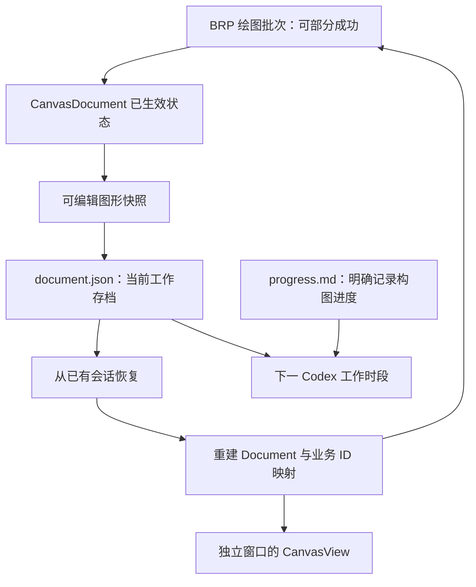

# 实验画作存档与跨时段恢复

动画人物复刻可能跨越多个 Codex 工作时段，原生绘画窗口与 Gallery 进程也可能被关闭。SVG 和 PNG 能证明当时画成什么样，却不足以可靠地继续编辑复杂路径；Codex 下次也不能只依赖对上次构图安排的记忆。这里采用一份**当前工作存档**和一份**明确的绘画进度说明**，避免为一次实验建设通用文件格式或操作事件系统。

本增量让 BRP 绘画会话把已生效的图形状态持久化，再按原会话 ID 重建 Document、窗口所需状态与可继续使用的图形 ID。历史阶段图像的命名和导出由后续增量提供。

## 存档权威与最小数据

每个实验会话使用 `gallery/exports/<会话ID>/document.json`。它保存能精确重建当前画作的全部信息：稳定业务图形 ID、Rectangle/Ellipse/Path 类型和参数、Path 原始命令、多子路径、Paint 的填充与描边及透明度/规则/端点/连接、Transform、从底到顶的图形顺序。还要保存会话身份、参考图原始宽高、固定画布区域与后续阶段编号所需状态，避免恢复时把前次图像当成另一张作品。

最简单的表达方式是按叠放顺序组织 `shapes` 数组，一条记录既包含内容又占据一个顺序位置，不另建冗余 `order`。例如 1920×1080 画作可依次有覆盖全幅的背景 Rectangle、人物头发的大 Path、脸的椭圆近似以及多个细节 Path。数组的实际 JSON 字段、颜色空间和角度单位可以在实现中决定，但恢复后必须保持 Canvas 现有几何与颜色语义。**这只是实验工作存档，不确立未来 Canvas 正式落盘协议。**

不持久化进程内 Entity、Camera、离屏 Image、GPU Mesh、选择框、Pointer 捕获、当前局部交互草稿等运行态。存档中的业务图形 ID 是跨重启标识；加载时用 `CanvasDocument` 的公开创建 API 按顺序重建 Shape，建立业务 ID 到新 Entity 的映射，之后 BRP 可以继续更新已有图形。不能通过直接写内部组件跳过几何或所属关系校验。

`document.json` 是可安全替换的**唯一当前状态文件**，不是历史版本库；不额外引入 `session.json`、`operations.jsonl` 或每次阶段导出一份完整编辑态 JSON。历史 SVG 和 PNG 留作视觉比较，不用反解析它们恢复 CanvasDocument。

## 按真实生效批次保存

Canvas 的一个 Path 可能有成百上千个命令。保存粒度是 BRP 批次，而不是每一个控制点或单条 Path 命令都同步重写整个文件。一次批次可以部分成功：如果前 86 项生效、第 87 项失败，保存的必须是包括前 86 项的新状态，而不是把整批当作未执行，也不是保存未经验证的原始请求。远程响应分别说明操作实际结果和存盘结果；若画面已改但写盘失败，必须明确告知其**当前生效但未确认持久化**，不得回复“已成功保存”。

磁盘替换采用先写完整临时文件，再安全替换当前 `document.json` 的做法，始终尽量保留上一份有效存档。对较大画作优先维持简单 JSON、按批写入和 BRP 局部查询，不因为尚未发生的体积瓶颈就加入压缩、增量日志或事件重放。提供显式的保存/状态核对入口，供使用额度即将耗尽或准备暂停时确认所有成功画笔已安全落盘。

会话初始化可以建立空白工作状态，但空 Document 不能被误判成旧画作损坏后的恢复结果。恢复旧会话时按 ID 找到原目录和 JSON，读取校验成功之后再替换/重建运行时状态；失败时保留文件与现有有效画面，不自动写入空文档覆盖原存档。关闭独立绘画窗口不代表删除存档，下一次通过 BRP 重新打开窗口并恢复画作；此机制不依赖进入或离开原 Gallery Canvas 演示页面。

## Codex 的进度说明

同一目录下的 `progress.md` 由 Codex 在有意义的绘画阶段及准备暂停时更新。内容包含参考图构图拆解、已经完成的区域、仍显著不准确的比例/轮廓/颜色、拟定的下一步绘制方向。它写的是 Codex **主动表达**的计划和判断，不是其不可见的内部推理轨迹，也不必复制 `document.json` 的 Shape 列表。

下一次工作时段可先读取 `progress.md` 与 BRP 会话摘要，通过 Gallery 恢复已存 Document，需要修改哪个区域时再查询相应 Shape。无需每次把可能长达数 MB 的 `document.json` 全部塞回模型上下文。Gallery 负责 BRP 绘制的自动存档；不扩展为观察者手工点击 Canvas 或旧演示页面操作时的通用自动保存。

## 验证与异常

工程测试及 Code Review 应覆盖：多子路径和弧/贝塞尔曲线、半透明填充/描边、旋转非均匀 Scale、重排与删除的保存/恢复等价；运行时 Entity 换新之后原业务 ID 继续有效；独立窗口关闭后重开、Gallery 重启后恢复；不同会话互不覆盖。模拟部分成功批次，确认存档只含真实生效修改；模拟存盘失败，确认接口不假报成功、旧存档不损坏。损坏 JSON、未知类型、非法几何、临时文件残留及恢复失败也不得静默清空或覆盖作品。

重要绘图计划由 Codex 自己填写；对这些艺术判断不进行逐条代码级验证。代码的错误路径及保存可靠性仍需按工程要求验收。
