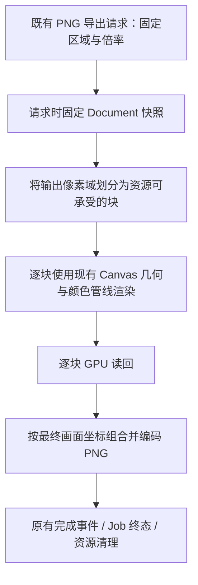

# Canvas 高分辨率 PNG 导出

Gallery 最终需要每个阶段都生成 1×、2×、4× PNG，而现有 Canvas PNG 导出一次性分配整幅导出纹理，并按像素数估算 4× MSAA、读回与 CPU 编码副本的工作集，限制为 512 MiB。尺寸计算见 `crates/canvas/src/export/png.rs`：除设备纹理/Buffer 上限外，还检查约 `pixels * 80 + padded_readback <= 512 MiB`。例如固定画布是 1920×1080，2× 的 3840×2160 已超过这个预算，4× 的 7680×4320 更不能直接使用旧管线。

这项改造是**本次实验唯一允许修改 Canvas 内部实现的例外**。目标仍是公开 `CanvasDocument::export_png` 按已有 `CanvasPngOptions { region, scale }` 语义完成导出；不允许借机改变几何模型、添加绘图原语或重新定义填充/描边语义。优先按块渲染、读回与输出，而不是直接提高内存限额。

## 分块后仍是一张完整画

导出区域始终由 Document 坐标决定，`scale=1` 产生与参考图同尺寸的像素图，`scale=2/4` 分别将两轴分辨率乘 2/4。每块必须使用与完整画面同一投影、图形顺序、填充与描边；块与块的边界只影响资源调度，不应影响最终像素。特别是跨块的宽描边、曲线、旋转图形和抗锯齿，不能因为裁剪/像素对齐出现可见接缝、透明缝隙或重复混色。

要保留现有 4× MSAA、Canvas 对 Bevy 预乘 RGB 与 straight alpha 的适配，以及线性颜色合成语义。透明导出仍保持真实 RGBA，不能用 Gallery View 的背景色填充空白区域。Path 的复杂曲线、填充孔洞、半透明叠加、覆盖次序，以及 View 与导出共用的几何解释，都应在跨块渲染中保持一致。

输出是**一份 PNG 文件**，而不是每块各输出一张图。不能为了避开 GPU 限额，改成在 CPU 或 GPU 常驻整幅数 GB 的中间 RGBA 缓冲，重新引入同类内存瓶颈。实际分块大小、写出顺序、编码与读回流水线可以在实现中选择；选择应符合设备限制与现有 Job 生命周期。

## 与现有异步导出契约的关系

现有 PNG API 在请求时创建独立 Document 快照并返回请求 Entity，随后由 Job 管理 GPU 准备、读回、PNG 编码与写盘，并以 `CanvasPngExportFinished` 发出最终状态。分块改造应继续遵守：后续 Document 修改不影响已发起的导出；与独立绘画窗口当前的 View Pan/Zoom、选中覆盖层、未提交 Pen 草稿无关；成功、失败、取消分别得到真实终态和完成通知。

取消和错误处理要贯穿尚未执行、正在等待读回和正在编码的各个块。不能因提前回收目标纹理、复用层号或丢弃已提交 GPU 读回，造成资源悬挂或结果串线；已有清理、等待和关闭时收尾责任继续有效。导出期间仍应使 reactive Gallery 和独立绘画窗口得到必要重绘/唤醒，任务完成后不无端持续刷新。

分块是为解决分辨率带来的峰值工作集和设备纹理尺寸限制，并不意味着无限制接受任意尺寸。最终像素数量、PNG 编码、磁盘容量、整数溢出和设备能力依然要校验；真正无法完成的请求应明确失败，不能输出被悄悄缩小或缺块的文件。

## 直接验收范围

此功能能够在正常设备能力内对 1920×1080 固定区域完成 1×、2×、4× 输出，得到 1920×1080、3840×2160、7680×4320 三组正确像素尺寸；旧版本会被 512 MiB 预算拒绝的 2×、4× 需要成为实际可执行的目标。

工程测试与 Review 重点检查：可由旧整幅路径处理的小图，在相同场景与倍率下与分块结果一致；跨块曲线、粗描边、轮廓孔洞、透明叠加、旋转/非均匀缩放没有接缝；PNG Alpha 和色彩表现不回退；大图内存峰值受控；导出时继续修改 Document 仍得到请求瞬间的画面；取消、失败、设备限制、文件 I/O 错误、请求实体提前销毁、重复完成通知与资源回收行为正确。不要把画得像不像参考图当成这项底层工程的测试条件。
