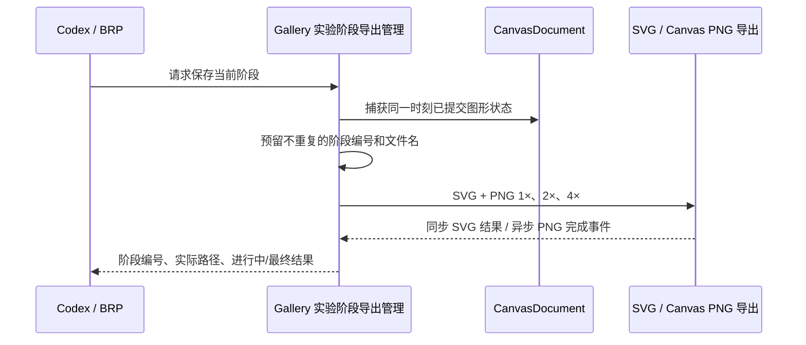

# Gallery 不覆盖的阶段导出

实验要留下绘画过程中真正可比较的图像。已有 Gallery Canvas 演示按钮固定向 EXE 同级目录写 `canvas.svg`、`canvas.png`，再次点击会覆盖；那是**旧演示功能**，不在这次实验中修改。新绘画窗口没有导出按钮，阶段保存通过 Gallery **新增的 BRP 方法**触发，由实验会话独立管理文件命名、快照和异步结果。

一个阶段必须对应同一瞬间的完整可编辑画作，产出一份 SVG 和三份不同倍率的 PNG。已有 `CanvasDocument` 导出语义仍是基础；前一工程增量解决大分辨率 PNG 的峰值资源问题。



## 导出位置与命名

实验文件固定在项目 `gallery/exports/` 内的会话专属目录。不得跟随 Debug/Release EXE 路径或当前工作目录变化，也不借用原 Canvas 演示的 `canvas.*` 路径。

```text
gallery/exports/<会话ID>/
├── document.json
├── progress.md
└── stages/
    ├── stage_0001.svg
    ├── stage_0001_1x.png
    ├── stage_0001_2x.png
    ├── stage_0001_4x.png
    ├── stage_0002.svg
    ├── stage_0002_1x.png
    ├── stage_0002_2x.png
    └── stage_0002_4x.png
```

每次新阶段使用新的单调递增编号。预留/生成历史文件应采用拒绝覆盖的文件操作，不能用 `std::fs::write` 的默认覆盖行为重新写已存在的阶段文件；失败占用过的编号也不能静默复用为另一时刻的画面。恢复既有会话时应继续从未使用的编号导出，即使目录里有此前失败留下的部分文件，也不覆盖它们。与此不同，`document.json` 是唯一的当前工作状态，按存档增量的安全替换规则更新。

BRP 返回阶段编号、各文件路径及进度/最终状态；导出路径应能被外部工具发现并直接打开进行视觉比较。**实验绘画窗口不添加工具栏或按钮**；无需把旧 Gallery Canvas 演示的手动 SVG/PNG 按钮改造成这个入口。

## 一次阶段的共同快照

每份阶段文件都按会话初始化时记录的固定 `Rect(0,0,width,height)` 导出，不能取自动图形 bounds，也不受 CanvasView Center/Zoom、原生窗口尺寸或 DPI 影响。SVG 的 `viewBox` 和宽高使用原始画幅；三个 PNG 分别为原图宽高的 1×、2×、4×。即使只完成一处头发或一只眼睛，也留下整幅画面当前进度。没有已提交背景 Shape 时图像相应区域为透明；选中轮廓、控制柄和未提交 Pen 草稿不会导出。

**四个结果必须来自同一时点的已提交 Document。** 如果 Codex 在 4× PNG 异步写盘期间继续作画，早先请求的 SVG 和三个 PNG 仍对应该阶段开始时的画面。底层 PNG 已在发起请求时复制模型数据；Gallery 必须妥善协调同一阶段四个请求的快照采集，不得因各自采集时间不同而出现一张新画、一张旧画。具体采用统一冻结的业务快照，还是一个串行协调窗口进行四次快照采集，由实现决定；不要要求整轮大图写盘完成才允许后续 BRP 绘图。

SVG 同步返回写盘结果，PNG 使用已有异步 Job 和 `CanvasPngExportFinished`。Gallery 聚合各文件状态，区分请求已接受、正在导出、全部成功和部分失败/取消，只有真正落盘才标记成功。多个阶段及三个 PNG 请求可由实现按资源能力串行或受控并行调度，不能因为同时争抢 GPU 资源而破坏画面一致性、Job 归属或取消清理。

## 失败处理与工程验证

当前 Canvas 对完全空 Document 导出报 `EmptyDocument`；本增量不改变这一底层语义。非法画幅、无效 Shape/颜色、资源不足、PNG 超时/取消、编码或 I/O 失败，都应通过 BRP 明确暴露，不能返回假成功或生成冒充完整阶段的文件。失败时对临时/部分文件的清理方式可按实现确定，但不可覆盖既有历史成果，也不可让编号倒退。Gallery 实验窗口的关闭和 Gallery 主程序退出应正确关联或收尾已接受的导出请求。

工程测试和 Code Review 覆盖：固定区域的 SVG `viewBox`、1×/2×/4× 像素尺寸；连续两次阶段留存八份不重复结果；中途继续绘制但先前四份仍来自同一状态；PNG Job 完成、失败、取消以及资源回收；崩溃/恢复或失败后编号不重复；原 Gallery Canvas 演示的固定文件导出与双 View 仍按原行为工作。艺术画面是否像参考图无需作为本功能的测试条件。
