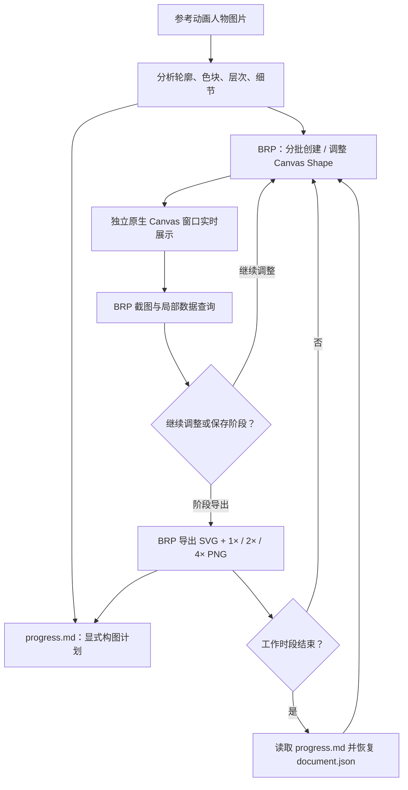

# 通过 BRP 复刻动画人物画作

全部必要工程能力完成后，实际实验是在运行中的独立 Canvas 绘画窗口复刻给定的动画人物参考图。Codex 自己决定如何把人物拆解为轮廓、色块和细节，通过 BRP 对同一份 CanvasDocument 逐步创建与修改图形；用户可以将独立窗口最大化，持续观看真实画面变化。

这一增量交付的是**可继续的绘画成果**，而不是另一套新控件：运行中的画作、完整工作存档、简明进度说明和可对比的历史阶段 SVG/PNG。绘画过程不要求对每个 Shape、每次笔画或每个构图决定进行单元测试和 Code Review。

## 构图自主性与实际画法

参考图在正式绘画开始时提供，取其**原始像素宽高**建立唯一固定画幅；在图片尚未给出时，不预设尺寸、角色、配色或必须使用哪种分层。可以分析头发、脸颊、眼睛、衣服、背景、阴影和高光，但绘制顺序、各部位使用多少独立 Shape、是否把多个轮廓并入同一 Path、怎样用半透明色叠加，都由 Codex 根据画面自主决定。

唯一的绘画通道是 Gallery 注册的 BRP 方法，它们调用现有 `CanvasDocument` 公开 API。可用 Rectangle、Ellipse、Path、Paint、Transform、重排、修改和删除，Path 可由直线、二次/三次贝塞尔曲线、圆弧和多子路径组成。允许不断试画、修正、覆盖局部、删除后重绘。不能直接把参考图作为 Canvas 纹理或图片显示，不能绕过 Canvas 调用 Bevy 的其他绘制系统，也不能仅为画出某个复杂元素新增 Canvas 原语。

每完成一批有意义的图形，独立窗口自动显示最新 Document，Codex 用现有 BRP Screenshot 和必要的指定图形查询复查比例、线条、遮挡与色彩；随后可以增量修改。复杂作品可能有大量 Path 命令，但日常不需要每次通读 `document.json`。原来的 Gallery Canvas 双 View 演示保持原样，**与这个独立绘画窗口及实验 Document 无关**，也不作为绘画界面。

## 过程痕迹和跨时段续画

Codex 可以在任何重要中间节点通过 BRP 请求保存阶段，始终以同一固定区域得到 `stage_NNNN.svg`、`stage_NNNN_1x.png`、`stage_NNNN_2x.png`、`stage_NNNN_4x.png`。文件不会覆盖前一阶段，因此可以比较粗轮廓、主体上色、面部细节和之后修改的画面；历史文件是可见绘制痕迹，不是内部思维日志。实验窗口没有导出按钮，需要导出时直接走 BRP。

Gallery 按 BRP 批次实际生效结果更新 `document.json`。批次里某一操作失败不回滚此前成功内容，接口返回逐项结果；存盘失败也必须显式报告。`progress.md` 由 Codex 在有意义的阶段和准备暂停时写下已完成部分、显著不足、下一步构图选择与尚待处理的区域，内容是主动表达的工作规划，不是隐藏的内部推理。

当工作时段额度用完、绘画窗口关闭或 Gallery 退出时，下次通过 BRP 读取已有会话、让 Gallery 加载 `document.json` 重建 Document 和业务图形 ID，再结合 `progress.md` 与必要的阶段 PNG 继续迭代。无需重新生成全部 Shape，也无需把完整 JSON 内容放入 Codex 上下文。当前可编辑状态只保留一份 `document.json`；不维护 `operations.jsonl` 或每阶段完整 JSON 存档。

## 观察与工程边界

绘画的观察重点是：人物比例、轮廓、颜色、发丝与五官等细节能否随着阶段推进接近参考图；阶段导出是否方便比较；额度中断后是否确实从原进度接着画。这里不设逐笔测试、逐图形 Review，也不要求机械的像素相似度作为唯一成败指标。

工程部分在正式作画前分别完成测试与 Code Review。绘画期间如果发现 BRP 接口、存档、PNG 或 Canvas 渲染确有代码缺陷，修复仍应独立接受相应工程检查，不能把绕过底层 API 的修改作为临时绘画手段。除已允许的高分辨率 PNG 内部导出改造外，不为了这幅动画人物图改变 Canvas 的底层几何与渲染表达能力。
