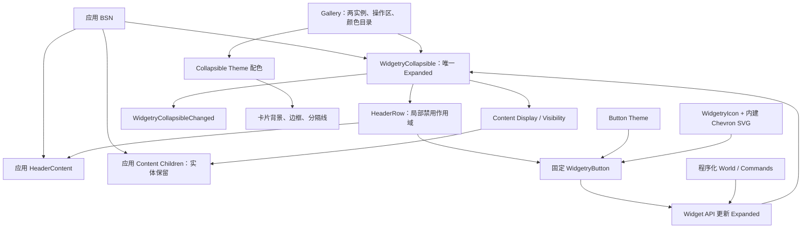

# Collapsible 控件：整体设计与实施方案

Collapsible 为设置页面、侧边栏和分组内容提供一个默认展开的可折叠卡片。应用使用 BSN 分别提供 Header 与 Content；控件自身管理根实体唯一的 `Expanded` 状态、固定折叠按钮、Content 的显示投影和两级 Disabled 语义。切换不销毁 Content 子树，所以内部输入和布局状态得以保留。可见外观采用已有 Widgetry Button、Icon、Asset 和 Theme 能力，并在 Gallery 中展示真实交互。

## 设计关系

整套能力围绕**一份状态 Authority**展开：外部通过公开 API 修改 `Expanded`，固定按钮通过同一路径切换；变化通知表示已提交的状态。`Display::None` 负责折叠内容退出布局，`Visibility::Hidden` 与派生可见性负责隐藏状态向输入、导航机制传播，而应用 Children 不被销毁或重置。根 `InteractionDisabled` 与 Header 局部请求分别管理整棵子树和 HeaderRow 的输入禁用，有效状态按继承请求组合，不相互覆盖。

实现分成五个**独立交付增量**：基础结构和程序化状态可以先独立验收；在此基础上增加按钮激活与焦点转移；再交付 Header 局部禁用 API；之后为已有结构添加完整卡片外观、Theme 和 SVG；最后由 Gallery 作为真实消费者演示全部行为。Header 局部禁用与卡片外观分别依赖已有结构，它们之间没有业务状态上的相互依赖；统一的编号只确定实施顺序。每个增量各自负责对应测试、必要文档和接口同步，Gallery 承担最后的 GUI 消费者验收，不另设纯验证阶段。

## 方案导航

1. [建立 Collapsible 结构与展开状态](01-建立Collapsible结构与展开状态.md)
2. [接入 Collapsible 固定按钮交互与焦点转移](02-接入固定按钮交互与焦点转移.md)
3. [实现 Collapsible Header 局部禁用 API](03-实现Header局部禁用API.md)
4. [实现 Collapsible 卡片外观与 SVG 状态图标](04-实现卡片外观与SVG状态图标.md)
5. [接入 Collapsible Gallery 交互展示](05-接入Collapsible-Gallery交互展示.md)
