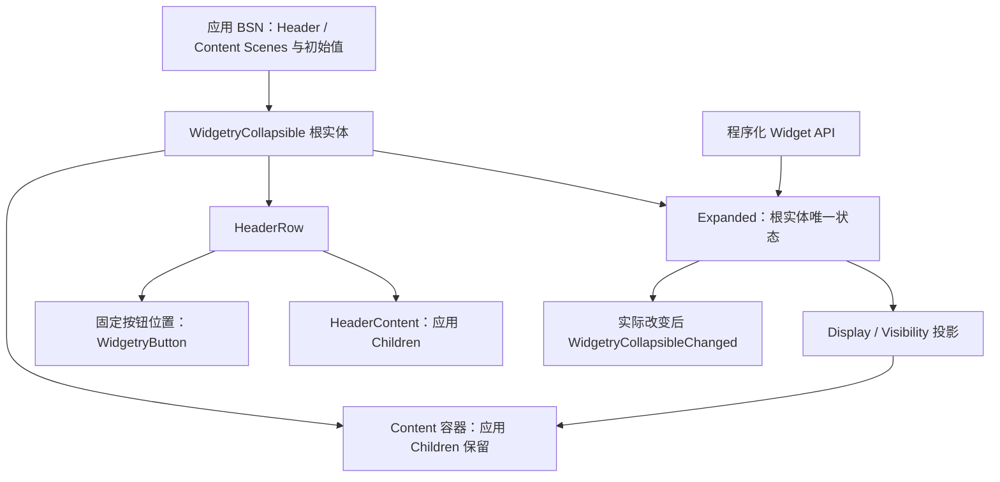

# 建立 Collapsible 结构与展开状态

## 目标与交付边界

交付一个能够通过公开 Widget API **查询、展开、折叠**的 `WidgetryCollapsible`：应用使用 BSN 提供 Header 和 Content，控件构造时一次性保留这些实体，运行时通过根实体的唯一展开状态控制 Content 是否参加布局。默认展开，支持指定初始折叠。该增量完成后，即使尚未接入按钮的用户激活逻辑，程序也能独立驱动、观察和验证折叠行为。

Collapsible 面向设置页、侧边栏及分组内容。它不管理应用内部字段的值，不靠销毁和重建 Content 实现折叠。专用按钮的实体位置在本增量确定，按钮输入、焦点、Header 局部禁用及完整卡片外观分别由后续方案补齐；这些不是本增量可运行的前提。



## BSN 组成与实体身份

`WidgetryCollapsible` 应是独立的 `SceneComponent`，让应用能通过根 Entity 识别控件、查询状态、调用 setter 与观察变化事件。构造过程使用项目统一的 `bsn!` Scene Composition，形成 `HeaderRow`、`HeaderContent`、固定切换按钮槽位以及 `Content` 容器。Header 与 Content 接收应用提供的 `Scene` / `SceneList`，可以包含任意 UI Children；不为纯 UI 内容设计 String 字段、Builder Callback 或新的 Spawn Helper。

Header 使用水平排列，`HeaderContent` 占据余下空间，固定的 `WidgetryButton` 位于末端；HeaderContent 不是整行点击热区，里面的自定义交互由应用自己的控件处理。`Content` 默认提供纵向 Flex 容器，但应用子实体自身的 Flex、Grid 等布局和输入数据不由 Collapsible 改写。

构造时一次性创建完整实体树。展开与折叠只修改 Content 容器，不能重建 Header、按钮或 Content 子树，也不能清空 Content 内的字段状态。这和现有 Tabs 保留非活动页面实体的原则一致。固定按钮可先作为结构组成存在，其激活行为归后续方案；内建 SVG 图标及卡片配色则由外观增量装配。

### 初始值与 Runtime State

`Expanded` 是根实体唯一展开状态，默认 `true`；`@expanded: false` 只为构造指定一次性初始折叠。Scene Props 在 Scene 展开后结束职责，不保留第二份运行时状态。

Widgetry 自有展开状态遵循 `rules/widget-api.md`：外部只能通过只读查询接口读取，不能直接替换或移除 `Expanded` Component 以绕开折叠联动及通知。内部可以维护投影所需的数据，但不能产生第二个展开状态 Authority。

## 公开更新与事件契约

```rust
WidgetryCollapsible::expanded(&world, entity) -> Result<bool, BevyError>;
WidgetryCollapsible::set_expanded_in_world(&mut world, entity, expanded)
    -> Result<bool, BevyError>;
WidgetryCollapsible::set_expanded(&mut commands, entity, expanded);
```

`expanded` 返回根实体实际展开状态。同步 setter 在执行时校验目标并提交真实状态，其返回意义如下：

| 返回 | 含义 |
| --- | --- |
| `Ok(true)` | 有效请求且 `Expanded` 实际改变 |
| `Ok(false)` | 有效同值请求，无状态改变 |
| `Err(...)` | 根 Entity 无效、目标不是所需控件，或操作无法执行 |

`Commands` 入口在命令**实际执行时**校验并提交，并通过宿主 Error Handler 反馈错误；调用排队函数本身不保证状态已更新。无效请求不得伪装成合法 no-op，不提交展开状态也不产生相应变化通知。

统一通知为：

```rust
WidgetryCollapsibleChanged { entity, expanded }
```

只有 `Expanded` 真实改变才发出该事件。状态必须**先提交，再通知**，使 Observer 可以读到已提交的展开状态；通知不担保此刻 UI 布局已经重算完成。程序化操作和后续的用户操作都走这条语义，不增加 `User` / `Programmatic` 来源字段。初始状态建立时不额外发送变化通知。

例如初始展开的实例执行 `set_expanded_in_world(world, root, false)`：返回 `Ok(true)`、状态成为 `false`、收到一次 `{ entity: root, expanded: false }`；再次传入 `false` 返回 `Ok(false)`，不再发事件。

## Content 显示投影与保留

| `Expanded` | Content `Node.display` | Content `Visibility` | 布局与可见性 |
| --- | --- | --- | --- |
| `true` | `Display::Flex` | `Visibility::Inherited` | 参与布局，按继承结果可见 |
| `false` | `Display::None` | `Visibility::Hidden` | 退出布局，不渲染 |

这是 Tabs 已有策略在 Collapsible 上的复用：`Display::None` 让折叠内容真正不占空间；`Visibility::Hidden` 及必要的派生可见性同步，使依赖可见性结果的输入、键盘导航逻辑也感知隐藏状态。由于输入分发可能早于 Bevy 正常的 `PostUpdate` 可见性传播，Content 子树所需的派生可见性应保持一致。

投影只改变 Collapsible 管理的 Content 容器及必要的派生结果，不覆盖应用 Children 的自有 `Node`、显式 `Visibility`、内部数据。展开时恢复容器的 `Display::Flex`，并不把应用自己设置的 Grid/Flex 改写为 Flex。第一版状态切换是**瞬时**的，不管理动画高度或插值状态。

## 与后续交付的关系

该增量建立 `crates/collapsible` / `bevy_widgetry_collapsible` 的基础控件类型、公开状态 API、场景组合、变化通知和基本插件装配；同步工作区成员以及 Facade 中相应的模块、Feature 与导出入口。插件与依赖方向遵循 `rules/architecture.md`，构造方式遵循 `rules/ui-composition.md`。运行时先获得可程序化操控的 Collapsible，下一增量在既有固定按钮上增加用户交互与焦点联动，不更换状态 Authority。

## 完成条件与验证

依据 `rules/testing.md`，主要从外部公共 API 和真实 ECS 组合验证：

- 默认 `Expanded(true)` 和 `@expanded: false` 的初始布局正确，初始化不产生状态变化事件。
- 同步与排队 setter 的实际提交时机；合法同值返回未改变且不通知；无效 Entity、错误类型及必要结构缺失明确反馈错误。
- Observer 收到事件时查询到的 `Expanded` 与事件中的 `expanded` 一致，事件仅发生在真实变化之后。
- 展开、折叠的 `Display` / `Visibility` 与派生可见性一致；折叠后 Content 不占据布局空间。
- 多次切换后 Content Children 的 Entity 身份、嵌套布局和输入状态不丢失，应用子节点配置不被覆写。
- 根据实际集成测试规模维护 `tests/COVERAGE.md`；不为原生 Bevy 已保证的行为编写重复性测试。

## 约束

不允许用直接修改 `Expanded`、销毁 Content、整行 Header 点击或新增通用状态绑定总线代替既定公开状态机制。无效程序调用不得静默忽略；错误处理遵循工程原有日志和宿主 Error Handler 契约。
