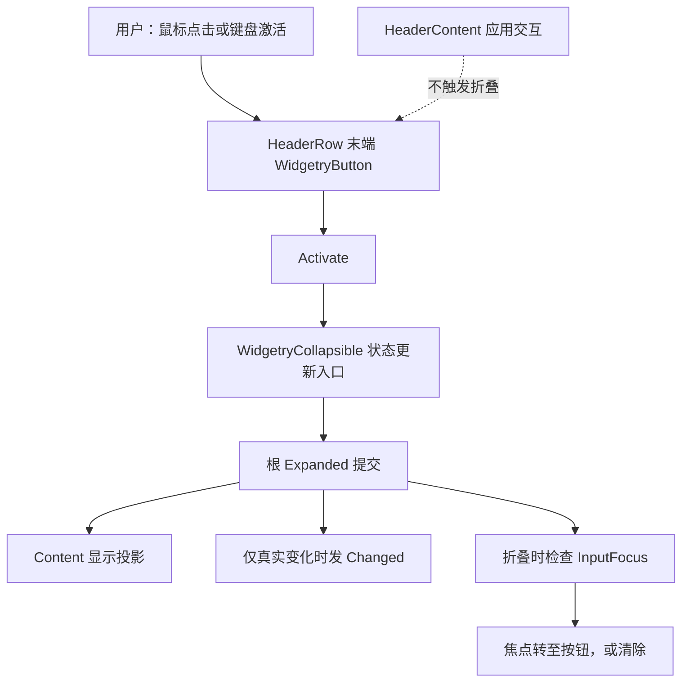

# 接入 Collapsible 固定按钮交互与焦点转移

## 目标与范围

为已有、可程序化展开的 Collapsible 接入**真正的用户切换入口**：Header 末尾固定 `WidgetryButton` 接受鼠标和键盘激活，激活后通过同一展开状态 API 改变 `Expanded`；折叠时妥善处理 Content 子树中已有的键盘焦点。增量完成后用户无需调用程序化 setter 即可正常折叠与展开，同时保持与程序操作一致的事件语义。

按钮并非整个 Header。应用自行提供的 HeaderContent 可以放文本、开关或其他输入控件，它们的点击不应触发 Collapsible 切换。Card 配色、内边距、SVG 箭头属于后续外观增量；输入和焦点行为不依赖这些外观细节。

## 固定切换按钮的用户输入

复用仓库自有的 `WidgetryButton`，而非为 Collapsible 直接重新包装一套原生 Bevy Button 样式、Hover、Pressed、Disabled 和激活逻辑。按钮绑定到 Collapsible 根实体，激活时调用其展开状态更新路径，将当前 `Expanded` 翻转；按钮事件本身不是另一个展开状态源。

- 指针激活只由固定按钮处理；不把整个 HeaderRow 或 HeaderContent 变为点击区域。
- 获得焦点后，按钮应能按已有 Button 的键盘激活约定响应；不另建不兼容的 Enter / Space 通知路径。
- 现有 `WidgetryButton` 默认使用 `TabIndex(-1)`，故 Collapsible 内建按钮必须覆盖为可通过 Tab 键顺序导航聚焦的配置，并让所需输入导航插件可用。
- 按钮的 Hover、Pressed、Disabled 反馈直接采用 Widgetry Button 能力；不复制一份 Collapsible 专属交互配色状态表。

上述输入与 `set_expanded_in_world` / `set_expanded` 具有统一的状态提交及变化通知语义：先改变根上的 `Expanded`，只在实际改变后触发 `WidgetryCollapsibleChanged { entity, expanded }`；初始化和同值操作不通知，事件不额外携带用户/程序来源。`Commands` 更新仍在执行时校验，不因按钮交互改变公开 API 的错误契约。

## 折叠期间的焦点所有权

Content 的 Entity 在隐藏后仍然存在，隐藏不等于主动移除 `InputFocus`。如果一个 TextField 正在编辑，折叠后继续把焦点留在隐藏的输入实体上是不合理的。因此折叠更新需要检查焦点实体是否位于 Content 子树内，并遵循下表：

| 发生情况 | 焦点处理 |
| --- | --- |
| 折叠前焦点位于 Content 子树 | 转移至固定切换按钮 |
| 折叠时按钮不可聚焦（例如 Disabled） | 清除原 Content 焦点 |
| 折叠前焦点在 Content 之外 | 不改变焦点 |
| 再次展开 | 不自动恢复原来的 Content 焦点 |

焦点规则同时覆盖**用户折叠和程序化折叠**，不得只在按钮 `Activate` 的处理器里实现，否则外部 setter 会绕过焦点收敛。检查子树归属应以当前实际 Entity 层级为准，而不是认为 Content 的直系 Children 是全部可聚焦对象。

折叠时继续沿用前一增量的 `Display::None`、`Visibility::Hidden` 和派生可见性同步；展开为 `Display::Flex`、`Visibility::Inherited`。仅 Content 容器退出布局，所有内部 TextField、CheckBox 等实体和数据保留。焦点转移与状态事件 Observer 的相对执行细节不另增加未约定的顺序保证，保持项目已有公开 API 规则中“状态提交先于变化通知、布局可稍后同步”的契约。

## 与前后方案的关系

先决条件是 Collapsible 根状态、HeaderRow / Content 实体关系和程序化展开 API 已建立；本增量直接使用它们，不产生第二个 `Expanded` Authority。后续 Header 局部禁用控制将复用已有按钮的禁用响应；外观增量把上、下箭头 SVG 及卡片配色附着到同一个按钮，不替换这一激活行为。

## 完成条件与验证

按 `rules/testing.md` 使用真实交互路径和外部 Observer 验证：

- 用户指针点击固定按钮切换；HeaderContent 被点击时不折叠，其内部自定义控件不被侵入。
- Tab 导航可聚焦按钮，获得焦点后键盘激活能切换；无效/重复输入不产生虚假的状态变化通知。
- 鼠标与键盘触发均使用根 `Expanded`；Observer 收到 `WidgetryCollapsibleChanged` 时已能查询新状态。
- 程序化折叠和用户折叠都正确执行四种焦点规则；包括嵌套在 Content 深处的输入实体、焦点原本在外部、按钮无法获得焦点以及展开后不自动恢复。
- 折叠后 Content 子实体、布局配置、编辑中的数据仍保留，隐藏 Content 不参与布局与导航。
- 按影响范围补充或更新 crate 集成测试与 `tests/COVERAGE.md`，不单设一个最终测试增量。

## 约束

不把整行 Header 或应用自定义 HeaderContent 设为额外激活热区，不引入另外的状态消息总线、状态副本或第二套 Button 交互逻辑；焦点处理不得破坏 Content 外的当前焦点。
