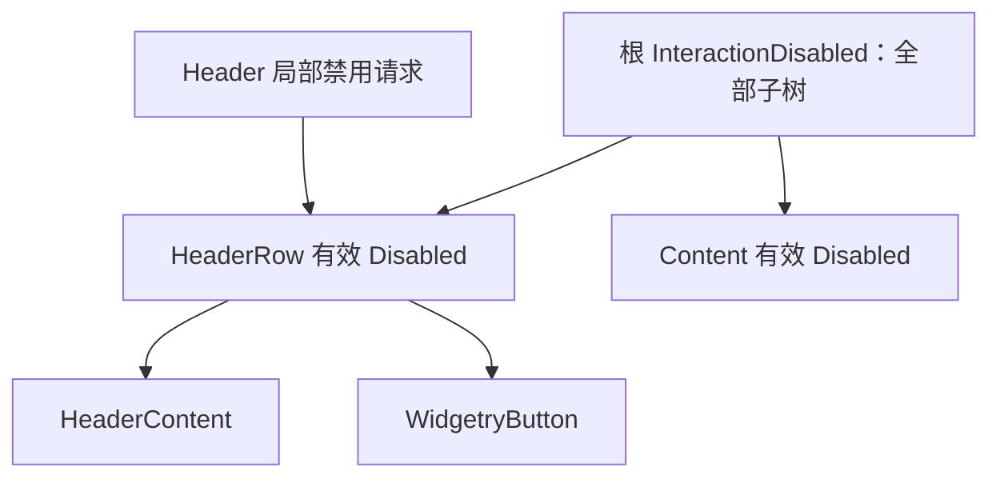

# 实现 Collapsible Header 局部禁用 API

## 目标与交付边界

在已有可交互 Collapsible 上增加一项**独立的 Header 禁用控制能力**：根节点的官方 `InteractionDisabled` 继续禁用整个控件；Header 局部禁用只影响 HeaderContent 和固定切换按钮，不影响展开后 Content 内的业务输入。两个禁用请求相互独立，恢复任一层级都不会误清除另一层级的请求。

这项能力可以通过程序化调用和 Gallery 操作独立观察，不需要改动展开状态的唯一 Authority，也不引入新的 Disabled 继承算法。



根禁用沿现有 Widgetry UI 层级继承生效，作用于 Header、按钮和 Content；Header 局部请求只施加到 `HeaderRow`，因此它会向 HeaderContent 和按钮传播，但不会向与 HeaderRow 同级的 Content 传播。

## 公共控制接口与持久请求

```rust
WidgetryCollapsible::set_header_disabled_in_world(&mut world, entity, disabled)
    -> Result<bool, BevyError>;
WidgetryCollapsible::set_header_disabled(&mut commands, entity, disabled);
```

程序入口以 Collapsible **根 Entity** 为目标；`HeaderRow` 是内部托管实现节点，不要求调用方自行定位。Header 局部禁用默认 `false`，可以由构造 Props 一次性初始化，运行期间保留独立的本地请求。`World` 入口立即处理；`Commands` 在实际执行时处理并反馈不能处理的错误。`Result<bool, BevyError>` 需符合 Widget API 的有效改变、有效同值与错误三态约定，不得把继承禁用时的有效禁用结果当作局部请求的丢弃理由。

优先复用 `bevy_widgetry_core::disabled::set_intrinsic_disabled_for<R>()` 代表 Collapsible Header 的独立内部禁用理由，使用现有有效状态投影与 `WidgetryEffectiveDisabled` 查询能力。根 `InteractionDisabled` 是官方 Component，仍允许正常的 Insert / Remove；不为了 API 一致性包装或限制它。局部禁用 API 只管理自己的请求，不覆盖应用及祖先的 Disabled 状态。

### 两层禁用的组合语义

稳定状态下，Header 的有效禁用满足：

```text
Header 有效禁用 = 祖先继承禁用 OR Header 局部禁用请求
```

例如按以下顺序操作：

| 操作 | 根禁用请求 | Header 局部请求 | Header 生效结果 | Content 结果（无其他限制时） |
| --- | --- | --- | --- | --- |
| 初始 | 否 | 否 | 启用 | 启用 |
| 禁用根 | 是 | 否 | 禁用 | 禁用 |
| 禁用 Header | 是 | 是 | 禁用 | 禁用 |
| 恢复根 | 否 | 是 | **仍禁用** | 启用 |
| 恢复 Header | 否 | 否 | 启用 | 启用 |

反向也成立：如果根仍禁用，即使调用 `set_header_disabled(false)`，Header 也不能被强行启用。这是两个独立请求的 OR 组合，不是后一次写入覆盖前一次写入。

两级禁用都**只限制用户输入**。即使根及按钮被禁用，外部仍可以通过 `WidgetryCollapsible::set_expanded*` 更新展开状态，其事件语义维持原约定：先提交，只在实际改变后通知；Disabled 状态投影本身**不产生** `WidgetryCollapsibleChanged`。

当折叠发生时 Content 内仍有焦点，沿用此前已实现的焦点规则：优先转向可聚焦的内建按钮；如果按钮因为禁用而不可聚焦，则清除 Content 旧焦点。Header 被禁用不应改变 Content 子实体自身的存活及输入数据。

## 与前后方案的关系

该增量依赖已存在的 Collapsible 根、`HeaderRow` 和固定按钮，沿用前序输入、焦点和展开事件路径。它不依赖未来卡片颜色与 SVG 的实现；后续 Style 阶段仅把禁用外观交给既有 `WidgetryButton` 和 `WidgetryIcon` 的机制处理，不改变 Header 局部请求的语义。

## 完成条件与验证

用真实 ECS 结构和外部操作验证：

- 根 `InteractionDisabled` 禁用 Header、按钮和 Content 的用户输入；移除根禁用时各子树按自身请求恢复。
- `set_header_disabled(true)` 禁用 HeaderContent 与按钮，不改变 Content 内的可交互能力和业务数据。
- 先禁用根、再禁用 Header、再恢复根时，Header 继续禁用；再恢复 Header 才启用。恢复 Header 不得越过仍有效的根禁用。
- 重复设置相同局部请求属于合法 no-op；无效根或内部所需结构失效按 API 错误约定报告，不静默成功。
- 无论禁用状态如何，合法程序化展开/折叠仍能提交 `Expanded`；Disabled 投影不额外发出展开变化通知。
- 当局部禁用导致折叠按钮不可聚焦时，Content 内焦点按已定义规则清除；按实际影响同步测试覆盖文档 `tests/COVERAGE.md`。

## 约束

不将 Header API 实现为直接移除祖先 `InteractionDisabled`、强行覆盖整棵子树 Disabled 或维护另一套全局继承状态。不要借 Header 局部禁用修改 Content 的输入状态，也不为 Disabled 请求发出展开状态事件。
