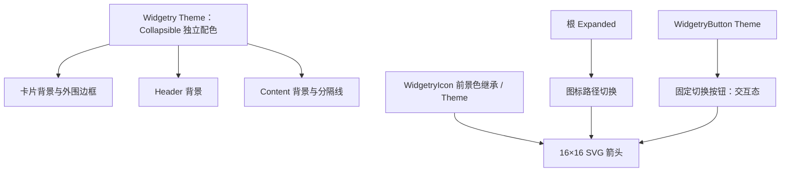

# 实现 Collapsible 卡片外观与 SVG 状态图标

## 目标与范围

在已有的 Collapsible 结构、展开状态、交互与禁用机制之上，交付**完整的默认卡片式外观**与随展开状态变化的 SVG 箭头。控件默认自带背景、边框、圆角、内边距及 Header / Content 分隔线，颜色接入 Widgetry Theme，尺寸采用控件内置 Style 常量。应用仍然通过 BSN 自定义 Header 和 Content 内容，不需要为外观配置新的尺寸/间距 Props。

颜色属于 Collapsible 容器自身；固定按钮的 Hover、Pressed、Disabled 等反馈属于 `WidgetryButton`，箭头显示与前景色属于 `WidgetryIcon`。三个模块各管理自己的外观，不在 Collapsible 里复制 Button 的交互颜色表。

## 卡片结构与默认尺寸

Header 使用水平布局，HeaderContent `flex-grow: 1`，右侧固定 32×32px 的 `WidgetryButton` 与 Header 内容垂直居中。Header 不设置固定高度；应用可能提供多行标题、描述或其他交互控件，因此实际高度由内容决定。Content 容器默认纵向 Flex，而用户 Children 的布局和输入状态不被改写。

| 元素 | 默认 Style |
| --- | --- |
| Header 内边距 | 左右 12px、上下 8px |
| 切换按钮 | 32×32px |
| SVG 箭头 | 16×16px |
| Content 内边距 | 四周 12px |
| 外围边框 | 1px |
| 卡片圆角 | 6px |
| Header / Content 分隔线 | 1px，**仅展开时显示** |

背景、边框、圆角和间距均内建在 Style 中，首版无需业务应用逐一补齐。Header 和 Content **默认使用相同背景色**，靠分隔线体现区域层次；折叠时 Content 及分隔线从布局中移除，卡片不遗留一条空的内容分隔。展开/折叠依旧瞬时切换，不新增高度动画、淡入淡出或额外的动画状态。

这些数值是 Collapsible 的内置 Style 常量，**不是 Theme 提供的尺寸值**；也不新增尺寸/间距 Props。应用可以用已公开、受支持的 BSN `Node` 覆盖常规布局参数，但不能依赖对内部托管 HeaderRow、Content 及按钮结构做未受支持的替换。

## 独立的 Theme 配色

提供 `WidgetryCollapsibleColors` 及对应的颜色覆盖接口，使应用只修改 Collapsible 的卡片配色，不影响 Button、Tabs 等其他控件。配色项覆盖：

- 卡片整体背景色。
- Header 背景色。
- Content 背景色。
- 外围边框色。
- Header / Content 分隔线色。

默认值从 Widgetry 现有主题语义色构造，Header 与 Content 默认一致，但两个字段仍可独立覆盖。运行时 `WidgetryThemeChanged` 后重新投影 Collapsible 自己托管的颜色输出；应用的自定义 Children 继续由各自控件或本地样式管理。

新增配色类型后需要同时更新 `crates/theme` 的 `WidgetryTheme` 字段及 **Light、Dark、PinkDream、KamuriViolet** 四套主题预设；不能只添加某一个模式，否则固定 Theme 结构和切换功能会不完整。颜色覆盖应沿用仓库其他 Widget 的公开 API 模式和已有颜色校验规则，不增加一套通用 Binding/Callback 配色框架。

固定切换按钮的 Normal、Hovered、Pressed、Disabled 颜色仍使用 `WidgetryButton` 自己的 Theme；Header 局部禁用或根禁用引起的按钮 Disabled 外观沿其现有有效禁用机制响应。Collapsible 不引入独立的按钮交互配色状态，图标也继续使用 `WidgetryIcon` 的前景色继承和 Theme 机制。

## 复用已注册 SVG 箭头

复用现有 `bevy_widgetry_asset` 注册过的内建图标，**不新增 SVG 文件**：

| `Expanded` | 所用内建 SVG | 大小 |
| --- | --- | --- |
| `true` | `BuiltinIcon::ChevronUp`（`chevron_up.svg`） | 16×16 |
| `false` | `BuiltinIcon::ChevronDown`（`chevron_down.svg`） | 16×16 |

切换图标要反映根实体已经提交的 `Expanded`，不能通过额外 `bool` 跟踪按钮图标方向，以免程序化 setter 与用户激活出现不同步。采用现有 `WidgetryIcon` Scene 以及 `WidgetryIcon::set_svg_in_world` 等图标变更机制；图标资产本身已由 Asset crate 负责 Embedded 注册，不把新素材散放到 Collapsible crate。图标前景色由既有继承规则及 Theme 决定，按钮上的图标不另复制一套 Disabled/Normal 调色板。

如果应用初始指定 `@expanded: false`，首帧箭头应向下；后续通过按钮或公开 setter 改变 `Expanded` 都应切换箭头。Theme 切换或局部禁用不改变箭头所表达的展开方向；只影响对应颜色。

## 与前后方案的关系

此前增量已经提供 Collapsible 根实体、Header / Content 结构、状态投影、按钮激活、焦点联动及两级禁用。这里在**原有实体及 WidgetryButton**上补齐外观，保留此前交互与状态 API，不创建另一个可点击按钮。该增量交付完整可复用的库控件外观；之后的 Gallery 增量负责消费者演示、颜色目录展示及 GUI 验收。

## 完成条件与验证

- 默认展开和初始折叠的卡片背景、边框、圆角、内边距正确，分隔线仅在展开时出现；Header 由任意高度的应用 Children 决定尺寸，按钮保持固定靠右。
- `Expanded` 的初始值、用户切换和程序化变更都驱动正确 SVG 方向；反复切换不需要重建 Icon Entity 或 Content Entity。
- 四套 Theme 均能解析完整的 Collapsible 配色，Theme 运行时切换能更新托管背景和边框等输出。
- 独立覆盖 Header、Content、外边框或分隔线颜色只影响本控件相应区域；未覆盖字段仍使用 Theme 默认值。
- 根禁用与 Header 局部禁用时，按钮与箭头复用已有 Disabled / Foreground 行为；恢复局部请求不错误覆盖祖先禁用。
- 保证前序瞬时折叠、Content 布局退出和实体保留契约；按实际影响补充样式与图标集成验证，更新受影响的 `tests/COVERAGE.md`。

## 约束

不重复创建按钮 SVG、不复制 Button 的交互态配色、不增加尺寸 Props 或专用动画系统；样式系统只写入 Collapsible 自己托管的节点输出，不擅自覆盖应用提供的 Header/Content 子实体样式。
