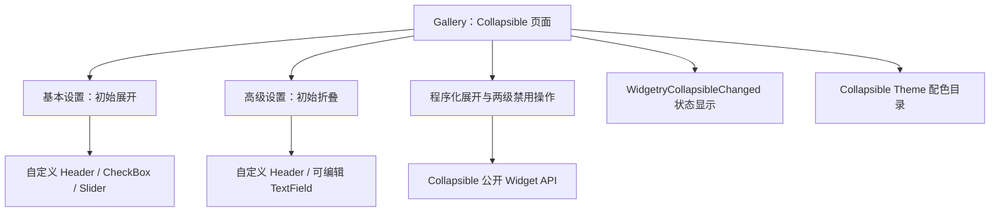

# 接入 Collapsible Gallery 交互展示

## 目标与范围

为已完成的 Collapsible 新增**独立 Gallery 页面**，让使用者能看见默认卡片外观、操作固定箭头、体验应用 Children 的状态保留，并通过页面控制操作与状态显示验证程序化展开及两级禁用行为。同时把 Collapsible 的独立 Theme 配色加入 Gallery 颜色展示目录。

这是一个真实的 Gallery 消费者交付，不是把前序库功能的测试另拆为一份“最终验收方案”。Gallery 的实例应使用公开 BSN Scene 组合和 Widget API，避免直接写入库自有 Runtime State 或触碰内部托管节点。

## 两个主要示例

**基本设置**：建立一个默认展开的 Collapsible。Header 是应用通过 BSN 组合的自定义 UI，Content 放置 CheckBox、Slider 等真实交互控件。卡片自带背景、边框、圆角及分隔线，Header 的自定义区域不会成为折叠按钮热区；只有右侧 `WidgetryButton` 的向上/向下 SVG 箭头可触发展开切换。示例需能观察折叠不销毁 Content，重新展开后之前的控件值仍存在。

**高级设置**：通过 `@expanded: false` 初始折叠，Content 放置可编辑 TextField。展开后输入文本，再折叠并重新展开，应能看到此前内容保留；如果正在编辑时触发折叠，则焦点根据已定义规则转向可聚焦的箭头按钮，按钮禁用时清除焦点，重新展开不自动恢复原焦点。

一个页面只保留这两个主要示例，不为每个状态、每项 Guard 单独增加卡片。Gallery 内容仍通过应用的 BSN 与 Widgetry 控件创建，不为演示另造一套 UI Builder。

## 控制区与状态反馈

在两个主要示例之外提供必要的控制操作：

- **程序化展开/折叠**：通过 `WidgetryCollapsible::set_expanded*` 更新指定示例，展示它和用户点击采用同一展开状态及变化通知机制。
- **根禁用**：对示例根应用或移除官方 `InteractionDisabled`，观察 Header、按钮、Content 的共同禁用效果。
- **Header 局部禁用**：通过 `set_header_disabled*` 控制 HeaderRow 局部请求，Content 保持可交互；重点呈现“禁用根 → 禁用 Header → 恢复根”后 Header 仍禁用的情况。
- **变化通知展示**：响应 `WidgetryCollapsibleChanged { entity, expanded }`，显示状态、事件次数或最近通知等有用信息，体现只有真实状态改变才通知；Disabled 请求不会伪造展开事件。

即使 Button 被禁用，程序化 setter 仍可合法展开/折叠；面板状态必须以 `Expanded` 为准，不能以 SVG 朝向、按钮的视觉 Disabled 或另存的 Gallery bool 作为业务真值。

## Gallery 与颜色目录接入

按照已有页面模式加入 Collapsible 的 `GalleryPage`、导航按钮、页面挂载/卸载和对应 `CollapsibleDemoPlugin` 注册。同步 `gallery/src/pages.rs`、`gallery/src/gallery.rs`、`gallery/src/main.rs` 等直接相关入口，提供**中文及英文**导航标题、说明、示例标签、操作和状态文案。

配色方面，把前序新增的 `WidgetryCollapsibleColors` 接入 Gallery 的 `color_showcase/catalog.rs` 及其字段枚举展示，使整体背景、Header、Content、外边框、分隔线能够按现有颜色目录模式查看。该工作依赖配色已进入 Widgetry 的四套 Theme，并不在 Gallery 内再次定义一份独立调色板。

Gallery 仅作为消费者，不反向被库 crate 依赖；示例也不绕过内建 Button、Icon、Disabled 传播或状态 setter 来模拟效果。

## 与前后方案的关系

先决条件是 Collapsible 的公开状态 API、固定按钮激活、焦点规则、根与 Header 两级禁用以及 Theme/SVG 外观均已交付。本增量在这些既有 API 上组成完整页面，没有后置的独立纯验收目标；它承担全案的消费者 GUI 收口检查，并只针对实际受本增量影响的库行为补做必要回归。

## 完成条件与验证

Gallery 按 `rules/testing.md` 的例外要求确保正常编译，针对可观察交互按 `rules/gui-debugging.md` 使用 BRP 走真实用户路径验证：

- 新导航项能打开、退出 Collapsible 页面；两个示例分别默认展开和默认折叠，中英文文案可正常展示。
- 默认卡片样式、四套 Theme 颜色及颜色目录字段正确；切换 Theme 后卡片颜色、按钮/箭头前景色保持协调。
- 点击或键盘激活固定箭头可折叠/展开，点击 HeaderContent 不会误触发折叠。
- CheckBox、Slider、TextField 等 Content 内部状态在折叠后仍然存在；隐藏内容退出布局，重新展开保留原值。
- 在 Content TextField 聚焦状态下折叠会正确迁移或清除焦点；展开不主动恢复旧焦点。
- 程序化展开/折叠与用户操作在状态通知上保持一致；合法同值无额外事件；Disabled 本身不产生 Collapsible 展开通知。
- 根禁用覆盖整棵控件；Header 局部禁用不影响 Content；按“先根禁用、再 Header 禁用、再恢复根、最后恢复 Header”的序列验证局部请求独立保留。禁用下程序化更新展开状态仍有效。

必要的错误路径和长期自动化测试归属此前各自的库功能增量；Gallery 不重复建设同一行为的完整自动化测试套件。

## 约束

不增加第三个或更多只为重复展示同一功能的主示例，不通过直接替换 `Expanded`、销毁/重建 Content 或改动托管内部子节点来演示状态变化，不建立新的 SVG 文件或独立的按钮样式表。
