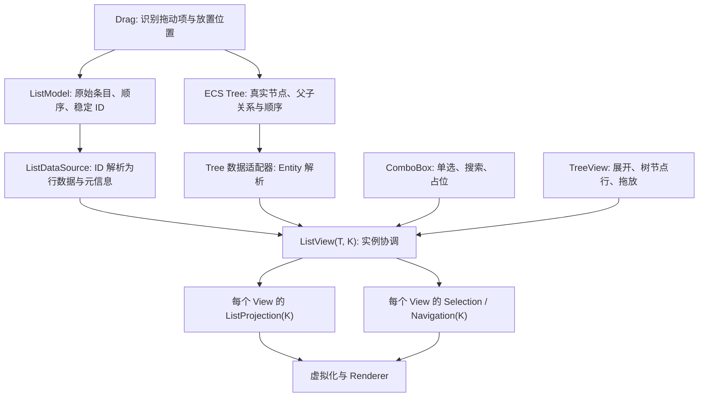

# ComboBox、ListView 与 TreeView 的统一列表架构

第三阶段的搜索、多选、拖拽和树节点操作需要共用同一套列表基础设施，但不能让上层控件共享本应属于各自实例的状态。整体设计将**原始数据、显示投影、选择状态、导航、数据修改交互**分开：数据源保存真实条目，Projection 决定本视图看见哪些稳定身份及其顺序，Selection 独立保存选择集合，ListView 负责交互与虚拟化。ComboBox 和 TreeView 在通用机制上加入各自规则，而不复制一套选择/列表实现。

普通 ListView 与 ComboBox 的 `K` 是 `WidgetryListItemId`，TreeView 的 `K` 是真实节点 `Entity`；`T` 则表示渲染时所需的行数据，允许是原始数据的借用或由 ECS 生成的展示信息。Projection 保留有序的稳定身份，不复制 Model 的条目实体。一个数据源可以被多个 View 使用，每个 View 的投影、选择、活动项、滚动以及 TreeView 展开状态均独立；只有数据增删、排序和树层级改动属于共享原始数据变更。

数据变更以 Bevy 0.20 ECS 变更检测为起点，同一更新周期内合并触发并在虚拟化前完成投影与状态修复；不为普通 `Vec` Model 新造逐项事件协议。选择数据仍以稳定 ID 为准，投影暂时隐藏的已选条目不失效。编辑性质的拖放必须实际修改共享 Model 或 ECS 树；搜索、折叠只影响具体视图的投影；选择只影响具体视图的 Selection。

ListView 的 Selection、Navigation、Drag 是按职责独立的子系统，但它们是否成为不同 crate 由依赖边界决定，不为拆 crate 而制造循环依赖。TreeView 保留现有按 ECS Component 类型注册的业务内容 Renderer、懒加载与颜色管理；ComboBox 保留基于同一 Model 的 Field 与 Popup，新增可选本地搜索、默认未选中与明确的程序化选择接口。

以下为唯一的实施顺序。测试、Gallery 迁移、必要的 i18n/文档和性能验证随各功能增量进行，不另外设置纯验收阶段。顺序相邻不代表所有阶段均存在直接代码依赖，例如 ComboBox 搜索与列表拖拽是共用前序基础设施的不同能力。

1. [建立稳定身份驱动的 ListView 数据源与 Projection](01-建立稳定身份驱动的列表投影.md)
2. [抽离 ListView Selection 子系统与公开状态接口](02-抽离列表选择子系统.md)
3. [实现 ListView 多选与整模型全选](03-实现列表多选与全选.md)
4. [改造 ComboBox 默认空选择及程序化选择 API](04-改造ComboBox空选择与程序化API.md)
5. [为 ComboBox 增加本地搜索与无结果展示](05-增加ComboBox本地搜索.md)
6. [实现 ListView 单条目拖拽排序并写入 Model](06-实现列表拖拽排序.md)
7. [让 TreeView 直接使用 ECS Entity 身份与数据适配器](07-改造树节点身份与数据适配.md)
8. [将 TreeView 的选择与展开状态迁移到视图实例](08-迁移TreeView独立视图状态.md)
9. [实现 TreeView 多选及全部展开折叠](09-实现树多选与全部展开折叠.md)
10. [实现 TreeView 单节点拖放与层级安全移动](10-实现树节点拖放与层级移动.md)
