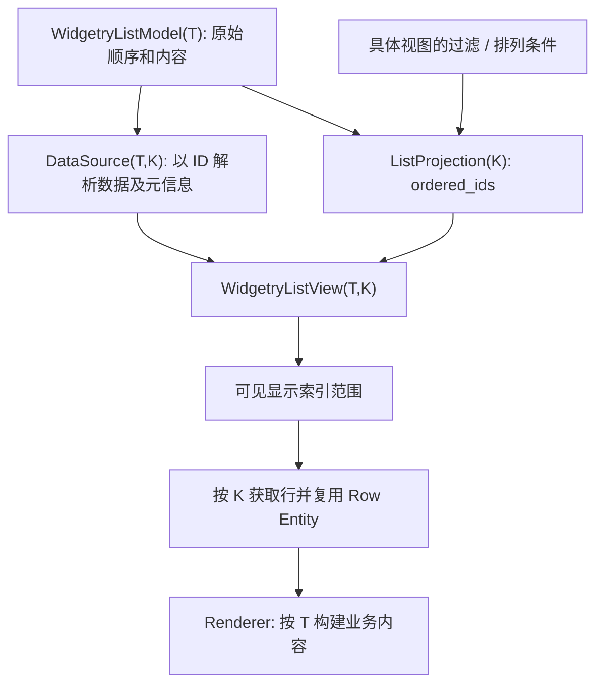

# 建立稳定身份驱动的 ListView 数据源与 Projection

## 目标与边界

将 ListView 从「直接按 `WidgetryListModel<T>` 索引渲染」改为「按每个视图自己的稳定 ID 投影渲染」，使同一份原始数据能够对应不同的显示顺序和可见子集。该增量需要交付可工作的普通 ListView 与虚拟化路径，并为后续 ComboBox 搜索和 TreeView 节点适配提供统一的数据读取协议；此阶段不引入搜索 UI、多选或拖拽。

原有 `WidgetryListModel<T>` 仍是普通列表的原始数据容器，其 `Vec<ListEntry<T>>` 保存数据、原始顺序、每项 Disabled、Revision 与单调递增的稳定 `WidgetryListItemId`。`push`、`insert`、`remove`、`move_item`、`get_mut`、`id`、`index_of` 等功能保留。一个 Model 可由多个 View 引用，View 不得为筛选、虚拟化或显示排序复制另一份原始 `T` 数据。

## 状态归属与数据通路

- `K` 是稳定身份，不是显示索引。普通 ListView 使用 `WidgetryListItemId`，TreeView 在后续阶段使用节点 `Entity`。`K` 至少满足适用于拷贝、比较、哈希和 Bevy ECS 运行的约束；不把异类身份强行转换为 ListItemId。
- `T` 是 Renderer 看到的行数据，不必与原始存储布局相同。`WidgetryListView<T, K>` 承担视图协调；普通列表提供 `K = WidgetryListItemId` 的便捷默认写法，现有 `WidgetryListView::<T>` 的可读性不应因泛型化丢失。
- `ListProjection<K>` 由每个 View 独立持有，存放当前显示顺序的 ID 向量，不存储 `T`，不充当选择集合。无筛选时，普通 ListView 的投影等于 Model 的原始稳定 ID 顺序。
- `ListDataSource<T, K>` 根据 `source: Entity` 和 `K` 解析一条完整行所需的信息。普通 Model 返回借用的 `&T`，ECS 树适配器可生成临时展示行。行的 Disabled 与内容变更凭据也通过该边界取得，避免虚拟化重新侵入某个具体 Model。接口内部可用借用或拥有形式满足 Rust 生命周期约束。
- 数据源的「身份仍存在」与 Projection 的「身份当前可见」必须分开判断。选中项被搜索隐藏或树节点被折叠，不表示原始条目删除；真正删除才允许后续 Selection 清理该 ID。

普通列表按稳定 ID 查询可能触发当前 `get_by_id()` 的线性扫描。投影构造可遍历 `Vec`，但可见行解析、导航和频繁交互不能在 10,000 行场景里退化成每行再遍历一次完整 Model；可采用按一次变更构建的 ID→索引映射或等效缓存，并在 Model 变更时失效。性能优化不能改变稳定 ID 的语义。

## 投影更新与虚拟化

默认依赖 Bevy 0.20 的 ECS 组件级 `Changed<WidgetryListModel<T>>`，以及 View 初次创建、视图投影条件变化触发投影重建。组件变更只能说明 Model 已改变，不能可靠区分一次 `Vec` 中的插入与删除，因此起始方案不引入逐条增删事件或必须由应用调用的 `refresh()`。一个更新周期里的多个改变合并成一次必要的 Projection 更新；顺序需位于导航/选择修复与虚拟化之前。

更新后的虚拟化根据 `projection.ordered_ids.len()` 计算 Top/Bottom Spacer、ScrollPosition、可见 Range 和 PageUp/PageDown 的位置。行的显示索引转换为 `K`，再通过 DataSource 解析 Renderer 数据、Disabled、Revision。已实现的按可见行复用 Entity、只在身份或内容变化时替换业务子树、保护 Hover/Pressed/Owner 与同帧 UI Build 的逻辑应延续；模型容量很大不意味着要实体化所有条目。数据源整体更新不应无故刷新全部可见业务 Scene，支持没有行版本的适配器采取保守局部策略。

`WidgetryListViewItem.index` 原先是 Model 索引；引入 Projection 后必须明确改成**显示索引**，`WidgetryListViewItem.id` 则继续是原始身份。不得使用显示索引直接 `model.get_mut(index)`，Gallery 和调用方需显式通过 ID 解析原始 Model 索引。为避免 ComboBox 选中项被过滤后没有显示索引而造成 Renderer 语义分裂，统一将 `WidgetryListViewRenderer<T>` 的业务回调改为消费 `&T`（例如 `Fn(&T) -> SceneList`），从现有 `Fn(usize, &T)` 中删除含义不稳定的位置参数。需要位置标签时，由行展示数据明确提供相关内容，不能让 ListView 显示索引、Model 索引和 ComboBox Field 的原始索引在同一个参数上混用。Gallery、ComboBox 字段和 Tree 内部行 Renderer 的调用方一并迁移，保持组件类型分发的 Tree 业务 Renderer 单独按真实节点 Entity 路由。

公开注册保持普通 Model 使用简便，同时支持带不同 `K` 的适配器注册；`WidgetryListViewProps`、Scene/FromTemplate、样式归属与 Typed Plugin 的泛型边界必须一起更新，避免 `K` 改动只覆盖核心组件而漏掉注册系统。

## Gallery、测试与完成条件

ListView 页面现有小型列表、10,000 条虚拟化列表、Disabled 列表、共享一个 Model 的双 View、滚动/尺寸变化和动态增删编辑排序均继续可用。两个 View 的 Projection 对同一个 Model 保持独立；可以用不同投影条件展示同一份数据。Gallery `VisibleUpdate` 等逻辑若读取 `WidgetryListViewItem.index`，应改为使用稳定 `id` 反查原始条目，避免在过滤或排序场景误改其他项。保留页面进入/退出时 Model 和 View 的创建清理，以及文字/图标 Renderer 与 Theme/Override 示例。

完成本增量应能验证：

- 列表插入、删除、编辑和 `move_item` 后，稳定 ID 不漂移，所有引用该 Model 的 Projection 自动更新；显示索引与原始索引在过滤场景下可以不同。
- 一个 View 的投影条件不改变另一个 View 的显示范围，也不改写原始 Model；失效 ID 不产生幽灵 Row。
- 10,000 条数据滚动、离屏内容更新、Viewport 改变和 ScrollPosition 边界仍只创建必要的可见行，Identity/Revision 决定子树更新；保留 Row 重用、按帧内容准备及无效源诊断。
- 原有 ListView 公开接口、测试、Gallery、Color State、Renderer 注册和 `PostUpdate` Build 顺序在泛型迁移后能够保持一致的可观察行为。

工程目标继续遵循当前 Windows 64 位的编译平台限制，Bevy ECS System 注册、`SceneComponent`/`FromTemplate` 与 Typed Renderer 的泛型变化需要在实际支持的平台上编译验证。Gallery 的图形和焦点行为还需要真实窗口验证，Headless 测试只用于数据/状态契约。

## 与后续方案的关系

该阶段交付 `T/K`、DataSource 和 Projection 的基础形态。后续的 Selection、ComboBox 搜索、TreeView Entity 数据源及拖拽都使用这一结果，但不在本阶段提前实现那些具体交互。对不存在或不匹配的源、非法行高度、缺失 Renderer 等配置继续保留现有错误诊断与恢复边界。
