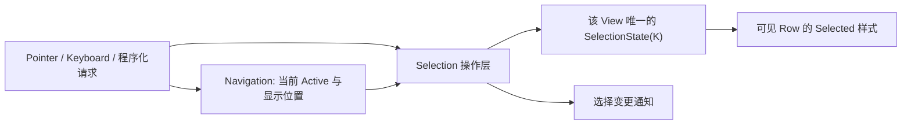

# 抽离 ListView Selection 子系统与公开状态接口

## 目标与职责

在基于稳定 ID 的 ListView 投影之上，将选择状态和选择操作从混合的 `behavior.rs` 逻辑中抽为独立的 Selection 子系统。此增量先落实**单选与统一状态所有权**，使普通 ListView 和未来使用它的 ComboBox、TreeView 复用同一套选择提交、失效修复和通知机制；多选手势在下一增量追加，而不是在此阶段混入 Ctrl/Shift 所有行为。

Selection 作为独立的内部模块及 ECS 状态存在，但使用 ListView 不要求应用单独创建 Selection 控件。具体是否再拆成 crate 由可独立依赖与避免循环依赖决定，不以 crate 数量为目标。

## 数据与行为边界

`ListSelectionState<K>` 持有按稳定 ID 记录的选择集合，支持单选模式，并预留多选范围锚点等状态；`ListNavigation<K>` 独立管理活动项、滚动揭示、键盘焦点所需信息。Active 是键盘操作候选，不等于 Selected。初始 Selection 为空；两个 ListView 即使共享相同数据源，也拥有独立状态、焦点与通知。Selection 不持有 `T`，不复制 Projection，不修改 Model，不直接实施虚拟化。

单击或 Enter/Space 的选择意图、程序化设值、清空等操作由统一入口提交。行为层负责捕获实际输入、焦点与有效 Disabled 边界，Selection 操作层完成 ID 合法性检查、集合变化与事件发布。公开 API 不应该迫使 Gallery 访问 Row 或内部 ListView 子树才知道选择了什么：提供按稳定 ID 选择/取消/清空、获取当前选择的只读能力，并给普通 ListView 提供语义明确的原始 Model 索引选择便利入口。带 Projection 的「显示索引」如果有单独入口，名称必须与「Model 索引」区分；不允许一个含糊的 `set_selected(index)` 随不同投影悄悄切换含义。

真实原始数据中的某个 `K` 被移除时，自动从 Selection 中修剪；仅在 Projection 不可见时不清除。若原始树中的节点折叠或 ComboBox 的匹配结果排除了已选项，其 ID 继续有效。删除或失效引起的自动修复应与既有测试中的静默 Repair 一致；用户或程序发起的真实变更应先提交状态再发通知，同值操作不重复通知。通知需有明确的 View 归属；为后续多选扩展，应具备表达集合变化的能力，不能将最终完整状态长期固定为 `Option<K>`。ComboBox 作为单选包装仍可以向外提供 `ValueChange<Option<WidgetryListItemId>>` 形式的值变化事件。

当前 Bevy 样式通过 `Selected` 和 `WidgetryListViewState` 的单值快照判断一行是否被选中。拆分后，用当前 ID 是否属于 Selection 集合来投影每条**可见** Row 的 Selected；不为 10,000 条数据生成 10,000 个 UI 实体，也不在单个 Row 的 Hover/Press 更新时克隆整个集合。Navigation 的有效 Active 在 Projection 改变时修复到仍可交互的可见身份，但不能因此擅自写入已选集合。按 ID 定位保证虚拟化 Row 被复用后不会承继旧行的选择或 Pressed。

## 公开接口与 Gallery 迁移

保留简单的 `WidgetryListView::<T>` 使用体验，同时把单选能力作为可配置 Selection 模式的一个实例。ListView 的 `clear_selection`、程序化选中与活动项操作归属 Selection/Navigation 的语义接口；对已经使用 `WidgetryListViewState.selected: Option<WidgetryListItemId>` 的 Gallery、外部观察者和测试，迁移到新的只读集合及事件访问方式。Selection 状态的权威来源只有一处，不能为方便 ComboBox 或 TreeView 复制一份可独立写入的 selected 字段。

ListView 页面「Set Selected」「Clear Selection」与状态栏应直接使用公开 API，不解析 `WidgetryListViewState` 的私有表示。共享 Model 双 View 展示一侧选择和另一侧选择互不干扰；Programmatic API 即使整个 View Disabled 仍可按现有契约更新状态，Disabled 只阻止用户输入。

## 验证与后续关系

在当前单选能力的集成测试上覆盖：选择与 Active 分离、单击与键盘选择一致、同值不通知、先提交后通知、清空、禁用输入、程序化操作、共享 Model 双 View 独立、删除真实条目清除选择、单纯过滤不清除选择、Row 重用 Pressed Identity 隔离。保留 Theme 与 Override 对 Selected、Active、Hover、Pressed、Disabled 的优先级验证，Focus 变更与输入取消后不残留旧状态。

后续多选增量扩展同一套 Selection 而不重写输入处理；ComboBox 选择与 TreeView Entity 选择均建立在这里的状态和提交语义上。
