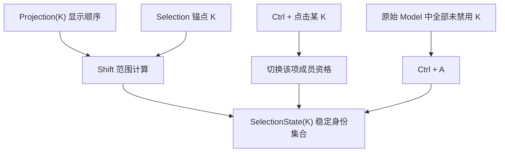

# 实现 ListView 多选与整模型全选

## 目标和用户行为

在已独立的 Selection 子系统中实现第三阶段 ListView 的 Ctrl + 点击、Shift + 点击和 Ctrl + A。普通 ListView 默认具备多选交互，ComboBox 则可配置为单选复用同一选择引擎。所有选中身份用 `K` 记录，不依赖 Row Entity 是否已创建，不把虚拟化显示索引作为持久选择值。该增量不包含拖拽修改数据，也不负责 TreeView 的展开规则；TreeView 的多选变体将在树视图完成状态迁移后接入。

## 选择集合与范围锚点

- **普通点击**：在未禁用行上建立新的单项选择，并将该行设为范围锚点与活动项。
- **Ctrl + 点击**：切换目标项是否在集合中；不影响其他条目，正确更新后续范围操作所需锚点。
- **Shift + 点击**：依据当前 View 的 Projection 顺序计算锚点与目标之间的连续范围；虚拟化离屏条目也参与，只要它们处于该显示范围且未禁用。锚点不得只是临时行索引，因为过滤、排序、虚拟化可能使该索引变为其他条目。
- **Ctrl + A**：选中**整个原始 Model** 里的全部未禁用项，而不只是当前 Projection、当前可见窗口或已创建的 Row。即使某些项被筛掉或远离 Viewport，仍应按稳定 ID 加入；真实数据删除后的无效 ID 正常清理。
- **单选模式**：保留单击/确认一个有效条目的行为，不接受 Ctrl/Shift 将选择扩为多个值；专供 ComboBox 等单选包装使用。

有筛选条件时，Shift 范围是投影中的连续可见项，而 Ctrl + A 是整个 Model 的未禁用项，这是两个不同的规则。Navigation 仍单独处理 Home/End、上下键、PageUp/PageDown 与活动项揭示，输入组合修饰符只改变 Selection 计算；活动项更新本身不必意味着提交选择。对无法解析、已删除或被禁用的目标，不产生错误的选择确认；Pointer 重用时保持原来稳定 ID 验证。

选择变更通知需要让应用可观察集合增减与当前结果，不能沿用 `ValueChange<Option<WidgetryListItemId>>` 假装只有一个选择。对一次 Ctrl + A 应形成一次语义上的批量提交，而不是为 10,000 条数据逐项向外触发选择事件。API 应支持应用程序化替换整个集合、增加/移除一项、清空、按 ID 查询成员及只读读取所有已选项。发通知前状态已提交、同值不重复通知、自动失效修复静默，这些约束与前一增量保持一致。

## Gallery 演示与可观察效果

ListView 小列表区添加 Ctrl + 点击切换成员、Shift + 点击连续范围的交互说明和选择集合可读状态；共享 Model 双 View 区验证两侧不同选择集与互不影响的锚点。大规模 10,000 条列表添加 Ctrl + A 的数量反馈，即使当前只渲染一小段 Row，也能显示完整选择数。Disabled 行与 Disabled 整体 View 的场景分别证明「禁用项不纳入全选」和「禁用视图不接受用户快捷键，但程序化状态可更改」。若 Gallery 展示不同 Projection，需同时演示过滤后 Shift 与整 Model Ctrl+A 的区别。

Gallery 不应依赖单值 `selected` 字段、遍历子节点推断集合，改用 Selection 公开读取 API 和对应选择事件。选中样式只绘制已实体化的行，滚动到其他选中项时自动显示 Selected，无需重新选择。

## 验收与回归

多选单元与集成测试覆盖普通点击清空其他选择、Ctrl 切换、Shift 正反方向及锚点修复、Ctrl+A 跨虚拟化窗口、Model Disabled 条目排除、Projection 过滤/重排后范围计算、模型删除失效成员、两个共享 Model View 的状态和事件隔离。校验用户输入被 Disabled 拦截、同值不重复通知、Active/Selected 独立以及行复用不会错标选择。GUI 验证键盘修饰符与 Pointer 的实际输入路径；高负载情形不得因选中 10,000 个身份而生成 10,000 个行实体。

## 与后续方案的关系

ComboBox 以单选模式复用 Selection，TreeView 后续以 `K = Entity` 使用同一多选能力，并提供其不同的 Ctrl+A 范围。此阶段不直接实现树节点范围或树展开功能。
