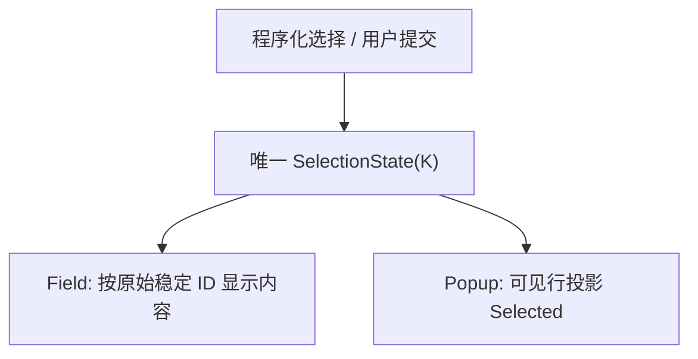

# 改造 ComboBox 默认空选择与程序化选择 API

## 目标与现有行为调整

ComboBox 初次创建时不再自动选择第一项，而是以 `None` 为权威选择状态并显示 Placeholder。外部可以明确选择一个条目、按原始索引选中某项或清空选择；搜索、数据插入和删除均不得隐式恢复第一项。该增量只处理选择语义、字段展示和公共 API，暂不引入搜索输入框。

目前 `initialize_selection()` 在 Model 非空时调用内部 ListView 选择首项；`WidgetryComboBox::<T>::set_selected(commands, combo, WidgetryListItemId)` 已存在，`clear_selection()` 也存在。`WidgetryComboBoxProps<T>` 无构造时选中位置字段。Gallery 中的「选择第一项」依靠 `model.id(0)` 获取 ID，状态读取则从内部 Popup 查找 `WidgetryListViewState`。新方案去掉隐式初始化、减少外部对内部组件布局的依赖，并保持同一份 SelectionState 为唯一权威。

## 选择行为与公开操作

| 场景 | 结果 |
| --- | --- |
| 构造完成，即使 Model 非空 | `None`，Field 显示 Placeholder |
| 外部按 ID 或原始 Model 索引选择 | 选择对应未失效条目，Field 显示 Renderer 内容 |
| 用户在下拉列表中确认 | 提交唯一选择 |
| 外部调用清空操作 | `None`，显示 Placeholder |
| 原始 Model 删除当前选中条目 | 自动清理为 `None`，不替换成第一项 |
| 删除未选中项，或插入/重排其他条目 | 有效已选 ID 保持不变 |
| 仅由于 Projection 筛选隐藏已选项 | 保持原选择 |
| `None` 后 Model 再增加选项 | 不自动选择 |

推荐公开两种按不同身份定位的入口（方法名可以依接口风格统一，语义不得变）：

```rust
// 概念调用方式：以稳定身份选择。
WidgetryComboBox::<T>::select_id(&mut commands, combo, item_id);

// 概念调用方式：选择原始 Model 第三条，不依赖 Popup 当前过滤结果。
WidgetryComboBox::<T>::select_index(&mut commands, combo, 2);

WidgetryComboBox::<T>::clear_selection(&mut commands, combo);
```

两者内部最终均把稳定 ID 写入 Selection；`select_index` 在命令**实际执行时**用 ComboBox 的 source Model 解析位置，避免在异步 Commands 排队期间拿到一个已经不代表预期条目的 ID。需要跨插入、删除与重排稳定指向同一条目时，应用应使用 `select_id`。无效 ID、越界 index、失效 source 按既有诊断契约显式拒绝；同值操作不重复通知。默认未选中时，活动项可以在打开 Popup 后初始化，但 Active 与 Selected 必须分离。

此外提供从 ComboBox 本体可靠读取 `selected_id()` 或等价选择快照的**只读 API**，供 Gallery、Header 和应用观察，而无需遍历内部 ListView、读取私有 `WidgetryListViewState`；不能为了读取便利新增另一份可写的 Selection Authority。保留对应用的单选值变化通知及事件中的稳定 ID；由真实数据删除引起的失效修复保持静默，同值不通知，正常提交先改状态再通知。

## Field 与 Popup 的显示语义

Field 仍是用于打开 Popup 的按钮，选择生效时渲染当前 `T` 对应内容；无选择时显示可配置 Placeholder。Placeholder 不仅用于空 Model，也适用于外部清空和当前选择被删除。无论视图投影是否包含已选项，Field 都从原始数据源按稳定 ID 获取该项，不能通过「已筛选的当前显示索引」查找已选内容。Field Renderer 与弹窗行 Renderer 的使用保持一致，因 Revision、当前选中 ID、模型内容改变而刷新，保留 Text/Icon 在 UI Build 当帧准备及旧 Scene 子树清理契约。



原有 `WidgetryComboBoxProps<T>` 的 `source`、`renderer`、`item_height`、`max_visible_items`、颜色覆盖与外部 Disabled 行为保留；Placeholder 增加明确可配置入口。不要将默认选中第一项保留成隐式初始化策略或把 ComboBox 的选择放入原始 Model。

## Gallery 与 Header 的直接改动

ComboBox 页面保留纯文字、图文、图标、Disabled 及动态 Model 的展示；首次进入页面，各正常 ComboBox 明确显示 Placeholder。「Set Selected First」通过新 `select_index(0)` 或等价 API 调用，不再要求示例先从 `model.id(0)` 转换。清除、删除当前选中项、插入、移动、编辑、重建 Model 等操作更新状态栏，状态查询走公开 API，展示不会在删除后自动跳到另一项。增加程序化选择非首项与非有效 ID 的回归路径。

Gallery Header 的 Theme、Language、Scale Factor 三个 ComboBox 是重要的特殊调用方：它们已经通过程序化选中与当前 Theme/语言/缩放值同步。默认 `None` 后必须仍能在初始化阶段和后续外部值变更时正确选中实际设置，避免错误地展示 Placeholder 或在首帧短暂反映无效设置。Header 中根据值查找选项的行为可以使用新便捷 API，但没有理由将存储的业务设置从原资源迁移到 ComboBox；这些设置仍由各自资源负责。外部配置变化导致程序化选择后，Field 与事件的顺序必须不形成循环更新。

## 验收与顺序关系

覆盖「有数据但初始 None」「编程选择任一合法 ID/索引」「清除后新增数据仍 None」「删除已选转 None」「移动未改变选择身份」「共享 Model 的多个 ComboBox 独立选择」「Field Theme/Override、Icon/Text 和 Disabled 仍正确」，以及越界索引、失效 ID、消息通知次序。更新原有 `selection_field`、`data_contract` 和 Popup 测试中依赖自动首选的断言。Gallery 的中英文本地化 Placeholder 与页面创建/销毁周期正常。

本增量依赖 Selection 单选模式与通用数据解析；下一增量只增加可选搜索。即使后续完全没有搜索，ComboBox 的默认空选择与程序化 API 也应当独立可用。
